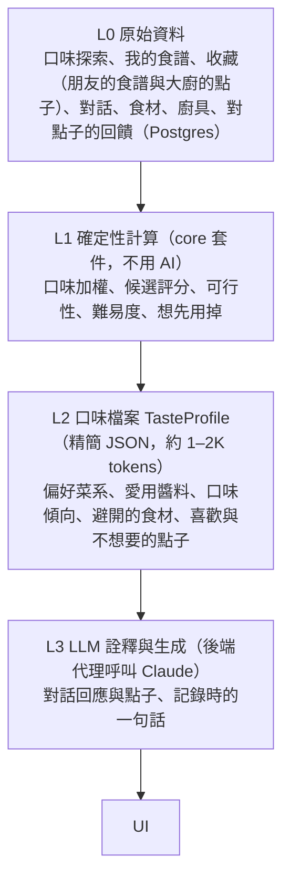

# 03 AI 設計

> 大廚不主動推播點子，只在首頁和使用者要求時給；唯一的例外是使用者自己開啟的「週末靈感」。口味從口味地圖（[13](13-taste-preferences.md)）與多個來源學習，不靠記錄量。

## 核心原則：統計交給程式，詮釋交給 AI

不把使用者整份歷史資料丟給 AI 去「自己看著辦」。而是分四層：



**為什麼這樣分？**

| 好處 | 說明 |
|------|------|
| 省錢 | 每次只送精簡的口味檔案，不送完整歷史 |
| 可預測 | 可行性、過敏原、難易度總分由程式判斷或計算，不會被 AI 算錯或幻想 |
| 只有一條路 | AI 不能用時，畫面只告訴使用者這個功能目前無法使用，不另外做一套挑點子的退路 |
| 隱私 | 照片和完整的食譜不必每次都送出去 |
| 可測試 | L1 是純函式，可以寫單元測試 |

## AI 功能清單

點子只出現在 App 內：**和大廚的對話**（主要），以及首頁對話框下方大廚主動給的點子（口味把握程度夠時才有）。沒有主動推播的點子、沒有每週批次。唯一的例外是使用者自己開啟的「週末靈感」（預設關閉）：每週六早上推播一則，內容用最新一組首頁點子或預寫的模板，**不另外呼叫 AI**。

| 功能 | 輸入 | 輸出 | 時機 | AI 不能用時 |
|------|------|------|------|---------|
| 首頁的大廚點子 | 口味檔案＋食材＋廚具＋朋友的菜＋候選清單 | 最多 5 個點子（依把握程度，不湊數），不含做法；五個都由 AI 從候選中挑選並寫理由 | 打開首頁時；情境沒變（食材、朋友的新食譜、時段）就用快取，變了才重算，每人最多 6 小時一次；也可以下拉重新整理。把握程度不夠時不呼叫 AI | 畫面告知目前無法使用：有上次的點子就繼續顯示並說想不出新的，沒有就只顯示大廚與提示；把握程度不夠是另一種畫面（請使用者多說一點口味） |
| **和大廚聊聊** | 使用者的話＋這段對話＋口味檔案＋食材＋廚具＋候選清單 | 一兩句回應＋選項（問問題時）＋1–2 個點子卡片（不含做法，收斂後才給）＋對話中提到的食材 | 使用者送出訊息時 | 畫面告知目前無法使用 |
| 展開做法 | 一個點子＋可用廚具＋食材 | 食材與步驟 | 使用者打開點子抽屜時（第一次才產生，之後用存下來的）；點子是現成的食譜就直接打開，不呼叫 AI | 畫面告知目前無法使用：有基礎菜色骨架就先顯示骨架，並說明大廚現在寫不出做法、可以再試一次 |
| 靈感彩蛋 | 醬料櫃或廚具中的一樣＋口味檔案 | 一句話＋一道菜 | 打開首頁時偶爾出現（例如一週最多一次），不推播 | 用預寫模板 |
| 發佈後整理 | 食譜的標題、心得與做法（文字，不送照片） | 菜系、主食材、手法、可能用到的廚具、口味標籤；難易度五個面向；偶爾一句大廚的話（只根據這一篇，不提次數） | 按下發佈時，使用者等約 2 秒；一句話在發佈完成時出現 | 一句話改用模板；標籤與難易度排進背景重試 |
| 匯入：網址 | 網頁內容 | 結構化食譜 | 即時；網頁裡有結構化的食譜資料（schema.org Recipe）時由程式直接讀，不呼叫 AI | 存網址與原文，之後再解析 |
| 食材正規化 | 對不到字典的食材名＋程式先挑出的候選 | 對應到標準食材 ID，或建議新增 | 背景，累積幾個詞一起送 | 先保留原文 |
| **用說的：口述整理成食譜** | 使用者口述的文字＋編輯頁上已經填好的欄位 | 標題、心得、食材、步驟、料理筆記、值得記住的原因、難易度，填進編輯頁 | 使用者按「用說的」說完時 | 原話放進心得，之後再整理 |
| 用說的改食譜 | 修改指令（「把蒜頭拿掉，XO 醬改成兩大匙」）＋目前的食譜（含還沒發佈的欄位） | 要改的欄位與新值，作者確認後才套用 | 發佈前在編輯頁、發佈後在食譜頁，按 🎙 說出要改的地方時 | 無，改用手動編輯 |
| 角色文案 | 情境＋狀態 | 一句話 | 大多用**預寫模板**，少數用 AI | 模板 |

> 情境文案（打招呼、到期提醒、歡迎回來等）**預設用預寫模板隨機抽**，不必每次叫 AI。模板寫得夠多夠有趣，體驗不會比 AI 差，而且零成本、零延遲、離線可用。

## 回應的語言

- 大廚的話、點子、對話回應、記錄時的一句話，一律用使用者的**介面語言**（`UserSettings.locale`，目前只有 `zh-TW`）。送給 AI 的字典名稱也用那個語言。
- 「用說的」整理成食譜時，用**口述的語言**，不強制轉成介面語言，並記在食譜的 `lang`。
- **使用者寫的內容不翻譯**：引用朋友的食譜時保留原文的菜名，只用介面語言說明推薦的理由。
- 大廚的口吻依語言另外設計（台語的幽默不直譯），每個語言各自有評估集（見〈品質評估〉）。

## 推薦演算法：對話與首頁的點子

兩階段：**程式先篩候選，AI 再創作與挑選**。

### 第一階段：候選評分（L1，程式計算）

候選來源：使用者自己的食譜、收藏（朋友的食譜與大廚的點子）、好友看得到的食譜、內建的基礎菜色庫（約 300–500 道家常菜骨架，每道標註所需手法與器具；依廚房地區調整）。

```
可行性檢查：所需手法無法用「可用」器具（含替代手法）完成 → 直接排除
硬性排除：過敏原、飲食限制、已過有效日期的食材

score = 0.30 × 食材覆蓋率        （手邊有的食材能湊齊多少比例；只看有沒有）
      + 0.20 × 手邊優先加權      （用到「想先用掉」、快到期（有設期限）的食材）
      + 0.25 × 口味相似度        （和口味檔案的距離）
      + 0.10 × 季節適合度        （依廚房所在地區的當季資料）
      + 0.10 × 器具與手法加分    （偶爾用上你有、但還沒出現在你食譜裡的手法）
      + 0.05 × 收藏加分          （還沒做過的收藏，材料差不多齊時加分）
```

權重先用直覺值，之後依「點子被收藏或做了並記錄的比例」調整。不再有「重複懲罰」：使用者不一定記錄每一餐，系統無從得知最近吃過什麼，也不需要知道。

### L1：候選評分（送給 AI 的候選）

首頁與對話的點子都由 AI 挑；L1 先用程式從自己的食譜與基礎菜色算出前 15 名候選，再交給 AI。評分寫在 `core`（純函式），`ai` 函式用它做 L1。評分的結果不會直接顯示給使用者。

**候選**

| 來源 | 條件 |
|------|------|
| 自己的食譜 | 已發佈、沒刪除；草稿不算 |
| 基礎菜色 | `regions` 含廚房的地區，或是空的（各地都適合） |

**先排除**（兩種來源都適用）

- 含過敏原、違反飲食原則或宗教與文化規則的；不用料理酒的人，排除用到料理酒的。
- 含「不吃的食物」的。
- 基礎菜色：所需器具與手法用廚房「可用」的器具（含替代手法）做不到的。自己的食譜不檢查器具（做過就是做得到）。

**分數（0–1）**

| 來源 | 計算 |
|------|------|
| 基礎菜色 | 0.45 × 口味相似度 ＋ 0.30 × 食材覆蓋率 ＋ 0.15 × 手邊優先 ＋ 0.10 × 季節適合度 |
| 自己的食譜 | 0.50 × 標籤（標了「值得再做」或「家人最愛」是 1，其他是 0.3）＋ 0.30 × 久沒做（`cooked_at` 距今 30 天以內是 0，180 天以上是 1，中間線性）＋ 0.20 × 食材覆蓋率 |

- 口味相似度只算把握程度 ≥ 0.5 的維度，見 [13 第七節](13-taste-preferences.md#七怎麼用在點子上)。
- 器具：廚房一件廚具都沒記時不檢查器具；記了廚具才排除做不到的菜。
- 食材「廚房有」：過期的食材不算。
- 基礎菜色的口味維度由程式從菜系、食材特性、做法推出；推不出對應維度時，口味相似度算 0.5。
- 手邊優先看兩種食材：想先用掉的、3 天內到期的；用到 2 樣就算滿分。「剛加進食材庫」不等於「最近買的」，所以不看加入日期。
- 自己的食譜「多久沒做」依序取：又做了一次的日期 → 料理時間 → 發佈時間。
- 食材覆蓋率只看主要食材「廚房有沒有」；廚房沒記任何食材時，這一項對所有候選都算 0.5，不讓空的食材清單把分數拉低。

**交給 AI 幾個**

- 口味的把握程度不夠（把握程度 ≥ 0.5 的喜好維度少於 3 個）時，**不給基礎菜色**。
- 只列分數 ≥ 0.5 的候選，取分數最高的 15 個交給 AI；不夠就少給，不湊數。最後給使用者幾個點子由 AI 決定（見〈第二階段〉）。
- 候選一個都沒有時，仍然交給 AI（只給變化版與新挑戰，「熟悉的」一定要指到候選）。

**點子卡點進去**：底部抽屜，顯示菜名、理由、主要食材（廚房有的標「廚房有」）。自己的食譜不收藏，主按鈕是「打開食譜」。基礎菜色的主按鈕「收藏」：存下菜名、理由與來源家常菜（`baseDishId`）的快照，主要食材由資料庫依家常菜算出，之後在「食譜 → 收藏」依收藏的月分組找得到；同一道家常菜每人只收藏一筆，已收藏的顯示「已收藏」，再按一下取消。收藏頁的卡片標「還沒做過」或「做過了」：從收藏的點子按「做了，記錄一篇」發佈後，會連到那一篇（`cooked_recipe_id`）。收藏的點子打開後（同一個點子抽屜）最下面是「做了，記錄一篇」，開新的一篇並帶入菜名；做法已經展開過的，連食材與步驟一起帶入。基礎菜色本身沒有做法，收藏的點子第一次打開時由大廚展開（見〈展開做法〉）。

### 第二階段：AI 生成（L3，後端）

把「前 15 名候選＋口味檔案＋食材（含想先用掉）＋可用器具與手法＋時段」送給 AI；對話時再加上使用者這段對話說的話與提到的食材（見下方〈和大廚聊聊〉）。首頁的點子最多 5 個，依三種槽位分配：熟悉的 2、變化版 2、新挑戰 1（延續與探索約 80／20）；對話中依使用者的要求給 1–3 道，不一定三種都有：

| 槽位 | 定義 | 例（喜歡台式、愛用豆瓣醬） |
|------|------|------|
| 🏠 熟悉的 | 你記錄過、收藏過的食譜，或口味探索中喜歡的類型，現在食材能做 | 麻婆豆腐 |
| 🔄 變化版 | 熟悉的風味 × 新的組合 | 豆瓣醬燒茄子（同醬料，換主角） |
| 🚀 新挑戰 | 舒適圈邊緣，只差一兩個新元素 | 韓式辣炒豆腐（辣味相近，換醬料系統） |

**首頁的「熟悉的」也由 AI 挑**：從 L1 排在前面的自己或朋友的食譜裡挑，並用大廚的口氣寫一句理由（「你標過值得再做」）。對話中由 AI 依使用者的要求挑選。

「新挑戰」採用**相鄰可能**策略：只改變一個維度（醬料系統、烹調技法、菜系、主食材其中之一），避免跨太遠。其中「換手法」最能用上使用者的器具，見下方〈器具與手法〉。

**當地買不買得到**：字典不記食材在各地區好不好買，由 AI 依廚房地區判斷。需要的其他材料在當地不好買（例：住美國的人需要九層塔）時，優先換成當地好買的替代，或在卡片註明「可能要去專門店買」。

**給偶爾下廚的人**：說了「我很少煮」，或使用者在口味探索中選了「偶爾下廚」時，點子都限制在步驟少、器具少、失敗率低的菜，大廚的語氣也更輕鬆（「難得下廚就是值得慶祝的事」）。

### 首頁點子的流程

打開首頁時，手機先顯示上次的點子（`ai_suggestion_cache`），接著呼叫 `ai` 的 `home_ideas`（任務 `home_ideas`，Sonnet 5.5、`low`；預算用到提醒門檻時降成 Haiku 5.5）。後端的順序：

1. 讀這個人的資料（口味、飲食限制、食材、廚具、自己的食譜、上次的點子）。
2. **新手門檻**：把握程度夠的喜好維度少於 3 個、又沒有自己的食譜，不叫 AI，回「資料不夠」，手機顯示 [12 第四節](12-onboarding.md#四新手之後空畫面) 的鼓勵文字。
3. 用 `core` 的 L1 算出前 15 名候選，並算出 `inputHash`（沒過期的食材與標記、口味、廚具、地區與月份、時段與日期、語言，加上飲食限制與大廚的語氣：這些一改，舊的點子就不能用）。
4. **快取**：上一組點子沒過期（最多用一天），而且 `inputHash` 沒變或離上次不到 6 小時，就用它。用之前再用現在的限制檢查一次（剛改了過敏原也不會出現舊點子）；檢查後一個都不剩就重新產生。快取命中不呼叫 Claude、不算速率。
5. 否則呼叫 Claude → 驗證格式 → 程式再檢查（見〈安全與信任〉與下面的清單）→ 存進 `ai_suggestion_cache` → 回傳。
6. AI 不能用（停用、預算、速率、合理使用上限、拒答、出錯）、或檢查後一個都不剩，回錯誤代號，手機顯示「現在想不出新點子」（見〈AI 不能用時〉）；不改用別的挑法。檢查後剩不到 5 個不補，有幾個給幾個。

**「換一組」**：再叫一次 AI，排除這個 6 小時內已經出現過的菜名與候選；同一個 6 小時內最多換 2 次，之後回「不給新的」（`unavailable`），手機維持上一組並說想不出新的，不再顯示「換一組」。輸入變了又超過 6 小時，算新的一輪。

**送給 AI 的內容**（只送摘要，不送完整的食譜清單與整本字典）

| 位置 | 內容 |
|------|------|
| 角色與規則（每次一樣，可快取） | 大廚的個性與語氣準則、三種槽位、禁用字眼、自由文字不寫帶單位的數字（要用時寫 `{{temp:180:C}}`）、輸出說明、回應語言 |
| 這位使用者 | 大廚的語氣；口味摘要（只放把握程度夠的維度）；排除清單（過敏原與宗教、飲食原則轉成具體的食材名稱，**不送宗教或原則的標籤**）；不吃的食物；不用料理酒；可用的廚具與手法代碼；是不是偶爾下廚 |
| 這一次 | 月份與時段；手邊的食材（ID 加名稱，標出「想先用掉」與「快到期」；已過有效日期的不送，也不提醒；排除清單裡的食材也不送，免得被拿去用；廚房沒記食材就說沒記）；調味料；15 個候選（代號、來源、菜名、主要食材與有沒有、主要加分項）；換一組時已出現過的菜名 |

**程式再檢查**（不合格的點子直接拿掉，不補；寫在 `supabase/functions/ai/home/check.ts`）

| 檢查 | 做法 |
|------|------|
| 過敏原、飲食原則、不吃的食物、不用料理酒 | 用到的食材 ID 查字典；菜名、其他材料、替代說明、理由再用關鍵字掃一次（字典的名稱與別名，加上「肉、蔥、蒜」這類泛稱）；使用者有設過敏原，而「其他材料」有對不到字典的，整個點子拿掉 |
| 過期食材 | `uses_pantry_ids` 只要不在送出的清單裡，整個點子拿掉 |
| 做不做得到 | 手法與廚具要在這個人可用的清單裡（用 `core` 與 `equipment` 現有的可行性判斷）；舒肥、需要精準時間溫度的做法，M1a 不送這個選項 |
| 不催促、不數次數 | `why`、`substitutions` 用語系檔同一套禁用字眼掃描（`core/chef/wording.ts`）；自由文字有帶單位的數字（阿拉伯數字，或中文數字加分鐘、公克、度…）就拿掉，只有 `{{temp:180:C}}` 標記放行；`chef_comment` 不合格就不用，手機改用情境句子 |
| 偶爾下廚 | 難易度總分（程式算）超過 4 就拿掉 |
| 格式 | JSON Schema 每個人、每一次都一樣（候選代號、手法與廚具不放 enum，寫在 prompt、由這裡檢查），前段規則的快取才讀得到；長度與數值範圍、槽位數量（熟悉的 2、變化版 2、新挑戰 1，合計 5）、菜名不能重複、「熟悉的」一定要指到某個候選（菜名以候選的為準） |

沒有候選（例如飲食限制很多）時仍然呼叫 AI，只給變化版與新挑戰。卡片不顯示槽位標籤，由 `why` 自然說明。

### 輸出格式

使用 Claude API 的結構化輸出（`output_config.format` 搭配 JSON Schema），保證回傳可直接解析：

```jsonc
{
  "suggestions": [
    {
      "slot": "familiar | twist | adventure",
      "candidate_ref": "c1",                  // 「熟悉的」一定要指到某個候選（代號 c1…c15）；其他槽位指了要是真的，沒有就是空字串
      "title": "豆瓣醬燒茄子",
      "why": "你記錄過麻婆豆腐，還標了值得再做，豆瓣醬你很會用。這次換茄子當主角。",
      "uses_pantry_ids": ["..."],             // 只能是送出的食材 ID
      "uses_priority_ids": ["eggplant"],      // 其中「想先用掉／快到期」的食材 ID
      "other_ingredients": [{ "name": "九層塔" }],   // 食材清單裡沒有的；程式用字典比對出 ID；卡片上寫「其他材料」，不寫「缺」
      "difficulty": { "ingredients": 2, "equipment": 1, "time": 2, "technique": 2, "failure_risk": 1 },   // 各 1–5；總分由程式算，見〈難易度〉
      "techniques": ["pan-fry", "braise"],    // 手法代碼，限定在這個人可用的；每次呼叫依可用的廚具產生 enum
      "equipment": ["wok"],                   // 廚具代碼，同上
      "substitutions": []                     // 例：{"need": "九層塔", "use": "甜羅勒"}
    }
  ],
  "chef_comment": "你說想先用掉的茄子，今天讓它當主角吧！"
}
```

點子的 ID 由程式產生（UUID v7），不讓 AI 編；收藏與展開的做法都用它對應。存下來與回給手機的格式（`AiIdea`）在 `packages/core/src/ideas/ai-types.ts`，除了上面的欄位，還有程式算出的難易度總分與比對出的食材 ID。

`why` 不得提到頻率或次數以外的壓力（例如「你很久沒煮了」），只說正向的理由。

點子卡片不含做法。大部分點子只是被看過，不會被點開；做法占了輸出的一大半，所以等使用者打開點子抽屜才產生（見下一節）。

### 展開做法

使用者點一張點子卡片、打開點子抽屜時，抽屜裡直接顯示食材與做法（沒有另外的「看做法」按鈕）。第一次打開要等大廚寫（十幾秒），食材與理由先顯示，做法區塊顯示大廚思考中：

| 點子的來源 | 做法 |
|-----------|------|
| 自己或朋友的食譜 | 直接打開那篇食譜，不呼叫 AI |
| 已經展開過 | 用存下來的做法，不重算 |
| 收藏了、但還沒展開過的大廚點子 | 第一次打開收藏時才產生，存進收藏 |
| 基礎菜色庫、AI 想出來的變化版與新挑戰 | 呼叫「展開做法」，依手邊的食材與廚具寫出食材與步驟；基礎菜色先顯示骨架 |

- 輸出是食材與步驟，加上可有可無的小提醒。份量與溫度用結構化欄位（見下方〈數字與單位〉）；步驟文字不寫帶單位的數字，時間放計時欄位，溫度放目標溫度欄位或 `{{temp:180:C}}` 標記。舒肥等需要溫度與時間的步驟，只能從安全表挑（表是空的時一律擋下）。肉類、蛋、海鮮的中心溫度提醒由程式依當地的安全表補上，不靠 AI。
- 後端自己讀點子、可用廚具、目前廚房的食材、飲食限制與平常煮幾人份；家常菜另外讀基礎菜色當依據。手機只送「哪個點子」，不送內容。排除清單裡的食材不給 AI 看。輸出格式（schema）每個人、每一次都一樣，提示詞快取才讀得到；誰能用什麼由程式檢查。
- **程式再檢查**：過敏原、飲食限制、不吃的食材、安全規則、手法與廚具、單位與數字用字。任何一項不合格，整份不用（不只刪掉違規的食材，因為步驟裡可能還寫著它），自動重寫一次，重寫時只告訴 AI 哪一類沒過；第二次還是不過就當成失敗。
- **失敗**（逾時、AI 不能用、兩次檢查都不過）什麼都不存。抽屜的做法區塊顯示「大廚需要再想想」和「再試一次」，家常菜的骨架照樣顯示。
- 寫好的做法存進那個點子的快取（`AiSuggestionCache.drafts`，依點子 ID）；同一個點子不重算，廚房之後變了也不重算（只重新檢查過敏原與飲食限制，不能再給他看的就重寫）。點子已經收藏時同時存進 `Bookmark.idea.recipeDraft`；收藏時快取裡已經有做法也一起存。收藏了、還沒展開過的點子，第一次從「食譜 → 收藏」打開時才寫，並存進 `recipeDraft`。
- 呼叫照一般的用量保護（速率、合理使用上限、預算），重寫一次算一次呼叫。

## 和大廚聊聊

使用者最常的用法是直接跟大廚說話。每送出一則訊息，後端做一次 AI 呼叫：

**送給 AI 的內容**

| 內容 | 說明 |
|------|------|
| 大廚角色與輸出格式 | 放在 system prompt 最前面並快取 |
| 口味檔案摘要、硬限制、可用廚具 | 同一段對話內不變，接在後面一起快取 |
| 食材（目前廚房）與 L1 候選前 15 名 | 依對話內容重新篩選候選：使用者說了「想吃熱的」「有筍子」，程式先把候選往這些條件調整 |
| 這段對話 | 最近 10 輪原文；更早的只留大廚整理的一句摘要（例：「不要太辣、只有 20 分鐘、有筍子和高麗菜」） |

**AI 回傳**（結構化輸出）

```jsonc
{
  "reply": "冷天配筍子剛好！高麗菜也一起用掉。",
  "ask": {                                       // 還在盤點、問風味時，每一輪附一個問題加 2–4 個選項；有問題就不給點子；不用問就是 null
    "question": "想吃哪一種感覺？",
    "options": ["清爽", "下飯", "暖胃"],
    "multi": false                               // 可以複選就是 true（例：「還有哪些食材」）
  },
  "hint": "那配菜呢？",                            // 使用者可能接著說的一句話（不超過 20 字），給輸入框當提示；有 ask 或想不到就是 null。程式檢查同 ask（字數、過敏原與排除的字），沒過只丟掉 hint
  "suggestions": [ /* 同上方的點子格式，收斂後 1–2 個 */ ],
  "mentioned_ingredients": [                     // 使用者在對話中說的食材，對到字典
    { "text": "鄰居送的筍子", "ingredient_id": "bamboo-shoot" }
  ],
  "preference_signals": [                       // 「從對話學口味」（P1）：使用者說出的偏好
    { "dimension_key": "protein.lamb", "affinity": -0.6, "scope": "long_term" },   // 「我不太吃羊肉」
    { "dimension_key": "taste.spicy", "affinity": -0.4, "scope": "today" }         // 「今天不要太辣」只用在這段對話，不寫進口味
  ],
  "user_wants_ideas": false,                     // 使用者這一則是不是明說要直接給點子
  "summary": "想吃熱的；有筍子、半顆高麗菜"       // 給下一輪用的條件摘要
}
```

- **三步收斂**：大廚不是丟一個問題就給點子，而是陪使用者想：① 盤點食材（還有別的嗎、份量夠不夠）→ ② 問想吃的風味與風格 → ③ 收斂，給 1–2 個點子。**大廚至少回應 3 輪（含這一則）才給點子**；使用者按「直接給我點子」或明說要點子（`user_wants_ideas`），就馬上給。輪數由程式算（看這段對話裡大廚回應了幾次），不靠模型自己數；給過點子之後、或開新的一段接著聊時，不再受 3 輪限制。程式發現還不到 3 輪就給了點子、使用者又沒要求，整批丟掉並請大廚重寫一次（改成附選項的反問）；重寫後還是這樣，這一輪當作失敗（手機顯示「大廚現在想不出來」，可以再送一次，什麼都沒存）。
- **盡量用到所有提到的食材**：提示詞要求每個點子用上大部分提到的食材，搭不起來的由大廚在回應裡說哪幾樣適合留到下次（語氣輕鬆，不催促）。程式檢查：使用者提到 3 樣以上、某個點子只用到 1 樣以下時，整批重寫一次；重寫後還是這樣就照給。
- **選項**：每個問題 2–4 個選項，每個不超過 10 個字；選項與問題一樣過字眼、過敏原與排除清單的檢查，不合格的選項拿掉，剩不到 2 個就整個問題當作沒有選項。手機把選項顯示成按鈕（單選點了就送出；多選勾完按「好了」），也可以自己打字；還沒給點子的每一輪都另外有「直接給我點子」。
- **對話中說的食材**：這段對話裡當成「手邊有」，評分時和食材一樣加權；**不會寫進食材**，食材只在「廚房」頁管理。
- **安全**：過敏原、飲食限制一樣由程式二次檢查；使用者在對話中說要用已過有效日期的食材時，大廚提醒，不推薦。
- **成本**：對話是用量最大的任務（多輪收斂之後平均每段對話的輪數增加，評估時要看每段對話的成本）。靠快取（角色、口味、廚具不變的部分）、點子卡片不含做法、只送最近 10 輪、每段對話最多 20 輪（之後請使用者開新對話）控制；自由文字每則上限 500 字（見下方用量保護）。
- **等待時**：整段回應完成才一次出現，等待時顯示燈泡閃爍與「大廚想一下」（不做邊想邊出字）。
- **AI 不能用時**：你說的那一則留在畫面上，下面大廚說「現在想不出來，等一下再問我一次」（被速率擋下時說「燈泡有點燙，等我一分鐘」）；這一則不存進對話，不改用別的挑法。
- **對話紀錄**：存在後端，只有本人能讀，保留 30 天；管理後台與產品數據都不讀對話內容（[14](14-product-metrics.md) 只記「送出一則訊息」這個操作）。

### 對話的一段

- **同一時間只有一段進行中的對話**。首頁只顯示最近一段，而且要在 6 小時內、同一個廚房：輸入框上方多一行大廚的上一句話與「接著聊 ›」，點了回到那段。
- **首頁的輸入框一律開新的一段**。有「接著聊」時，提示文字改成「想聊點別的？跟大廚說…」。對話頁右上角也有「新對話」。
- 開了新的一段，舊的就不在首頁出現，不能再接著聊；資料留到 30 天後刪除。對話紀錄列表（回去看舊對話）延後。
- **20 輪上限**：大廚說一句「這段聊了好多，我們開新的一段吧」並附「開新的一段」（只有到 20 輪才出現；給了點子不會結束對話，輸入框不鎖）；新的一段帶著舊的那段的條件摘要（`summary`），條件不用重講。畫面不顯示輪數。
- 「這餐誰一起吃」（`diners`）延後到有家人與朋友時；對話中說的偏好（`preference_signals`）存下來，長期的算進口味檔案（M1a-10a）。

### 數字與單位

單位換算一律由程式處理，不交給 AI（規則見 [02 單位與換算](02-features.md#i-單位與換算共通設定)）：

- **AI 產生的食譜**：份量和溫度只放在結構化欄位，數值一律用公制與攝氏（例：`{"amount": 15, "unit": "ml"}`、`{"value": 180, "unit": "C"}`），App 再依使用者偏好顯示。
- **匯入的食譜**：AI 保留原文的數值與單位，不自行換算。美國網站的 350°F 就存 350°F。
- **自由文字**（推薦理由、大廚的話）不寫帶單位的數字。真的需要時，使用標記（例：`{{temp:180:C}}`），由 App 依偏好轉成「180°C」或「355°F」。

## 用說的：口述整理成食譜

做完菜很累，手動填食材和步驟的阻力太大；但完全不寫做法，朋友的拿手菜就學不到。所以讓使用者給碎片、大廚做結構化。編輯頁本身仍是一般欄位，不用 AI 也能完成；「用說的」只是把整理好的內容**填進同一頁的欄位**，使用者看過、改過再發佈。

**輸入**：使用者用鍵盤聽寫說的一段文字（每次上限 1,000 字），加上編輯頁上已經填好的欄位。**不送照片**。

**輸出**（結構化輸出）

```jsonc
{
  "title": "培根高麗菜",
  "story": "培根先煎出油再炒高麗菜，很下飯。",          // 只修錯字、斷句、贅字，保留原本的說法；不加 emoji
  "ingredients": [
    { "raw_text": "培根 4 片", "ingredient_id": "bacon" },
    { "raw_text": "高麗菜 半顆", "ingredient_id": "cabbage" },
    { "raw_text": "黑胡椒 適量", "ingredient_id": "black-pepper" }   // 沒說份量就寫「適量」，不自己估
  ],
  "steps": [
    "培根切小片，冷鍋下鍋煎到出油。",
    "放入高麗菜，大火拌炒到軟。",
    "撒黑胡椒，試味道再決定要不要加鹽。"
  ],
  "notes": "培根本身很鹹，下次少放鹽。",                  // 料理筆記：從口述中挑出提醒與防雷
  "highlights": ["make_again"],
  "difficulty": { "ingredients": 1, "equipment": 1, "time": 1, "technique": 1, "failure_risk": 1 },
  "unclear": ["高麗菜是先燙過還是直接炒？"]               // 口述中不清楚、大廚不敢猜的地方，顯示在欄位旁給作者補
}
```

**規則**

- 只用口述裡說到的資訊。食材只列說出口的；步驟可以補上合理的順序與連接（「切小片」「試味道」），但不新增沒提到的食材或調味。
- 份量只寫說出口的，沒說的寫「適量」。
- 已經填過的欄位不覆蓋，只填空的欄位。使用者按「重新整理」才會用新的口述覆蓋大廚填的內容。
- 過敏原、安全規則一樣由程式檢查；舒肥等需要溫度時間的步驟，照安全規則處理。
- 口述原文存在另一張只有作者能讀的表（`RecipePrivate`），給之後的「重新整理」與「用說的改食譜」用。

**用說的改食譜**：發佈前在編輯頁、發佈後在食譜頁都能用。大廚填好欄位之後，同一個 🎙 按鈕就變成「再跟大廚說」。使用者說「把蒜頭拿掉，XO 醬改成兩大匙」，AI 回傳要改的欄位與新值，App 先列出「會改這些」，作者確認後才套用；已發佈的食譜改了做法，會留下一個版本。

## 器具與手法：讓點子更有創意

使用者的器具清單（見 [02 廚具](02-features.md#d-廚具)，字典見 [07](07-equipment-techniques.md)）讓 AI 從「你能煮什麼」，進一步想到「你可以怎麼煮」。

### 三個作用

| 作用 | 說明 |
|------|------|
| 可行性（硬限制） | 點子所需的手法，必須能用使用者廚房裡的器具完成（自訂、對不到字典的不算），或有替代手法。都做不到的候選直接排除 |
| 正向的廚具靈感 | 偶爾用上你有、但還沒出現在你食譜裡的手法（「你有舒肥機，週末試試舒肥牛排？」）。**不計算使用次數、冷落天數**，不讓人有「買了沒用」的壓力 |
| 手法變奏（創意） | 把「換手法」當成相鄰可能的主要維度：熟悉的食材，配上你有、但還沒試過的手法 |

### 手法變奏範例

| 你喜歡的 | 大廚的點子 | 用到的器具與手法 |
|-------|-----------|----------------|
| 煎雞胸 | 舒肥雞胸，最後噴槍炙燒上色 | 舒肥機（舒肥）＋噴槍（炙燒） |
| 清炒高麗菜 | 烤箱焦香高麗菜排，淋胡麻醬 | 烤箱（烤） |
| 手邊有快熟的香蕉 | 切片冷凍，隔天用調理機打成香蕉冰淇淋 | 冷凍庫（冷凍）＋調理機（打泥） |
| 九層塔一大把 | 打成九層塔青醬，倒進製冰盒冷凍分裝 | 調理機（乳化）＋冷凍庫（冷凍） |
| 滷肉 | 滷肉氣炸成脆皮，夾刈包 | 氣炸鍋（氣炸） |
| 蒸地瓜 | 電鍋先蒸熟，再進氣炸鍋烤出焦糖外皮 | 電鍋（蒸）＋氣炸鍋（氣炸） |

### 組合手法與多器具協作

- **一道菜多種手法**：舒肥＋炙燒、蒸＋氣炸、冷凍＋打泥。AI 輸出的每個步驟都標明手法與器具，烹飪模式才能提示「現在換氣炸鍋上場」。
- **一餐多道菜同時進行**（P2）：電鍋蒸飯、烤箱烤蔬菜、爐上煮湯同時進行。招待朋友的入口會考量器具不衝突、總時間最短。
- **容量**：使用者有填容量時，份量超過就提醒分批（「你的氣炸鍋一次只塞得下兩人份」）。

### 創意要有節制

- 「熟悉的」那一道不刻意換手法；只有「變化版」和「新挑戰」會用手法變奏。
- 一次最多一道需要「還沒試過的器具」的菜，避免平日晚上要搬出三台機器。
- 使用者說要快、要簡單時（「15 分鐘能好的」「今天好累」），限制「時間」「廚具」面向的分數，排除準備太費工的器具組合。

### 難易度

食譜和點子**不顯示烹煮分鐘數，也不顯示要洗幾件**：做菜花多久、用幾件器具因人而異，給精準數字反而不準。改用一個 1–10 的**難易度**，點進食譜再用雷達圖看五個面向。

| 面向 | 看什麼 | 1 分 | 5 分 |
|------|-------|------|------|
| 食材 | 食材種類數、少見或要特別去買的食材、前處理（剝殼、去骨、泡發） | 5 樣以內的常見食材 | 15 樣以上，或要特別去買 |
| 廚具 | 用到幾種廚具、要不要專門器具（舒肥機、溫度計、模具） | 一鍋到底 | 多種器具或專門器具 |
| 時間 | 整體花的時間長短（相對的，不換算成分鐘），包含醃、泡、發酵、燉等等待 | 很快就好 | 要燉很久，或前一天就要準備 |
| 技巧 | 用到的手法有多難（[07](07-equipment-techniques.md) 每種手法的技巧等級）、火候、刀工 | 拌、煮 | 打發、油炸控溫、揉麵整形 |
| 失敗風險 | 容不容易翻車，也就是成功率的反面：步驟的容錯、對溫度與時機的敏感度 | 很難失敗 | 差一點就塌、焦、不熟 |

**總分**：五個面向各 1–5 分，平均後換算成 1–10：`難易度 = round(1 + 9 × (平均 − 1) ÷ 4)`。先用相同權重，之後依使用者回饋調整（見 [08](08-open-items.md)）。

**誰來估**

| 情況 | 做法 |
|------|------|
| 有做法的食譜 | 用說的整理時一起估；自己打的做法在「發佈後整理」時一起估（Haiku 5.5），依食材、步驟、廚具、手法估五個面向；手法的技巧等級查字典，當作 AI 的依據 |
| 只有標題與心得 | AI 從文字粗估，標示「大廚估的」；補上做法後重估。只有照片時不估 |
| 大廚的點子 | 點子產生時一起給 |
| 作者想調整 | 編輯食譜時可以拖動五個面向（選填），朋友看到的是作者調整後的版本 |

**在推薦中怎麼用**

- 口味地圖的「情境」（下廚頻率、願意花的時間）決定平常的難易度範圍；偶爾下廚的人，點子多半在 1–4。
- 對話中說「今天好累」「要快」「想挑戰」時，大廚調整難易度或單一面向（例：「時間」≤ 2）。
- 「新挑戰」槽位的難易度可以比平常高 1–2，但一次只拉高一個面向（相鄰可能）。
- 有洗碗機時，大廚可以在對話中順口提「鍋碗交給洗碗機」，但不計算、不顯示要洗幾件。

## 以廚房為準，全家一起吃

點子用到的食材與廚具，一律來自使用者**目前所在的廚房**（見 [02 核心概念：廚房與家人](02-features.md#核心概念廚房與家人)）。選了「這餐誰一起吃」（同廚房的成員與家人檔案）時，條件改為合併所有一起吃的人：

| 條件 | 合併方式 |
|------|---------|
| 過敏原 | **聯集**，硬性排除（程式在 L1 篩候選時就排除，AI 回傳後再檢查一次） |
| 不吃的食物 | 聯集，盡量避開 |
| 飲食限制（素食、不吃牛等） | 聯集，硬性排除 |
| 口味 | 取各人口味檔案的交集，送給 AI 的是合併後的摘要，不送個別成員的完整檔案 |
| 份量 | 依人數調整 |

- **成分不明的食材**：食譜裡有對不到字典、作者也沒勾成分的食材時，只要一起吃的人有過敏原或飲食限制，點子卡片與食譜頁就提醒「有 1 樣食材無法確認成分：阿嬤的辣醬」，但照樣推薦。不交給 AI 猜成分。

- 只有選擇「讓家人知道我的過敏原和不吃的食物」的成員，資料才會被合併。沒有分享的成員一起吃時，點子卡片會提醒：「有成員沒有分享飲食限制，煮之前記得問一下喔。」

## 食材正規化（Ingredient Normalization）

「醬油」「生抽」「薄鹽醬油」「金蘭醬油」應屬同一家族；「蔥」「青蔥」「三星蔥」也是。正規化讓「食材有沒有」的比對、口味計算都準確。

做法：

1. **內建標準食材字典**（M0 先 300 筆台灣最常用的，M1 前擴充到 800–1500 筆並加入美國常見食材），每筆有：標準 ID、名稱與別名（分語言）、分類、所屬家族、是否為生鮮（決定「最近買的」多久淡化）、依地區的當季月份、口味屬性、過敏原。
2. 使用者輸入時先用程式比對字典（完全符合 → 別名 → 模糊比對）。
3. 比對不到的，先存原文，背景交給 AI 對應到既有 ID 或建議新增，結果快取到全站共用的對應表（之後其他人輸入同一個詞就不用再問 AI）。
4. 使用者可手動修正，**修正只影響自己的資料**；全站共用的對應只來自 AI 與你的審查（M3 字典審查會列出大家常修正的詞，由你決定要不要改全站）。

字典是需要人工整理的資產，M0 就開始建。字典對不到的食材先保留原文，交給 AI 正規化。不再需要保存天數資料。

## 口味檔案（TasteProfile）

使用者不一定常記錄，所以口味檔案**不靠記錄量**，而是綜合五個來源計算。**由後端計算**：相關資料改變時標記為過期，下次呼叫 AI 或打開口味頁前，用共用的 `core` 套件重算；手機只讀來顯示，不上傳計算結果。

| 來源 | 權重 | 說明 |
|------|------|------|
| 口味探索 | 起始最高，隨其他資料增加而降低 | 新手約 2 分鐘，不用圖片：描述菜卡、二選一、口味光譜、快問快答，自適應提問（設計見 [13 口味地圖](13-taste-preferences.md)）；使用者親口設定的偏好不會被自動學習覆蓋 |
| 自己記錄的食譜 | 高 | 菜系、食材、手法；標成「家人最愛」「值得再做」的加重。**發佈後整理寫好標籤後才計入**（M1b）；在那之前，記錄的食譜不算進口味檔案 |
| 收藏 | 中 | 收藏的朋友食譜（M2）與大廚點子代表興趣；點子用基礎菜色的菜系、食材、手法換算成維度，AI 想的點子只用主要食材 |
| 對點子的回饋與對話 | 中 | 做了並記錄的點子加分（比收藏高）；對話中說的長期偏好（「我不太吃羊肉」）也算，只針對今天的不算；「不想要」的原因（不愛吃／太麻煩／沒時間）分別調整口味或難度（這一項還沒有來源，沒有「不想要」按鈕） |
| 食材與醬料櫃 | 低 | 手邊常有的食材與醬料，反映日常口味（目前廚房裡還在的食材，權重很小） |

**計算規則**（`core` 的 `taste/learn.ts`，純函式）：

- 口味地圖是起點；其他來源逐筆加進去，公式和口味探索一致，力道依來源而定：做了 > 收藏、對話 > 食材櫃。
- **同一個點子只算一次**：收藏過又做了的，只算「做了」。計算只讀收藏本身（還在收藏裡、`cookedRecipeId` 有值就是做了），不靠快取：點子快取一天就過期，快取不在時也不影響口味。取消收藏就不再計入。
- 使用者親口設定的（`user_set`）維度不會被覆蓋；其他新學到的標成 `learned`。
- 探索來的（`explored`）也算明確的：隱含訊號可以調整強度與把握程度，但不能讓喜好的正負號翻轉（最多停在 0）。
- 隱含訊號隨時間變輕，一年後剩一半。快照超過 30 天沒重算也當作過期（資料庫與 `core` 用同一個天數），沒有資料變動時淡化也照樣發生。
- 對話的偏好：只算長期的；同一段對話裡同一個維度只算最新的一次。
- 一筆隱含訊號力道小，把握程度要累積幾筆才會到 0.5；把握程度不夠的維度，點子不用它加分、口味名片不顯示。
- 輸出和口味地圖同一個形狀（`dims`、`context`），另加 `sources`（探索過沒有、收藏、做了、對話偏好、食材的筆數，只用來決定信心，不顯示給使用者）。口味名片與口味地圖頁照樣只顯示使用者親口設定和探索的結果，不顯示學到的。

**快取與重算**：結果存在 `taste_profile_snapshots`（每人一列）。口味地圖、收藏、點子回饋、食材櫃、對話的偏好一變，觸發器把那位使用者標成過期（食材櫃：同廚房的成員都標）。`ai` 函式的首頁、對話、展開做法讀口味時，快照過期或不存在就先用 `core` 重算、存回去再用；首頁點子快取的雜湊用合併後的口味，所以口味變了就不沿用舊點子。

送 AI 前只取需要的部分。示意：

```jsonc
{
  "sources": {"quiz": true, "saved": 12, "cooked": 3, "signals": 4, "pantry": 20},   // 只用來決定信心程度，不送給使用者看
  "cooking_style": "occasional",             // 來自口味地圖：occasional（偶爾下廚）／regular；只影響點子難度
  "top_cuisines": [{"name": "台式", "share": 0.55}, {"name": "日式", "share": 0.2}],
  "liked_ingredients": ["雞蛋", "豆腐", "豬絞肉", "蒜"],
  "signature_seasonings": [["醬油", "米酒", "糖"], ["豆瓣醬", "蒜", "蔥"]],
  "flavor_vector": {"salty": 0.7, "sweet": 0.4, "sour": 0.2, "spicy": 0.6, "umami": 0.8},
  "tried_techniques": ["炒", "煮", "蒸", "氣炸"],
  "untried_techniques": ["舒肥", "發酵"],     // 有器具做得到、但還沒出現在食譜裡的手法
  "loved": ["麻婆豆腐", "三杯雞"],            // 記錄過且標成值得再做、家人最愛
  "saved_not_cooked": ["韓式拌飯"],          // 還沒做過的收藏
  "dismissed_patterns": ["步驟太多的烘焙"],    // 對話裡常說不要的類型
  "avoid": ["香菜"],                          // 使用者設定
  "allergens": ["花生"],                      // 使用者設定，硬性限制
  "household_size": 2,
  "equipment": ["電鍋", "氣炸鍋", "舒肥機"]    // 只列對到字典的廚具
}
```

## 模型選擇

**原則：依任務的難度，挑最便宜、而且夠用的做法。**

1. 程式或模板做得到的，不叫 AI：可行性、過敏原、難易度總分、大部分情境文案、有結構化資料的網址。
2. 有標準答案的抽取、分類、對應，用 **Haiku 5.5**。
3. 要創意、口吻，或要理解碎碎念的，用 **Sonnet 5.5**。
4. **Opus 5.5 不在預設路徑**：只當評估時的品質上限，以及某個任務評估不過時的升級選項。

**三個模型**（每百萬 token 的價格，輸入／輸出；上線前再確認一次）

| 模型 | 價格 | 快取讀取 | 用在 |
|------|------|---------|------|
| Haiku 5.5（`claude-haiku-5-5`） | US$0.10／0.50 | 約 US$0.01 | 背景與抽取類 |
| Sonnet 5.5（`claude-sonnet-5-5`） | US$2／10 | US$0.10 | 直接面對使用者、要創意的 |
| Opus 5.5（`claude-opus-5-5`） | US$4／20 | US$0.20 | 預設不用 |

**各任務**

| 任務 | 模型 | effort | 理由 |
|------|------|--------|------|
| 和大廚聊聊 | Sonnet 5.5 | `medium` | 要同時顧口味、條件、對話脈絡與大廚的口吻，使用者會直接感受到好壞。Haiku 容易流於制式；Opus 每則貴一倍，超出預算。App 裡的 AI 任務預設都不用 Opus |
| 首頁大廚點子 | Sonnet 5.5 | `low` | 候選已由程式排好，AI 從中挑 5 個並寫理由。M1a 和 Haiku 5.5 比較，夠好就改用 Haiku |
| 展開做法 | Sonnet 5.5 | `low` | 使用者會照著煮，步驟要合理；只在打開點子抽屜、而且沒有現成食譜時才產生 |
| 口述整理成食譜 | Sonnet 5.5 | `low` | 要從碎碎念推出步驟，又不能亂加食材；結果會發佈給朋友看。M1b 和 Haiku 5.5 比較 |
| 匯入：網址 | Haiku 5.5 | `low`，不思考 | 網頁文字長，Haiku 的輸入便宜 20 倍；有結構化資料時根本不叫 AI |
| 用說的改食譜 | Haiku 5.5 | `low`，不思考 | 指令明確，只回傳要改的欄位，作者會先確認 |
| 發佈後整理 | Haiku 5.5 | `low`，不思考 | 固定選項的分類與 1–5 的評分；標籤、難易度、一句話讀的是同一篇食譜，合成一次呼叫。使用者在等，Haiku 也夠快 |
| 食材正規化 | Haiku 5.5 | `low`，不思考 | 從程式挑出的候選中選一個 ID；結果全站共用，越用越少呼叫 |
| 靈感彩蛋、角色文案 | Haiku 5.5 | `low` | 大多用模板，AI 只寫一句話 |

**每月費用估計**（30 人中約 20 人每月有用；M1a 實測前的估計）

| 任務 | 每月次數 | 每次的 token（輸入／輸出） | 每月約 |
|------|---------|------------------------|-------|
| 和大廚聊聊 | 240 則 | 7K（其中 2K 讀快取）／1.4K（含思考） | US$5.8 |
| 首頁大廚點子 | 160 次 | 6.5K／1.5K（5 個點子） | US$4.5 |
| 展開做法 | 120 次 | 2K／1.2K | US$2.0 |
| 口述整理 | 40 次 | 2.5K／1.2K | US$0.7 |
| Haiku 的所有任務 | 約 150 次 | 每次不到 US$0.002 | US$0.2 |
| **合計** | | | **約 US$13**（預算 US$18） |

- 對照：對話、首頁點子、展開做法、口述整理都用 Opus 5.5，約 US$24，超出預算；都用 Haiku 5.5 約 US$1，但口吻與創意要先通過評估。
- 30 人都用到同樣的程度時約 US$18，碰到預算。到時先把首頁點子改用 Haiku 5.5，這是最大、也最容易省的一塊；在那之前，用到 80% 時也會自動降級。

**換模型的規則**

- 每個任務的模型、effort、輸出上限都寫在後端設定檔，改設定不用改程式。
- App 裡的 AI 任務預設都不用 Opus。**M1a**：首頁點子比較 Sonnet 5.5 與 Haiku 5.5（結果見 `spikes/README.md` 06）；對話先用 Sonnet 5.5，自己用一陣子再看。**M1b**：口述整理比較 Sonnet 5.5 與 Haiku 5.5。
- **往下換**：便宜的模型在評估集上的分數差不多（點子合理度、口吻、過敏原遵守率、欄位正確率），就換便宜的。
- **往上換**：只升級評估不過的那一個任務，並先確認每月估計還在預算內。
- **預算快用完時先降級**：本月用到 80% 時，首頁點子自動改用 Haiku 5.5、靈感彩蛋改用模板，對話維持不變；用到 100% 才全部 AI 功能顯示目前無法使用。

**實作注意**

- 所有任務都用結構化輸出，並各自設輸出上限（例：發佈後整理 600、正規化 300、對話與做法 2,000 tokens）。
- Haiku 5.5 的 effort 預設是 `medium`、Sonnet 5.5 預設是 `high`，都要明確設定。Haiku 5.5 的抽取類任務關閉思考；Sonnet 5.5 與 Opus 5.5 不能完全關閉思考，用 effort 控制。
- 快取：大廚角色、規則與輸出格式放在最前面，同一段對話的口味摘要與廚具接在後面；前段至少 512 tokens 才會快取。首頁點子每人間隔好幾個小時，快取用不太到，不必為它調整。
- 不用 Batch API：背景任務量很小，半價省不到一美元，卻要多等最長一天。
- Haiku 5.5 拒答時沒有自動改用其他模型的機制。它的任務都在背景或可以手動完成，失敗時保留原文、標記「待處理」即可。
- 目前沒有任何任務送圖片給 AI。

**不讓 AI 看照片**：判斷照片裡有什麼食材、成品做得如何，容易錯又多花錢，留給使用者自己說。「拍手寫食譜」先不做（見 [02 之後可以擴充與檢討](02-features.md#之後可以擴充與檢討)）。

## 成本控制

沒有每日推播與每週批次。首頁的大廚點子在情境改變時才重算；對話在使用者送出訊息時才呼叫 AI。

**原則：正常使用感覺不到限制，限制只用來擋下異常**。App 裡不顯示「今天還剩幾次」，也沒有固定的每日次數；成本靠快取與設計控制，濫用靠下方「用量保護」擋下。

| 手段 | 說明 |
|------|------|
| 程式與模板優先 | 情境文案、靈感彩蛋的大部分句子、有結構化資料的網址都不叫 AI |
| 依難度選模型 | 見上方〈模型選擇〉；只有直接面對使用者、要創意的任務用 Sonnet 5.5 |
| 做法延後產生 | 點子卡片不含做法，點開才產生；現成的食譜直接打開 |
| 合併呼叫 | 補標籤、難易度、記錄時的一句話合成一次「發佈後整理」；食材正規化累積幾個詞一起送 |
| 情境快取 | 首頁的點子在食材、朋友的新食譜與時段都沒變時，用上次的結果；就算情境變了，每人最多 6 小時重算一次 |
| Prompt caching | 大廚角色、規則與輸出格式放在最前面並快取；同一段對話中不變的口味摘要與廚具接在後面；只送最近 10 輪原文 |
| 只送需要的 | 送口味檔案摘要與前 15 名候選，不送完整的食譜清單或整本食材字典；正規化只送程式挑出的候選 |
| 預算快用完先降級 | 用到 80% 時首頁點子改用 Haiku 5.5，見上方〈換模型的規則〉 |

### 用量保護（防止惡意使用）

一般人一天用幾次到幾十次都不會碰到任何限制。下面每一層都只針對「不像人在用」的情況：

| 層 | 做法 | 碰到時 |
|----|------|-------|
| 只接受固定任務 | AI 代理只接受 App 定義好的任務（點子、對話、展開做法、口述整理、匯入、發佈後整理…），prompt 由後端組裝；使用者能輸入的自由文字有長度上限（例：對話每則 500 字、每段對話最多 20 輪、口述每次 1,000 字、匯入網址的內容截斷）。App 不能被拿來當免費的通用聊天機器人 | 不符合格式的請求直接拒絕 |
| 只限受邀帳號 | 必須是已登入、狀態正常的受邀帳號（ADR-14）；匿名或停用的帳號不能呼叫 | — |
| 速率限制 | 每人每分鐘、每小時的呼叫上限（例：每分鐘 6 次、每小時 60 次），擋連點與腳本 | 大廚說「點子想太快，燈泡有點燙，等我一分鐘」，一兩分鐘後自動恢復 |
| 合理使用上限 | 每人每天、每月的 AI 費用上限，設得遠高於正常使用（數值依 M1 實測的每次成本訂，見 [08](08-open-items.md)），使用者看不到 | 當天 AI 功能顯示目前無法使用：「今天點子想了好多，我先休息，明天再想新的給你」；同時通知管理員 |
| 異常偵測 | 短時間大量呼叫、大量重複相同輸入、輸入長度一直貼著上限、多個裝置同時大量呼叫，標記成「異常使用」 | 管理員在後台查看，可以暫停該帳號的 AI（其他功能照常） |
| 全站每月預算 | 所有 AI 呼叫（含背景任務）都計入 | 80% 提醒管理員，並把首頁點子降級成 Haiku 5.5；100% 全部 AI 功能顯示目前無法使用 |

用量保護的數值都放在後台「系統設定」（`app_config.ai_protection`），不用改程式就能調整。M1a-04 訂的預設值：

| 數值 | 預設 | 理由 |
|------|------|------|
| 速率 | 每分鐘 6 次、每小時 60 次 | 一個人連續聊天也很難一分鐘送 6 則；每小時 60 次大約是每分鐘 1 次一整小時 |
| 合理使用上限（免費） | 每日 US$1.5、每月 US$5 | 正常使用每人每月約 US$0.6，每月上限約 8 倍；每日上限約等於 60 則對話（每則約 US$0.025），一般人一天用不到。每月 5 約佔全站預算 18 的 28%，單一帳號就算滿上限也撐不垮預算 |
| 合理使用上限（付費） | 每日 US$3、每月 US$10 | 免費的 2 倍。M1–M3 全部視為免費方案，付費方案的數值正式定價時再訂 |
| 個人覆寫 | 讀取順序：個人覆寫（每日、每月可分開設）→ 方案的值 | 管理員在後台調整單一帳號 |
| 全站預算 | 80% 降級並提醒（同一個月一次）、100% 全部 AI 功能顯示目前無法使用 | 見〈換模型的規則〉；調高預算或換月立刻恢復 |
| Claude Console 硬上限 | US$20（存在 `ai_protection.consoleHardCapUsd`，後台對照預算 US$18，不打 API） | 預算是軟的、Console 上限是最後一道，兩者差 US$2 是保護失靈時的緩衝 |

- 「天」與「月」都用 UTC 切（和 Anthropic 的帳單月一致）；台灣的每日重置是早上 8 點。
- 速率限制只擋呼叫的次數，超過的請求不增加計數；背景任務（發佈後整理、食材正規化）不算速率，但算費用與預算。
- 超過上限只在「用完當下」判斷，所以最後一次呼叫可能讓累計略為超過上限；這是設計，不是漏洞。
- 異常偵測只標記、不擋人，暫停某人的 AI 由管理員決定（`user.ai_pause`）。標記的條件（預設）：一小時被速率限制擋下 10 次以上、同一個輸入（雜湊）一小時內 10 次、連續 10 次輸入長度都在上限的 95% 以上、10 分鐘內 20 次且來自 3 個以上的登入工作階段（代表不同裝置）。只存輸入的雜湊與長度比例，不存內容。

## 安全與信任

| 原則 | 做法 |
|------|------|
| 過敏原是硬性限制 | 在 L1 篩候選時就排除，並在 prompt 中明確列出；AI 回傳後再用程式二次檢查 |
| 食品安全 | 絕不推薦已過有效日期的食材；已過賞味期限的只說「看看狀況再決定」 |
| 器具與手法安全 | 舒肥等低溫烹調一律附明確的溫度與時間，AI 不得自行產生，只能從核對過的舒肥預設組合表挑選，程式比對不上就不顯示；無法穩定控溫的替代做法（溫水自製舒肥）只用在表中標記為短時間的組合（規則全文見 [07 安全規則](07-equipment-techniques.md#四安全規則)）。安全表依廚房地區各自一份，用當地的標準；還沒有當地表的地區用最嚴格的一份。油炸提醒油溫與防濺，壓力鍋依原廠說明，微波不放金屬，調理機打熱湯注意蒸氣 |
| 不給醫療與營養建議 | 不做營養計算，不談疾病、減重 |
| 不製造壓力 | 推薦理由與大廚的話不提頻率、次數、多久沒煮 |
| 處理 AI 拒答 | 檢查 `stop_reason`，遇到 `refusal` 時當作這次不能用，畫面顯示目前無法使用 |
| 可解釋 | 每個點子都附「為什麼推薦」，讓使用者理解並信任 |
| 可回饋 | 不喜歡就在對話裡直接說（「不要太辣」「再簡單一點」），大廚換一批，說出的偏好回饋進口味檔案；不另外做「不想要」按鈕 |
| 資料最小化 | 只送口味檔案摘要，不送完整的食譜清單；照片不送給 AI |

## AI 不能用時

AI 關閉、暫停、全站預算用完、個人的速率或合理使用上限、Claude 出錯或拒答、輸出沒過程式檢查，都算「不能用」。**不改用別的挑法**（沒有第二套推薦），每個用 AI 的功能只在畫面上告訴使用者這個功能目前無法使用，說法不催促、不提次數：

| 畫面 | 不能用時 |
|------|---------|
| 首頁的大廚點子 | 有上次的點子（手機的上次紀錄或後端快取）就繼續顯示，輪播上方加一句大廚的話，說現在想不出新的點子，並拿掉「換一組」；沒有上次的點子，就顯示大廚（安靜的表情）和一句提示。被速率擋下和合理使用上限各有自己的一句，其他原因共用一句 |
| 首頁：新手門檻 | 這不是「不能用」：後端回「資料不夠」，大廚說「再告訴我一點你的口味，或記錄幾道你做的菜，我就能給你更準的點子」，附「繼續口味探索」按鈕（見 [13 第七節](13-taste-preferences.md#七怎麼用在點子上)） |
| 和大廚聊聊 | 使用者說的那一則留在畫面上，下面大廚說現在想不出來、等一下再問；這一則不存進對話 |
| 點子抽屜的做法 | 家常菜先顯示食材與手法的骨架；大廚說現在寫不出做法，附「再試一次」 |

背景任務（發佈後整理、正規化、食譜解析）失敗時留在後端的待處理清單，退避重試；次數用完標成放棄，並寫一筆錯誤紀錄（只有任務種類與錯誤代號，見 [16](16-backend-implementation.md)）。

**輸出檢查的結果**：首頁點子、對話、展開做法每次請求都記一個代號到用量紀錄——第一次就通過、重寫後通過、沒過檢查被擋下（`invalid_output`）。只有代號，不記內容；後台用它看「被擋下的比率」，判斷提示詞與檢查規則要不要調。

## 外部 AI 連接器（M4）

除了 App 內建的大廚，使用者也可以用自己的 AI 透過 MCP 連接器讀寫資料（功能見 [02 外部 AI 連接器](02-features.md#j-外部-ai-連接器mcp)，架構見 [04 ADR-13](04-architecture.md#adr-13外部-ai-連接器採遠端-mcp-伺服器m4)）。和內建 AI 的差別：

| 項目 | App 內建的大廚 | 使用者自己的 AI |
|------|--------------|----------------|
| AI 費用 | App 負擔，受用量保護與每月預算控管 | 使用者自己的 AI 服務負擔，不計入 App 的用量 |
| prompt 與語氣 | App 控制，大廚語氣一致 | 使用者的 AI 決定，大廚語氣只是建議 |
| 安全檢查 | 點子顯示前由後端檢查 | 點子不經過 App。改成**讀取時附上限制**、**寫入時由後端檢查** |
| 資料範圍 | 只送精簡的口味檔案 | 使用者授權範圍內的文字資料（不含照片） |

**讀取時附上限制**：每個讀取工具的回傳都帶著該使用者的過敏原與飲食限制；食材清單把已過有效日期的另外列出並標示「不可推薦」；舒肥相關查詢只回傳預設組合表。

**寫入時由後端檢查**：透過連接器存入的食譜，跑和內建 AI 相同的檢查（過敏原、安全溫度、舒肥組合）。不通過的仍然儲存，但在 App 中加上醒目的警告，不默默丟棄使用者要存的東西。

## 品質評估（之後做）

建立一份小型評估集：20–30 組「假想使用者（含偶爾下廚的人、記錄很少的新使用者）＋食材狀態＋一段對話」，人工標註「好的點子長什麼樣」。每次調整 prompt 或換模型時跑一次，比較點子的合理度、過敏原遵守率、語氣是否符合大廚設定，以及有沒有出現頻率或壓力相關的字眼。

---

## 之後可以擴充與檢討

上線後依實際使用再看的事。類型：**擴充**＝之後可以加的功能；**優化**＝讓現有的更好；**檢討**＝回頭確認當初的決定還對不對。全部項目依時間整理在 [08 第四部分](08-open-items.md#四之後可以擴充優化或檢討)。

| 項目 | 類型 | 什麼時候看 | 怎麼判斷 |
|------|------|-----------|---------|
| 對話的回合與長度上限 | 檢討 | M1a 上線一個月後 | 看每段對話的輪數分布與被截斷的比例，調整 20 輪、每則 500 字、只送最近 10 輪 |
| 跨對話的記憶 | 擴充 | M3 後 | 對話紀錄保留 30 天之外，讓大廚記得重要的事（「上次說不吃羊肉」）；做法是把長期偏好寫進口味地圖，不保留對話原文 |
| 大廚反問的規則 | 檢討 | M1a 上線一個月後 | 「至少 3 輪才給點子」是否太多：看使用者按「直接給我點子」的比例，與問完後點子被採用的比例 |
| 首頁點子與口述整理改用 Haiku 5.5 | 優化 | M1a、M1b 實測時 | 用評估集比較 Sonnet 5.5 與 Haiku 5.5；分數差不多就改用 Haiku |
| 實際的 AI 費用 | 檢討 | M1a 上線一個月後 | 用後台的用量紀錄核對〈每月費用估計〉；哪個任務超出估計，先看次數還是每次的 token 量 |
| 口述整理的準確度 | 檢討 | 「用說的」上線一個月後 | 看 AI 填的欄位被作者修改的比例；某一類欄位（例：步驟）常被改，就調整提示 |
| 讓 AI 看照片 | 檢討 | 每半年 | 目前不看料理照片（成本與錯誤）。圖片辨識變便宜、變準時，評估選填的「幫我看照片補漏的食材」 |
| 難易度的估計 | 檢討 | 難易度上線三個月後 | 比較 AI 估的和作者調整後的分數；差距大的面向調整提示或手法的技巧等級 |
| 當地買不買得到 | 檢討 | 有美國或其他地區的使用者三個月後 | AI 判斷不準（常推薦當地買不到的食材）時，改回在字典記錄各地區的取得難易度 |
| 其他語言的大廚口吻 | 擴充 | 加介面語言時 | 每個語言重寫大廚的角色設定與文案，各自建評估集 |
