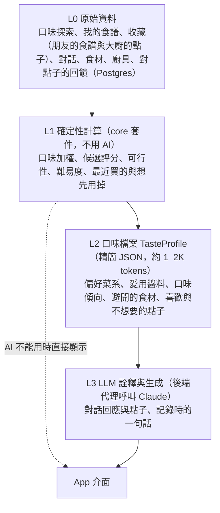
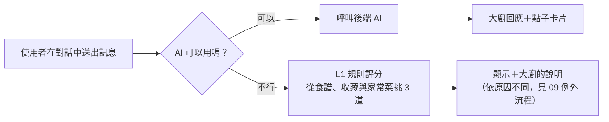

# 03 AI 設計

> 依 2026-11-18 的產品決策整理（決策 28–57，見 [06](06-roadmap.md#決策紀錄)）：大廚不推播點子，只在首頁的大廚區（口味把握程度夠時，0–3 個）與使用者要求時給點子；口味不靠記錄量，而是從口味地圖（[13](13-taste-preferences.md)）與多個來源學習；沒有每日推薦、週報與即期統計。

## 核心原則：統計交給程式，詮釋交給 AI

不把使用者整份歷史資料丟給 AI 去「自己看著辦」。而是分四層：



**為什麼這樣分？**

| 好處 | 說明 |
|------|------|
| 省錢 | 每次只送精簡的口味檔案，不送完整歷史 |
| 可預測 | 可行性、過敏原、難易度總分由程式判斷或計算，不會被 AI 算錯或幻想 |
| 有退路 | AI 預算用完、出錯或被用量保護擋下時，規則評分也能給出點子 |
| 隱私 | 照片和完整的食譜不必每次都送出去 |
| 可測試 | L1 是純函式，可以寫單元測試 |

## AI 功能清單

點子只出現在 App 內：**和大廚的對話**（主要，決策 53），以及首頁對話框下方大廚主動給的點子（口味把握程度夠時才有）。沒有推播點子、沒有每週批次。

| 功能 | 輸入 | 輸出 | 時機 | AI 不能用時 |
|------|------|------|------|---------|
| 首頁的大廚點子 | 口味檔案＋食材＋廚具＋朋友的菜＋候選清單 | 0–3 個點子（依把握程度，不湊數） | 打開首頁時；情境沒變（食材、朋友的新食譜、時段）就用快取，變了才重算；也可以下拉重新整理。把握程度不夠時不呼叫 AI | 本地評分；不夠就顯示鼓勵文字 |
| **和大廚聊聊** | 使用者的話＋這段對話＋口味檔案＋食材＋廚具＋候選清單 | 一兩句回應＋0–3 個點子卡片＋對話中提到的食材（結構化 JSON） | 使用者送出訊息時 | 規則評分挑 3 道，並說明大廚暫時想不出來 |
| 靈感彩蛋 | 醬料櫃或廚具中的一樣＋口味檔案 | 一句話＋一道菜 | 打開首頁時偶爾出現（例如一週最多一次），不推播 | 用預寫模板 |
| 記錄時的一句話 | 剛記錄的食譜＋口味檔案 | 一句溫暖的觀察或鼓勵 | 記錄時偶爾產生 | 用預寫模板 |
| 照片補標籤 | 食譜的照片＋標題 | 菜系、主食材、手法、可能用到的廚具、口味標籤 | 記錄後背景處理 | 先存，之後再補 |
| 食譜解析 | 網址內容／手寫照片／自由文字 | 結構化食譜 | 即時 | 存原文／原圖，之後再解析 |
| 拍照給大廚看 🧪 | 手邊食材的照片 | 食材清單，放進對話讓使用者確認 | 對話中拍照時 | 無，改用打字 |
| 食材正規化 | 未知的自由文字食材名 | 對應到標準食材 ID | 背景 | 先保留原文 |
| AI 幫我寫描述 🧪 | 食譜的照片＋標籤 | 一段描述草稿 | 使用者按下時 | 無 |
| 角色文案 | 情境＋狀態 | 一句話 | 大多用**預寫模板**，少數用 AI | 模板 |

> 情境文案（打招呼、到期提醒、歡迎回來等）**預設用預寫模板隨機抽**，不必每次叫 AI。模板寫得夠多夠有趣，體驗不會比 AI 差，而且零成本、零延遲、離線可用。

## 推薦演算法：對話與首頁的點子

兩階段：**程式先篩候選，AI 再創作與挑選**。

### 第一階段：候選評分（L1，裝置上）

候選來源：使用者自己的食譜、收藏（朋友的食譜與大廚的點子）、好友看得到的食譜、內建的基礎菜色庫（約 300–500 道家常菜骨架，每道標註所需手法與器具；依廚房地區調整）。

```
可行性檢查：所需手法無法用「可用」器具（含替代手法）完成 → 直接排除
硬性排除：過敏原、飲食限制、已過有效日期的食材

score = 0.30 × 食材覆蓋率        （手邊有的食材能湊齊多少比例；只看有沒有）
      + 0.20 × 手邊優先加權      （用到「最近買的」「想先用掉」、快到期（有設期限）的食材）
      + 0.25 × 口味相似度        （和口味檔案的距離）
      + 0.10 × 季節適合度        （依廚房所在地區的當季資料）
      + 0.10 × 器具與手法加分    （偶爾用上你有、但還沒出現在你食譜裡的手法）
      + 0.05 × 收藏加分          （還沒做過的收藏，材料差不多齊時加分）
```

權重先用直覺值，之後依「點子被收藏或做了並記錄的比例」調整。不再有「重複懲罰」：使用者不一定記錄每一餐，系統無從得知最近吃過什麼，也不需要知道。

### 第二階段：AI 生成（L3，後端）

把「前 15 名候選＋口味檔案＋食材（含最近買的、想先用掉）＋可用器具與手法＋時段」送給 AI；對話時再加上使用者這段對話說的話與提到的食材（見下方〈和大廚聊聊〉）。首頁的點子固定三個槽位；對話中依使用者的要求給 1–3 道，不一定三種都有：

| 槽位 | 定義 | 例（喜歡台式、愛用豆瓣醬） |
|------|------|------|
| 🏠 熟悉的 | 你記錄過、收藏過的食譜，或口味探索中喜歡的類型，現在食材能做 | 麻婆豆腐 |
| 🔄 變化版 | 熟悉的風味 × 新的組合 | 豆瓣醬燒茄子（同醬料，換主角） |
| 🚀 新挑戰 | 舒適圈邊緣，只差一兩個新元素 | 韓式辣炒豆腐（辣味相近，換醬料系統） |

「新挑戰」採用**相鄰可能**策略：只改變一個維度（醬料系統、烹調技法、菜系、主食材其中之一），避免跨太遠。其中「換手法」最能用上使用者的器具，見下方〈器具與手法〉。

**給偶爾下廚的人**：用了「新手友善」開頭、說了「我很少煮」，或使用者在口味探索中選了「偶爾下廚」時，三道都限制在步驟少、器具少、失敗率低的菜，大廚的語氣也更輕鬆（「難得下廚就是值得慶祝的事」）。

### 輸出格式

使用 Claude API 的結構化輸出（`output_config.format` 搭配 JSON Schema），保證回傳可直接解析：

```jsonc
{
  "suggestions": [
    {
      "slot": "familiar | twist | adventure",
      "title": "豆瓣醬燒茄子",
      "why": "你記錄過麻婆豆腐，還標了值得再做，豆瓣醬你很會用。這次換茄子當主角。",
      "uses_pantry_ids": ["..."],
      "uses_priority": ["茄子"],              // 用到的「最近買的／想先用掉／快到期」食材
      "missing_ingredients": ["九層塔（可省略）"],
      "difficulty": { "ingredients": 2, "equipment": 1, "time": 2, "technique": 2, "failure_risk": 1 },   // 各 1–5；總分由程式算，見〈難易度〉
      "techniques": ["煎", "燒"],
      "equipment": ["炒鍋"],                  // 對應到使用者可用的器具
      "substitutions": [],                    // 例：{"need": "氣炸鍋", "use": "烤箱熱風模式"}
      "recipe_draft": { "ingredients": [...], "steps": [...] }  // 使用者點開才展開
    }
  ],
  "chef_comment": "你說想先用掉的茄子，今天讓它當主角吧！"
}
```

`why` 不得提到頻率或次數以外的壓力（例如「你很久沒煮了」），只說正向的理由。

## 和大廚聊聊

使用者最常的用法是直接跟大廚說話（決策 53）。每送出一則訊息，後端做一次 AI 呼叫：

**送給 AI 的內容**

| 內容 | 說明 |
|------|------|
| 大廚角色與輸出格式 | 放在 system prompt 最前面並快取 |
| 口味檔案摘要、硬限制、可用廚具 | 同一段對話內不變，接在後面一起快取 |
| 食材（目前廚房）與 L1 候選前 15 名 | 依對話內容重新篩選候選：使用者說了「想吃熱的」「有筍子」，程式先把候選往這些條件調整 |
| 這段對話 | 最近 10 輪原文；更早的只留大廚整理的一句摘要（例：「不要太辣、只有 20 分鐘、有筍子和高麗菜」） |

**AI 回傳**（結構化輸出）

```jsonc
{
  "reply": "冷天配筍子剛好！高麗菜也一起用掉。",
  "ask": null,                                   // 條件太模糊時只問一個問題，例：「想吃飯還是麵？」；有問題就不給點子
  "suggestions": [ /* 同上方的點子格式，1–3 個 */ ],
  "mentioned_ingredients": [                     // 使用者在對話中說的食材，對到字典
    { "text": "鄰居送的筍子", "ingredient_id": "bamboo-shoot", "in_pantry": false }
  ],
  "summary": "想吃熱的；有筍子、半顆高麗菜"       // 給下一輪用的條件摘要
}
```

- **對話中說的食材**：這段對話裡當成「手邊有」，評分時和食材一樣加權；**不會自動寫進食材**。對話結束（離開對話畫面）時，App 列出 `in_pantry: false` 的項目讓使用者勾選要不要加入。
- **安全**：過敏原、飲食限制一樣由程式二次檢查；使用者在對話中說要用已過有效日期的食材時，大廚提醒，不推薦。
- **成本**：對話比一次給點子多用 token。靠快取（角色、口味、廚具不變的部分）、只送最近 10 輪、每段對話最多 20 輪（之後請使用者開新對話）控制；自由文字每則上限 500 字（見下方用量保護）。
- **AI 不能用時**：顯示「大廚現在想不出來，先從你的食譜和收藏裡挑幾道」，用規則評分配合對話中能辨識的關鍵字（食材名稱、時間）挑 3 道。
- **對話紀錄**：存在後端，只有本人能讀，保留 30 天；管理後台與產品數據都不讀對話內容（[14](14-product-metrics.md) 只記「送出一則訊息」這個操作）。

### 數字與單位

單位換算一律由程式處理，不交給 AI（規則見 [02 單位與換算](02-features.md#i-單位與換算共通設定)）：

- **AI 產生的食譜**：份量和溫度只放在結構化欄位，數值一律用公制與攝氏（例：`{"amount": 15, "unit": "ml"}`、`{"value": 180, "unit": "C"}`），App 再依使用者偏好顯示。
- **匯入的食譜**：AI 保留原文的數值與單位，不自行換算。美國網站的 350°F 就存 350°F。
- **自由文字**（推薦理由、大廚的話）不寫帶單位的數字。真的需要時，使用標記（例：`{{temp:180:C}}`），由 App 依偏好轉成「180°C」或「355°F」。

## 器具與手法：讓點子更有創意

使用者的器具清單（見 [02 廚具](02-features.md#d-廚具)，字典見 [07](07-equipment-techniques.md)）讓 AI 從「你能煮什麼」，進一步想到「你可以怎麼煮」。

### 三個作用

| 作用 | 說明 |
|------|------|
| 可行性（硬限制） | 點子所需的手法，必須能用使用者「可用」的器具完成（借出、待修的不算），或有替代手法。都做不到的候選直接排除 |
| 正向的廚具靈感 | 偶爾用上你有、但還沒出現在你食譜裡的手法（「你有舒肥機，週末試試舒肥牛排？」）。**不計算使用次數、冷落天數**，不讓人有「買了沒用」的壓力 |
| 手法變奏（創意） | 把「換手法」當成相鄰可能的主要維度：熟悉的食材，配上你有、但還沒試過的手法 |

### 手法變奏範例

| 你喜歡的 | 大廚的點子 | 用到的器具與手法 |
|-------|-----------|----------------|
| 煎雞胸 | 舒肥雞胸，最後噴槍炙燒上色 | 舒肥機（舒肥）＋噴槍（炙燒） |
| 清炒高麗菜 | 烤箱焦香高麗菜排，淋胡麻醬 | 烤箱（烤） |
| 手邊有快熟的香蕉 | 切片冷凍，隔天用調理機打成香蕉冰淇淋 | 冷凍庫（冷凍）＋調理機（打泥） |
| 九層塔一大把 | 打成九層塔青醬，倒進製冰盒冷凍分裝 | 調理機（乳化）＋冷凍庫（冷凍） |
| 滷肉 | 滷肉氣炸成脆皮，夾刈包 | 氣炸鍋（氣炸） |
| 蒸地瓜 | 電鍋先蒸熟，再進氣炸鍋烤出焦糖外皮 | 電鍋（蒸）＋氣炸鍋（氣炸） |

### 組合手法與多器具協作

- **一道菜多種手法**：舒肥＋炙燒、蒸＋氣炸、冷凍＋打泥。AI 輸出的每個步驟都標明手法與器具，烹飪模式才能提示「現在換氣炸鍋上場」。
- **一餐多道菜同時進行**（P2）：電鍋蒸飯、烤箱烤蔬菜、爐上煮湯同時進行。招待朋友的入口會考量器具不衝突、總時間最短。
- **容量**：使用者有填容量時，份量超過就提醒分批（「你的氣炸鍋一次只塞得下兩人份」）。

### 創意要有節制

- 「熟悉的」那一道不刻意換手法；只有「變化版」和「新挑戰」會用手法變奏。
- 一次最多一道需要「還沒試過的器具」的菜，避免平日晚上要搬出三台機器。
- 使用者說要快、要簡單時（「15 分鐘能好的」「今天好累」），限制「時間」「廚具」面向的分數，排除準備太費工的器具組合。

### 難易度

食譜和點子**不顯示烹煮分鐘數，也不顯示要洗幾件**（決策 57）：做菜花多久、用幾件器具因人而異，給精準數字反而不準。改用一個 1–10 的**難易度**，點進食譜再用雷達圖看五個面向。

| 面向 | 看什麼 | 1 分 | 5 分 |
|------|-------|------|------|
| 食材 | 食材種類數、少見或要特別去買的食材、前處理（剝殼、去骨、泡發） | 5 樣以內的常見食材 | 15 樣以上，或要特別去買 |
| 廚具 | 用到幾種廚具、要不要專門器具（舒肥機、溫度計、模具） | 一鍋到底 | 多種器具或專門器具 |
| 時間 | 整體花的時間長短（相對的，不換算成分鐘），包含醃、泡、發酵、燉等等待 | 很快就好 | 要燉很久，或前一天就要準備 |
| 技巧 | 用到的手法有多難（[07](07-equipment-techniques.md) 每種手法的技巧等級）、火候、刀工 | 拌、煮 | 打發、油炸控溫、揉麵整形 |
| 失敗風險 | 容不容易翻車，也就是成功率的反面：步驟的容錯、對溫度與時機的敏感度 | 很難失敗 | 差一點就塌、焦、不熟 |

**總分**：五個面向各 1–5 分，平均後換算成 1–10：`難易度 = round(1 + 9 × (平均 − 1) ÷ 4)`。先用相同權重，之後依使用者回饋調整（見 [08](08-open-items.md)）。

**誰來估**

| 情況 | 做法 |
|------|------|
| 有做法的食譜 | 記錄後背景由 AI（Haiku 5.5）依食材、步驟、廚具、手法估五個面向；手法的技巧等級查字典，當作 AI 的依據 |
| 只有照片和標題 | AI 從照片與標題粗估，標示「大廚估的」；補上做法後重估 |
| 大廚的點子 | 點子產生時一起給 |
| 作者想調整 | 編輯食譜時可以拖動五個面向（選填），朋友看到的是作者調整後的版本 |

**在推薦中怎麼用**

- 口味地圖的「情境」（下廚頻率、願意花的時間）決定平常的難易度範圍；偶爾下廚的人，點子多半在 1–4。
- 對話中說「今天好累」「要快」「想挑戰」時，大廚調整難易度或單一面向（例：「時間」≤ 2）。
- 「新挑戰」槽位的難易度可以比平常高 1–2，但一次只拉高一個面向（相鄰可能）。
- 有洗碗機時，大廚可以在對話中順口提「鍋碗交給洗碗機」，但不計算、不顯示要洗幾件。

## 以廚房為準，全家一起吃

點子用到的食材與廚具，一律來自使用者**目前所在的廚房**（見 [02 核心概念：廚房與家人](02-features.md#核心概念廚房與家人)）。選了「這餐誰一起吃」（同廚房的成員與家人檔案）時，條件改為合併所有一起吃的人：

| 條件 | 合併方式 |
|------|---------|
| 過敏原 | **聯集**，硬性排除（程式在 L1 篩候選時就排除，AI 回傳後再檢查一次） |
| 不吃的食物 | 聯集，盡量避開 |
| 飲食限制（素食、不吃牛等） | 聯集，硬性排除 |
| 口味 | 取各人口味檔案的交集，送給 AI 的是合併後的摘要，不送個別成員的完整檔案 |
| 份量 | 依人數調整 |

- 只有選擇「讓家人知道我的過敏原和不吃的食物」的成員，資料才會被合併。沒有分享的成員一起吃時，點子卡片會提醒：「有成員沒有分享飲食限制，煮之前記得問一下喔。」

## 食材正規化（Ingredient Normalization）

「醬油」「生抽」「薄鹽醬油」「金蘭醬油」應屬同一家族；「蔥」「青蔥」「三星蔥」也是。正規化讓「食材有沒有」的比對、口味計算都準確。

做法：

1. **內建標準食材字典**（約 800–1500 筆，先做台灣與美國常見食材），每筆有：標準 ID、中文名、別名、分類、所屬家族、是否為生鮮（決定「最近買的」多久淡化）、依地區的當季月份、口味屬性、過敏原。
2. 使用者輸入時先用程式比對字典（完全符合 → 別名 → 模糊比對）。
3. 比對不到的，先存原文，背景交給 AI 對應到既有 ID 或建議新增，結果快取到全站共用的對應表（之後其他人輸入同一個詞就不用再問 AI）。
4. 使用者可手動修正，修正結果優先。

字典是需要人工整理的資產，建議 M0 就開始建，先從 300 筆最常見的開始。不再需要保存天數資料。

## 口味檔案（TasteProfile）

使用者不一定常記錄，所以口味檔案**不靠記錄量**，而是綜合五個來源，在裝置上計算：

| 來源 | 權重 | 說明 |
|------|------|------|
| 口味探索 | 起始最高，隨其他資料增加而降低 | 新手約 2 分鐘，不用圖片：描述菜卡、二選一、口味光譜、快問快答，自適應提問（設計見 [13 口味地圖](13-taste-preferences.md)）；使用者親口設定的偏好不會被自動學習覆蓋 |
| 自己記錄的食譜 | 高 | 菜系、食材、手法；標成「家人最愛」「值得再做」、評分 😋 的加重 |
| 收藏 | 中 | 收藏的朋友食譜與大廚點子代表興趣 |
| 對點子的回饋與對話 | 中 | 收藏、做了並記錄的點子加分；對話中說的偏好（「我不太吃羊肉」）也算；「不想要」的原因（不愛吃／太麻煩／沒時間）分別調整口味或難度 |
| 食材與醬料櫃 | 低 | 手邊常有的食材與醬料，反映日常口味 |

送 AI 前只取需要的部分。示意：

```jsonc
{
  "sources": {"quiz": true, "collected": 12, "recipes": 20, "feedback": 35},   // 只用來決定信心程度，不送給使用者看
  "cooking_style": "occasional",             // 來自小測驗：occasional（偶爾下廚）／regular；只影響點子難度
  "top_cuisines": [{"name": "台式", "share": 0.55}, {"name": "日式", "share": 0.2}],
  "liked_ingredients": ["雞蛋", "豆腐", "豬絞肉", "蒜"],
  "signature_seasonings": [["醬油", "米酒", "糖"], ["豆瓣醬", "蒜", "蔥"]],
  "flavor_vector": {"salty": 0.7, "sweet": 0.4, "sour": 0.2, "spicy": 0.6, "umami": 0.8},
  "tried_techniques": ["炒", "煮", "蒸", "氣炸"],
  "untried_techniques": ["舒肥", "發酵"],     // 有器具做得到、但還沒出現在食譜裡的手法
  "loved": ["麻婆豆腐", "三杯雞"],            // 記錄過且標成值得再做、家人最愛
  "saved_not_cooked": ["韓式拌飯"],          // 還沒做過的收藏
  "dismissed_patterns": ["步驟太多的烘焙"],    // 常按「不想要」的類型
  "avoid": ["香菜"],                          // 使用者設定
  "allergens": ["花生"],                      // 使用者設定，硬性限制
  "household_size": 2,
  "equipment": ["電鍋", "氣炸鍋", "舒肥機"]    // 只列可用的（不含借出、待修）
}
```

## 模型選擇

已決定：**創作類任務用 Opus 5.5，高流量的抽取類小任務用 Haiku 5.5**（見 [06 決策紀錄](06-roadmap.md#決策紀錄)）。

| 任務 | 模型 | effort | 理由 |
|------|------|--------|------|
| 和大廚聊聊、首頁大廚點子 | Claude Opus 5.5（`claude-opus-5-5`） | `medium` | 要理解口味、發揮創意，品質直接影響使用者是否信任大廚 |
| 靈感彩蛋、記錄時的一句話、AI 幫我寫描述 | Claude Opus 5.5 | `low` | 短文字，重語氣；頻率低 |
| 食譜解析（網址、手寫照片） | Claude Opus 5.5 | `low` | 使用者主動觸發、頻率低；手寫字辨識較難，錯了使用者要手動修，不划算 |
| 拍照給大廚看 🧪 | 手邊食材的照片 | 食材清單，放進對話讓使用者確認 | 對話中拍照時 | 無，改用打字 |
| **照片補標籤** | **Claude Haiku 5.5**（`claude-haiku-5-5`） | `low` | 每篇有照片的食譜都會跑；輸出是固定選項的標籤，使用者可修正 |
| **食材正規化** | **Claude Haiku 5.5** | `low` | 背景執行、結果全站共用快取；任務單純（對應到既有 ID） |

**實作注意**

- 模型與 effort 依「任務類型」寫在後端設定檔，不寫死在程式碼裡，之後要調整只改設定。
- Haiku 5.5 的 effort 預設是 `medium`，要明確設成 `low`。
- Haiku 5.5 遇到拒答時沒有伺服器端自動改用其他模型的機制。這兩個任務都在背景跑，拒答或失敗時保留原文、標記「待處理」即可，不影響使用者。
- 上線前用 30–50 筆真實的料理照片和食材名，比較 Haiku 5.5 與 Opus 5.5 的結果，確認標籤與對應的正確率可以接受。正確率不夠時，個別任務改回 Opus 5.5。

所有模型都支援圖片輸入，照片相關功能不需另外接視覺模型。

## 成本控制

沒有每日推播與每週批次。首頁的大廚點子在情境改變時才重算；對話在使用者送出訊息時才呼叫 AI。

**原則：正常使用感覺不到限制，限制只用來擋下異常**（決策 44）。App 裡不顯示「今天還剩幾次」，也沒有固定的每日次數；成本靠快取與設計控制，濫用靠下方「用量保護」擋下。

| 手段 | 說明 |
|------|------|
| Prompt caching | 大廚角色設定、輸出格式說明、食材字典摘要放在 system prompt 前段並快取；變動內容（目前的食材）放後面 |
| 情境快取 | 首頁的點子在食材、朋友的新食譜與時段都沒變時，用上次的結果，不重算 |
| 對話快取 | 角色設定、口味摘要、廚具在同一段對話中不變，用 prompt caching；只送最近 10 輪原文 |
| 模板優先 | 情境文案、靈感彩蛋的大部分句子用預寫模板，不叫 AI |
| 圖片壓縮 | 送 AI 的照片縮到 1024px 以內 |

### 用量保護（防止惡意使用）

一般人一天用幾次到幾十次都不會碰到任何限制。下面每一層都只針對「不像人在用」的情況：

| 層 | 做法 | 碰到時 |
|----|------|-------|
| 只接受固定任務 | AI 代理只接受 App 定義好的任務（點子、匯入、補標籤…），prompt 由後端組裝；使用者能輸入的自由文字有長度上限（例：對話每則 500 字、每段對話最多 20 輪、匯入網址的內容截斷）。App 不能被拿來當免費的通用聊天機器人 | 不符合格式的請求直接拒絕 |
| 只限受邀帳號 | 必須是已登入、狀態正常的受邀帳號（ADR-14）；匿名或停用的帳號不能呼叫 | — |
| 速率限制 | 每人每分鐘、每小時的呼叫上限（例：每分鐘 6 次、每小時 60 次），擋連點與腳本 | 大廚說「點子想太快，燈泡有點燙，等我一分鐘」，一兩分鐘後自動恢復 |
| 合理使用上限 | 每人每天、每月的 AI 費用上限，設得遠高於正常使用（數值依 M1 實測的每次成本訂，見 [08](08-open-items.md)），使用者看不到 | 當天改用不用 AI 的推薦：「今天點子想了好多，我先從你的食譜裡挑，明天再幫你想新的」；同時通知管理員 |
| 異常偵測 | 短時間大量呼叫、大量重複相同輸入、輸入長度一直貼著上限、多個裝置同時大量呼叫，標記成「異常使用」 | 管理員在後台查看，可以暫停該帳號的 AI（其他功能照常） |
| 全站每月預算 | 見下方；所有 AI 呼叫（含背景任務）都計入 | 80% 提醒管理員，100% 全部改用不用 AI 的推薦 |

用量保護的數值都放在後台「系統設定」，不用改程式就能調整。

## 安全與信任

| 原則 | 做法 |
|------|------|
| 過敏原是硬性限制 | 在 L1 篩候選時就排除，並在 prompt 中明確列出；AI 回傳後再用程式二次檢查 |
| 食品安全 | 絕不推薦已過有效日期的食材；已過賞味期限的只說「看看狀況再決定」 |
| 器具與手法安全 | 舒肥等低溫烹調一律附明確的溫度與時間，AI 不得自行產生，只能從核對過的舒肥預設組合表挑選，程式比對不上就不顯示；無法穩定控溫的替代做法（溫水自製舒肥）只用在表中標記為短時間的組合（規則全文見 [07 安全規則](07-equipment-techniques.md#四安全規則)）。油炸提醒油溫與防濺，壓力鍋依原廠說明，微波不放金屬，調理機打熱湯注意蒸氣 |
| 不給醫療與營養建議 | 不做營養計算，不談疾病、減重 |
| 不製造壓力 | 推薦理由與大廚的話不提頻率、次數、多久沒煮 |
| 處理 AI 拒答 | 檢查 `stop_reason`，遇到 `refusal` 時退回模板與不用 AI 的推薦 |
| 可解釋 | 每個點子都附「為什麼推薦」，讓使用者理解並信任 |
| 可回饋 | 每個點子可以按「不想要」並選原因（不愛吃／太麻煩／沒時間），回饋進口味檔案 |
| 資料最小化 | 只送口味檔案摘要，不送完整的食譜清單；照片只在需要辨識時送出 |

## AI 不能用時

AI 預算用完、服務出錯、拒答，或被用量保護擋下時，不讓畫面空著：



背景任務（照片補標籤、正規化、食譜解析）失敗時留在後端的待處理清單，之後自動重試。

## 外部 AI 連接器（M4）

除了 App 內建的大廚，使用者也可以用自己的 AI 透過 MCP 連接器讀寫資料（功能見 [02 外部 AI 連接器](02-features.md#j-外部-ai-連接器mcp)，架構見 [04 ADR-13](04-architecture.md#adr-13外部-ai-連接器採遠端-mcp-伺服器m4)）。和內建 AI 的差別：

| 項目 | App 內建的大廚 | 使用者自己的 AI |
|------|--------------|----------------|
| AI 費用 | App 負擔，受用量保護與每月預算控管 | 使用者自己的 AI 服務負擔，不計入 App 的用量 |
| prompt 與語氣 | App 控制，大廚語氣一致 | 使用者的 AI 決定，大廚語氣只是建議 |
| 安全檢查 | 點子顯示前由後端檢查 | 點子不經過 App。改成**讀取時附上限制**、**寫入時由後端檢查** |
| 資料範圍 | 只送精簡的口味檔案 | 使用者授權範圍內的文字資料（不含照片） |

**讀取時附上限制**：每個讀取工具的回傳都帶著該使用者的過敏原與飲食限制；食材清單把已過有效日期的另外列出並標示「不可推薦」；舒肥相關查詢只回傳預設組合表。

**寫入時由後端檢查**：透過連接器存入的食譜，跑和內建 AI 相同的檢查（過敏原、安全溫度、舒肥組合）。不通過的仍然儲存，但在 App 中加上醒目的警告，不默默丟棄使用者要存的東西。

## 品質評估（之後做）

建立一份小型評估集：20–30 組「假想使用者（含偶爾下廚的人、記錄很少的新使用者）＋食材狀態＋一段對話」，人工標註「好的點子長什麼樣」。每次調整 prompt 或換模型時跑一次，比較點子的合理度、過敏原遵守率、語氣是否符合大廚設定，以及有沒有出現頻率或壓力相關的字眼。
