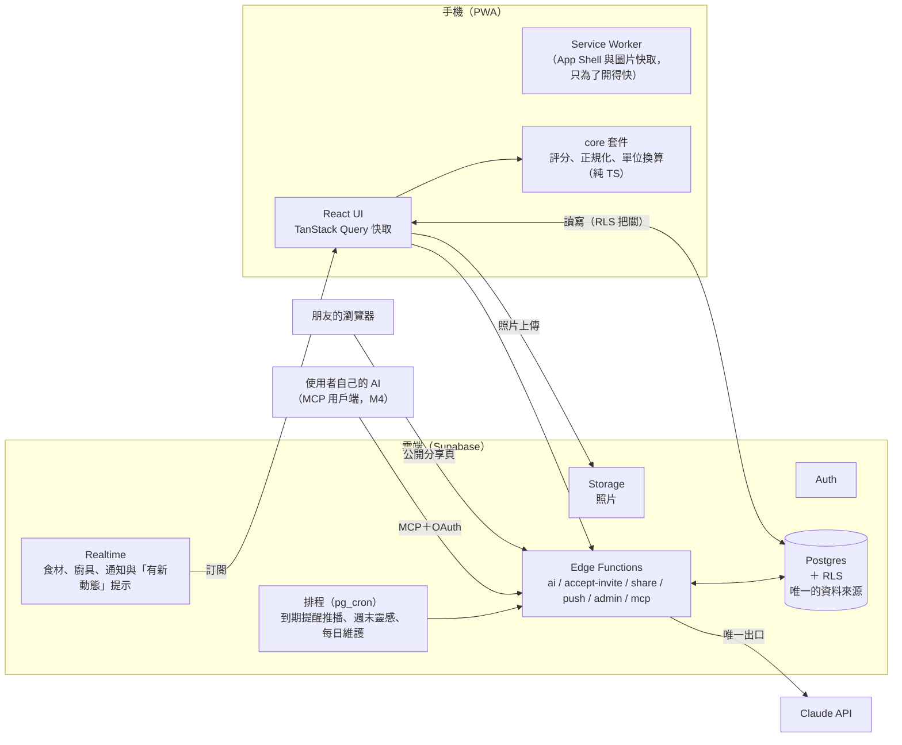

# 04 技術架構決策

## 系統全貌



## 架構決策紀錄（ADR）

編號 ADR-03 已停用。

### ADR-01：PWA 單頁應用，使用 Vite + React + TypeScript

- **決策**：前端為純 SPA，不做伺服器端渲染。
- **理由**：App 的主體是登入後使用的工具與社群介面，SSR 帶來的好處（SEO、首屏）對已安裝的 PWA 意義不大。React 生態系最大，招募與找元件都容易。
- **例外**：公開分享頁需要伺服器端輸出 meta 標籤（見 ADR-07），由 Edge Function 處理，不影響主 App。

### ADR-02：雲端為唯一的資料來源，不做離線

- **決策**：所有資料存在 Supabase Postgres，前端直接透過 `supabase-js` 讀寫，權限由 RLS 把關。不在手機上保存資料副本，也不做離線使用。
- **理由**：廚房通常有很好的網路。不需要同步佇列、欄位層級合併與同步引擎，M0 到 M2 的開發量明顯減少。資料一律在雲端，換手機、多裝置、家人共用都自然成立，也不用擔心 iOS 清除本地資料。
- **細節**：
  - **讀取**：TanStack Query 管理快取與重新整理；回到前景時重新抓取。
  - **寫入**：樂觀更新（畫面先變，失敗再還原並提示）。修改只送有改的欄位，所以兩位家人同時改同一個食材的不同欄位不會互相覆蓋；改到同一個欄位時，後送到的為準。食譜的做法是整包存的，儲存時比對讀取時的 `updatedAt`，不一致就不存，請使用者看過最新版再改（見 [05 完整性與穩定性規則](05-data-model.md#完整性與穩定性規則)）。
  - **多步驟的動作用資料庫函式**：發佈食譜、合併食材、離開廚房、接受邀請、指定管理者、刪除帳號這類要改好幾張表的動作，寫成 Postgres 函式（RPC），一次全部成功或全部不做，不讓手機一步一步寫、中途斷線只完成一半。刪除帳號另外在同一個流程排程清掉 Storage 裡的照片檔。
  - **搜尋也走資料庫函式**：手機只傳搜尋字，由函式組 PGroonga 查詢並照樣套用權限規則。
  - **產品事件與錯誤紀錄由後端寫入**：手機把事件送到後端函式，由後端填上分析 ID 再寫進資料庫，手機不知道自己的分析 ID，刪除帳號時刪掉對照就真的對不回本人。
  - **先顯示、再更新**：首頁點子這類要等 AI 的內容，先顯示上次的結果，背景重算完成後再替換，不讓使用者空等。
  - **新舊版本相容**：App 的更新由使用者決定何時重新整理（ADR-09），舊版可能會用好幾天。所以資料庫結構與 API 的改動要和前一版相容（先加欄位、下一版才拿掉舊的）；另設「最低支援版本」，App 太舊時請使用者重新整理。M2 完成、正式邀請朋友之前只有測試者，資料可以整個清掉重建，這條先不適用。
  - **即時更新**：訂閱目前所在廚房的食材與廚具，以及自己的通知（Supabase Realtime）：家人用掉食材，你的畫面幾秒內就更新；有人留言，「我的」分頁馬上出現紅點。
  - **「有新動態」提示**：朋友發佈食譜時，發佈用的資料庫函式順便對他的好友與家人各送一則「有新動態」的訊號（Realtime Broadcast，只有數量、沒有內容），首頁上方顯示「有 2 篇新的」，點一下才載入。不讓每個人監聽所有好友的食譜表。
  - **不即時的**：動態內容本身、食譜頁的留言與反應，在打開首頁、回到前景或下拉時重新抓取。
  - **ID**：仍在客戶端產生（UUID v7，含時間序），樂觀更新時不用等伺服器回傳 ID。
  - **刪除**：食譜等資料採軟刪除（`deletedAt`），方便復原誤刪。
  - **沒有網路時**：畫面上方顯示「網路好像斷了，連上後就能繼續」。不提供離線瀏覽或離線新增。
  - **沒送出的內容不會不見**：M0 不暫存文字（草稿每次有改動就存到雲端）；照片在上傳成功前暫存在手機（IndexedDB），關掉 App 再回來時自動續傳，上傳成功就刪掉暫存。這只是保護使用者的輸入，不是離線模式：暫存只有這一台手機看得到，也不能在沒網路時瀏覽資料。

### ADR-04：後端使用 Supabase

- **決策**：Postgres（資料，唯一的資料來源）、Auth（登入）、Storage（照片）、Realtime（即時更新）、Edge Functions（AI 代理、分享頁、推播、管理後台、MCP）、排程（到期提醒推播、週末靈感）。
- **理由**：
  - Postgres 適合做跨時間的統計查詢（之後的年度報告）。
  - Row Level Security 讓「每人只能看自己的資料」在資料庫層就被保證。
  - 一個平台涵蓋所需功能，小團隊維運負擔低；開源，必要時可自架。
- **登入方式**：Email＋密碼、Google，都用 Supabase 內建功能。不做 Apple 登入（網頁的 Apple 登入需要付費的 Apple 開發者帳號，超出營運總額）。LINE Login 需要自訂 OAuth 流程，暫不做。初期採邀請制且 App 不寄信，M1 做密碼與 Google，見 ADR-14。
- **方案與用量保護**：`entitlements` 表記錄使用者方案（`free` / `plus`）。AI 代理呼叫前依序檢查：帳號狀態、速率限制、合理使用上限、全站預算（見 [03 用量保護](03-ai-design.md#用量保護防止惡意使用)）。速率限制用 Postgres 的計數表（每人每分鐘、每小時一列）即可，30 人規模不需要另外的快取服務。
- **中文搜尋**：用 PGroonga 擴充套件做全文搜尋，能斷中文與日文詞；Postgres 內建的全文搜尋不會切中文。M0 前驗證免費方案能不能啟用、繁中的搜尋品質；不能用時退回 `pg_trgm` 的字串片段比對。
- **方案：親友階段用免費方案**（每月營運總額 US$20 全部留給 AI）。免費方案的限制與對策（上線前再確認一次最新條款）：

  | 限制 | 影響 | 對策 |
  |------|------|------|
  | 資料庫 500 MB | 30 人的文字資料遠用不完；產品事件最占空間 | 原始事件每月匯總後刪除（[14](14-product-metrics.md)）；後台總覽顯示用量 |
  | 檔案儲存 1 GB | 照片是主要用量（三種尺寸合計每張約 400 KB），約可放 2,500 張 | 後台總覽顯示用量，用到 80% 提醒你；必要時把原圖長邊從 1600px 降到 1280px（動態圖與縮圖不動，畫質不受影響） |
  | 流量 5 GB（另有 5 GB 快取流量） | 朋友動態的照片最耗流量 | 動態與食譜頁的小圖都用 400px 的縮圖，點開看大圖才載入 1080px 的動態圖；照片設長效快取，Service Worker 也快取看過的照片 |
  | 一週沒有使用會暫停專案 | M0 只有你一人時容易發生 | 用 GitHub Actions 每週排程呼叫一次，保持專案啟用。公開的 GitHub 儲存庫 60 天沒有更新會自動停用排程，所以後台總覽顯示上次喚醒與上次清孤兒照片檔的時間，超過 8 天沒執行就在你的首頁提醒 |
  | 沒有自動備份 | 資料庫出問題時無法還原 | 目前只有你一人使用，暫不做自動備份。有風險的 migration 前手動把資料庫匯出到本機。開始有朋友的資料時，升級 Supabase 付費方案的每日備份。照片不備份（接受風險） |
  | 最多 2 個啟用中的專案 | — | 一個正式環境、一個測試環境；測試環境不放真實使用者資料，一樣每週喚醒。開發時用本機的 Supabase CLI |

  任一項用到 80%，或需要每日備份時，再和你一起檢討預算。

### ADR-05：AI 一律經後端代理呼叫

- **決策**：前端永遠不直接呼叫 Claude API，API 金鑰只存在後端。
- **理由**：金鑰安全；用量保護（只接受固定任務、速率限制、合理使用上限）；prompt 集中管理與版本化（可 A/B 測試）；統一做過敏原二次檢查與記錄。
- **細節**：
  - Edge Function `ai` 接收「任務類型＋精簡上下文」，由後端組裝 prompt。前端不傳 prompt 文字，避免被濫用成免費 AI 代理。
  - 使用 Anthropic 官方 TypeScript SDK（`@anthropic-ai/sdk`）。
  - **不做邊想邊出字**：大廚的回應整段完成才一次回傳給 App；等待時顯示燈泡閃爍與「大廚想一下」。後端呼叫 Claude 時仍用串流，避免長回應逾時，只是不轉送給 App。
  - 每種任務類型用哪個模型（Haiku 5.5、Sonnet 5.5，必要時 Opus 5.5）、effort 與輸出上限多少，寫在後端設定檔（見 [03 模型選擇](03-ai-design.md#模型選擇)）。
  - 每次呼叫記錄任務類型、token 用量、延遲，作為成本與品質追蹤。
  - **從網址匯入**：由後端抓網頁，只允許 http／https 的 80／443 埠、不帶帳號密碼；網址是 IP 時直接檢查，是網域名稱時先解析 DNS、每個位址都要不是內部網路或保留位址（回送、私有、link-local 含雲端 metadata、多播、IPv6 的內部與內嵌 IPv4 形式等）；重新導向最多 5 跳，每一跳重新檢查；逾時 10 秒（含所有跳轉）、大小上限 2 MB、只收 HTML；請求不帶任何使用者的憑證。只取文字與食譜結構化資料，不執行網頁的程式。已知限制：DNS 在檢查與連線之間被換掉（DNS rebinding）理論上擋不住，因為這個函式沒有內部服務的憑證可偷、回應也只取食譜文字，風險可接受。抓不到（網站擋程式、內容要登入或要執行 JavaScript）時回固定的錯誤代號，畫面請使用者直接貼上食譜文字。匯入的食譜存來源網址（僅允許 http／https）與網站名稱，顯示時連結一律 `rel="noopener noreferrer"`。
  - **逾時與重試**：Claude API 回應忙碌、限流或逾時時，退避重試 1–2 次；仍失敗就回錯誤代號，畫面告知目前無法使用（見 [03 AI 不能用時](03-ai-design.md#ai-不能用時)）。每次請求帶一個請求 ID，用量紀錄以它去重，重試不會重複計費。

### ADR-06：照片在客戶端處理，再上傳物件儲存

- **決策**：
  1. 選取／拍照後，在手機端轉成 WebP，產生三種尺寸（顧及 iPhone Retina 螢幕的畫質）：
     - **原圖**：長邊 1600px，食譜頁點開看大圖用。
     - **動態圖**：長邊 1080px，點開照片全螢幕看時用。iPhone 螢幕寬約 390pt、Retina 是 3 倍，滿版約需 1170px，1080px 看起來仍然清楚；400px 的縮圖放滿版會糊。
     - **縮圖**：長邊 400px，動態與食譜頁一排三格的小圖、時間軸三欄格子、通知、清單用（每格約 120pt × 3 倍）。
     - **怎麼轉 WebP**：瀏覽器能直接輸出 WebP 的（Chrome、Android）用內建的；不能的（iPhone 的 Safari）改用 WebAssembly 的 WebP 轉檔程式（`@jsquash/webp`，約 340 KB），只在需要時下載，打開編輯頁時先預載。iPhone 實測（iOS 18.7）：相機照片三種尺寸合計約 330–620 KB、每張約 0.2 秒；同品質的 JPEG 大 2–2.6 倍，所以不退回 JPEG（見 `spikes/README.md` 第 03 節）。
     - **HEIC**：iPhone 選照片時系統會先轉成 JPEG，App 不用自己解 HEIC。
  2. **上限**（後台系統設定可以調）：每篇食譜上方最多 5 張、做法最多 10 步且每步 1 張、每次「又做了一次」最多 3 張。
  3. 移除 EXIF（特別是 GPS），只保留拍攝時間：重新編碼時 EXIF 會自動拿掉，所以要在轉檔前先讀出拍攝時間。
  4. 直接上傳到 Supabase Storage（私有 bucket）；失敗時自動重試，畫面顯示上傳進度，全部上傳完才能發佈。照片檔先傳到 Storage，傳完後由儲存食譜的函式（`save_recipe`）一次建立資料列；已發佈的食譜按「儲存」才生效。還沒傳完時，壓縮後的照片暫存在 IndexedDB，關掉 App 再回來會自動續傳。
- **理由**：手機照片動輒 3–5MB，直接上傳慢又耗流量；位置資訊會洩漏住家地址。

### ADR-07：分享採「公開分享頁＋系統分享選單＋圖卡」

- **分享連結**：
  - 建立分享時，後端產生一組不可猜測的 token（例：`/s/k3Jd9xQ2`），對應到該食譜的**快照**（之後修改食譜不會自動影響已分享的內容，使用者可選擇更新）。
  - 分享頁由 Edge Function 輸出 HTML，含 Open Graph meta 標籤與預覽圖，LINE / FB / Messenger 貼上時才有漂亮的卡片。
  - **網址用 App 自己的網域**：`/s/{token}` 由 Netlify 轉到 `share` Edge Function，貼到 LINE 的是短網址，不是 Supabase 的長網址。
  - **預覽圖在建立分享時由手機產生**（和食譜圖卡同一套 Canvas 繪製），上傳成公開副本；Edge Function 的 CPU 時間很短，不在伺服器上即時產生圖片。
  - 分享頁本身是輕量靜態頁，不需要登入、不需要安裝 App；頁尾邀請安裝。
  - 可撤銷：撤銷後 token 失效，頁面顯示「這道菜已經被主人收回去了」。
- **系統分享**：使用 Web Share API（`navigator.share`），手機上會跳出原生分享選單。
- **食譜圖卡**：在客戶端用 Canvas 繪製直式圖卡（照片＋食材＋步驟摘要＋大廚小插圖），可透過 Web Share API 分享檔案或存到相簿。
- **純文字分享**：產生排版好的文字貼到 LINE，不需要產生分享連結。

### ADR-08：UI 技術

| 項目 | 選擇 | 理由 |
|------|------|------|
| 樣式 | Tailwind CSS | 開發快；色彩、字級、圓角都用 [17](17-visual-design.md) 的代碼設定 |
| 元件基礎 | Radix UI primitives（或 shadcn/ui） | 無樣式、無障礙支援好，外觀可完全客製成手繪風 |
| 字型 | 內文用手機內建黑體；標題用 jf 粉圓，只下載用到的字 | 中文字型很大，內文不下載字型；圓體只用在標題與大廚的話（見 [17](17-visual-design.md#三字型)） |
| 圖示 | 手繪 SVG；M0 先用現成的圓頭線條圖示佔位 | 名稱與尺寸照手繪版規劃，之後一次替換（見 [17](17-visual-design.md#七圖示)） |
| 動畫 | Motion（原 Framer Motion） | 微互動、轉場 |
| 角色動畫 | Rive | 大廚的眨眼、帽子飄動、嘴形與燈泡顏色；Rive 的狀態機適合「依情境換表情」（見 [17](17-visual-design.md#八靈感大廚)） |
| 圖表 | 輕量圖表庫（如 Recharts 或自繪 SVG） | 口味雷達、統計圖 |
| 路由 | React Router | 每個畫面有自己的網址：返回鍵與重新整理正常，邀請連結與推播可以直接開到某一頁 |
| 非同步狀態 | TanStack Query | AI 與伺服器請求的快取、重試 |
| UI 狀態 | Zustand | 輕量 |
| 多語系 | 只做繁體中文（已決定），但文字一開始就抽到語系檔；字典資料用 `LocalizedText` 分語系存（見 [15](15-regions-i18n.md)） | 之後擴充不用大改；產品名、角色名也從語系檔讀，方便改名 |

### ADR-09：PWA 設定

- **工具**：`vite-plugin-pwa`（底層 Workbox）。
- **Manifest**：`name` 為「今仔日煮啥」，`short_name` 為「煮啥」（桌面圖示底下顯示），`lang` 為 `zh-Hant-TW`。
- **快取策略**：
  - App Shell（HTML/JS/CSS/字型/大廚素材）：預先快取。
  - 照片：Cache First ＋ 數量上限。
  - API：不由 Service Worker 快取；資料一律即時向雲端讀取。
- **沒有離線模式**：Service Worker 只為了讓 App 開得快、能安裝與收推播；沒有網路時顯示提示畫面。
- **更新**：偵測到新版時顯示「大廚換了頂新廚師帽，重新整理看看？」，由使用者決定何時更新，避免煮到一半畫面重載。
- **安裝引導**：Android 用 `beforeinstallprompt`；iOS 沒有這個事件，需要自製圖文引導（「點分享 → 加入主畫面」）。

### ADR-10：通知

- **原則**：通知越少越好（產品原則「偶爾用也完整」）。沒有每日推薦、週報、補記提醒或「很久沒來」的通知。
- **App 內提醒**（P0）：只針對使用者**自己設了期限**的食材。快到期時在食材頁標示、首頁出現一張小卡（分級與處理動作見 [02 有效期限與到期提醒](02-features.md#有效期限選填與到期提醒)）。到期狀態由 `core` 套件依廚房時區計算。
- **推播通知**（P1）：Web Push，每台裝置的訂閱存在 `PushSubscription`，失效的自動清掉。三種且都可關閉：① 設了期限的食材到期提醒，每個廚房依它自己的時區，在設定的時間（預設傍晚 5 點）各彙整一則；② 社群通知（M2 起）；③ 使用者自己開啟的「週末靈感」（每週六早上一則，預設關閉；內容用最新一組首頁點子或預寫的模板，不另外呼叫 AI，決策 64）。
- **限制**：iOS 需 16.4 以上且**已加入主畫面**才能收推播，所以 App 內提醒永遠是主要管道，推播是加分。
- **排程**：用 Supabase 的 `pg_cron`。每 15 分鐘跑一次，找出「現在是當地提醒時間」的廚房發到期提醒、週六早上發週末靈感；每天凌晨跑一次維護（清理過期資料、軟刪除到期、孤兒照片、AI 費用對帳，見 [05](05-data-model.md#完整性與穩定性規則)）。每次執行的結果寫進資料庫，後台總覽顯示。

### ADR-11：專案結構採 monorepo

```
cooking-recipe-app/
├── apps/
│   └── web/                 # PWA 主程式（Vite + React）
│       ├── src/
│       │   ├── features/    # 依功能切：recipes/ pantry/ equipment/ inspiration/ social/ review/ share/ admin/
│       │   ├── data/        # supabase-js 存取層、TanStack Query hooks、Realtime 訂閱
│       │   ├── chef/        # 大廚：文案模板、表情狀態、語氣模式
│       │   └── pwa/         # Service Worker、安裝引導、更新提示
│       └── public/
├── packages/
│   ├── core/                # 純 TypeScript 領域邏輯：統計、推薦評分、份量換算、單位換算、季節判斷
│   ├── ingredients/         # 標準食材字典（JSON 資料＋查詢函式）
│   ├── equipment/           # 器具字典、手法字典、器具↔手法對照、替代手法、安全溫度表
│   ├── taste/               # 口味地圖的字典：偏好維度、題庫、基礎菜色庫（JSON 資料＋查詢函式）
│   └── shared-types/        # 前後端共用的型別與 JSON Schema（含 AI 輸出格式）
├── supabase/
│   ├── migrations/          # 資料庫 schema 與 RLS
│   └── functions/           # Edge Functions：ai / accept-invite / share / push / admin / mcp（M4）；排程在 migrations 裡用 pg_cron 設定
└── docs/                    # 本文件
```

- **套件管理**：pnpm workspace。
- **部署**：前端由 Netlify 從 git 自動部署；資料庫 migration 與 Edge Functions 由 GitHub Actions 用 Supabase CLI 部署：先部署到測試環境，Netlify 的預覽網址連到測試環境，確認沒問題才部署到正式環境。
- **測試**：Vitest（`core` 的評分與換算要有完整單元測試）、Playwright（主要流程與權限的端對端測試）。
- **字典的版本一致**：`ingredients`、`equipment` 與地區、題庫等字典套件同時打包進前端與 Edge Functions，每次部署一起更新；部署時也匯入資料庫的唯讀表（`dict_*`），讓資料庫函式計算衍生欄位、搜尋別名、檢查過敏原。字典檔帶版本號，後端記錄每次請求用的版本。
- **命名**：資料庫與資料存取層一律 snake_case，型別由 Supabase 自動產生。實作細節見 [16 後端實作規格](16-backend-implementation.md)。
- **為什麼 `core` 獨立**：評分、口味計算與單位換算前端和後端（AI 代理、外部 AI 連接器）都要用，獨立成純函式套件可共用、易測試。

### ADR-12：單位存原始值，顯示時換算

- **決策**：溫度、重量、容量、尺寸一律存「原始數值＋原始單位」，畫面顯示時才依使用者偏好換算。換算邏輯集中在 `core` 的單位模組，前端、分享頁、後端都用同一套。
- **理由**：
  - 避免來回換算產生誤差（350°F → 177°C → 351°F）。
  - 使用者切換偏好不用改資料，只是換個顯示方式。
  - 分享頁可以依瀏覽者的語系換單位，不受分享者設定影響。
- **細節**：
  - 換算與進位規則（烤箱溫度到 5 度、美制用分數、安全溫度往高溫進位）都寫成有單元測試的純函式。
  - 安全溫度表存來源公布的攝氏與華氏官方數值，不經換算。
  - AI 不做換算：AI 產生的食譜用公制與攝氏，匯入的食譜保留原單位（見 [03 數字與單位](03-ai-design.md#數字與單位)）。

### ADR-13：外部 AI 連接器採遠端 MCP 伺服器（M4）

- **決策**：在 Supabase Edge Functions 上提供一個遠端 MCP 伺服器（`mcp` 函式，HTTP 傳輸），讓使用者自己的 AI 透過 OAuth 授權後讀寫資料。功能範圍見 [02 外部 AI 連接器](02-features.md#j-外部-ai-連接器mcp)。
- **理由**：
  - 使用者用自己的 AI 訂閱，App 不負擔這部分的 AI 費用。
  - 資料本來就在 Postgres、有 RLS 保護，MCP 伺服器只是多一個讀寫入口，不需要新的資料層。
  - 比「自備 API 金鑰」更適合一般使用者：不用碰金鑰，登入授權就好。
- **細節**：
  - **授權**：依 MCP 授權規範走 OAuth 2.1。授權伺服器先用 Supabase Auth 的 OAuth 伺服器功能，M4 開工前驗證；不行再自建輕量的授權端點。
  - **權限**：存取權杖對應到使用者身分，所有查詢以該使用者的身分執行，讓 RLS 照常生效。權限分 `read` 與 `write` 兩級。
  - **資料來源**：讀寫的是同一個雲端 Postgres，App 透過 Realtime 立刻看到外部 AI 寫入的資料。
  - **共用邏輯**：口味檔案、到期狀態、單位換算、安全檢查都呼叫 `packages/core` 與 `packages/equipment`，和 App 內的結果一致。
  - **限流**：每個連接設定呼叫頻率上限，保護資料庫。
  - **伺服器說明**：MCP 伺服器的 instructions 簡短說明資料的意義、要先讀「我的限制」、要依單位偏好呈現。大廚的語氣只作為建議，使用者的 AI 不一定採用。

### ADR-14：邀請制註冊（M1 起）

- **決策**：
  - 自建 `invites` 資料表，作為「誰可以註冊」的唯一依據。使用人數上限 30 人。
  - **同一個邀請表單、兩種結果**：「一般邀請」讓受邀者建立自己的廚房；「廚房邀請」（勾選「也邀請他加入我的廚房」）讓受邀者加入邀請者的廚房。系統管理員兩種都能發；使用者能發廚房邀請（**不需要管理者核准**），一般邀請 M4 才開放。都計入人數上限，預設和邀請者成為好友。
  - **App 不寄信**：管理員在後台產生邀請連結，自己傳給對方。
  - **兩條註冊路徑，各自檢查邀請**：
    - **已經有帳號的人**收到家人邀請：登入後在 App 內接受，帳號的 email 必須和邀請相同；同樣由 `accept-invite` 處理，加入廚房並依設定成為好友。
    - **設定密碼**：由自建的 `accept-invite` 函式處理。驗證邀請連結後，以管理權限建立帳號，並直接標記 email 已確認，不寄驗證信。持有一次性的邀請連結，就視為受邀者本人。
    - **Google 登入**（M1）：由 Supabase Auth 在建立使用者前觸發的 hook 檢查，email 必須對應到一筆「待接受、未過期、未撤銷」的邀請，否則拒絕建立。這個 hook 也擋下有人繞過 App、直接呼叫註冊 API 的情況。
  - 所有花錢或寫入雲端的 Edge Functions（`ai`、建立分享連結、`mcp`）及直接寫入資料庫的 RLS 規則都檢查使用者狀態是「啟用中」。
  - 知道網址但沒受邀的人，無法消耗 AI 費用。
- **理由**：
  - 自建邀請表，可以自己決定邀請期限、人數上限、備註與方案，也方便之後切換成等候名單或開放註冊。
  - 在「建立帳號前」擋，比「建立後再停用」乾淨，不會留下一堆沒用的帳號。
  - 不寄信，就不需要寄信服務與寄件網域，也不用處理垃圾信匣的問題。以 30 人的規模，管理員自己傳連結完全可行。
- **細節**：
  - **邀請連結**：隨機至少 128 bits，資料庫只存雜湊值，所以連結只在產生當下顯示一次；綁定 email、一次性、14 天到期。
  - **重設密碼連結**：同一套機制，由管理員在後台產生，24 小時到期、一次性。Supabase 內建的「忘記密碼」寄信流程不啟用。
  - **管理員**：使用者資料加上 `role`（`user`／`system_admin`），和廚房的「管理者」分開命名。第一位管理員的 email 寫在部署設定中。管理 API 一律在後端檢查角色，前端隱藏管理頁只是介面上的處理。
  - **關閉 Supabase 的自動寄信**：註冊確認信、登入連結、忘記密碼信都不使用，避免碰到內建寄信服務的寄送限制。
  - **註冊模式**：放在後端設定（`invite_only`／`waitlist`／`open`），切換不用改程式。
  - **分享頁不受影響**：朋友打開公開分享連結不需要帳號。
- **已知取捨**：密碼註冊不驗證 email 的擁有權，連結被轉傳的話，別人可以用那個 email 註冊。在「自己和朋友」的規模可以接受；公開上線前要接寄信服務，補上 email 驗證與自助重設密碼。

### ADR-15：管理後台放在同一個 PWA 的 `/admin`

- **決策**：
  - 管理後台是同一個 PWA 裡的 `/admin` 路由，程式碼分割成獨立的區塊，不放進 Service Worker 的預先快取，一般使用者不會下載。後台不需要離線運作。
  - 後台所有資料都由獨立的 `admin` Edge Function 提供。每次請求在後端檢查三件事：已登入、角色是 `system_admin`、已完成兩步驟驗證（Supabase Auth 的 MFA，達到 AAL2 等級）。
- **理由**：共用元件、登入與部署流程。一個人維運，少一套系統就少一份負擔。
- **細節**：
  - **隱私靠設計保證**：`admin` 函式只回傳統計與帳號資料，設計上就沒有「讀取某位使用者私人內容」的端點。使用者主動授權查看的那筆回報，才透過專門的端點讀取，並記錄在操作紀錄。
  - **AI 用量紀錄**：`ai` 函式每次呼叫 AI 都寫一筆用量紀錄（任務類型、模型、輸入／輸出／快取 token、估計費用、耗時、結果）。呼叫前先讀本月累計費用（短暫快取），超過預算就回「目前無法使用」。
  - **操作紀錄只能新增**：資料庫權限禁止修改與刪除。
  - **通知**：App 不寄信。預算警示目前只顯示在後台頂端；管理員自己 App 首頁的提醒與推播通知 M2 才加。

### ADR-16：料理社群的資料與權限（M2 起）

- **決策**：
  - 食譜多一個「可見範圍」欄位（`private`／`household`／`friends`）。
  - 社群資料（好友關係、料理頁、反應、留言、收藏的好友食譜、分享給好友、通知）和其他資料一樣存在雲端。
  - 「誰能看什麼」全部由資料庫的 RLS 規則判斷，不靠前端隱藏。
- **RLS 規則**：
  - 食譜：擁有者可讀寫；可見範圍是 `friends`、且雙方是已接受的好友時，可讀（公開上線前加入檢舉後，再加上「沒有被下架」）。
  - 系統管理員：沒有讀取食譜的一般權限。廚房求助透過 `admin` 函式，只回傳廚房的名稱與成員名單，每次都寫操作紀錄；公開上線前加入的檢舉處理也走同一條路，只回傳被檢舉的那一筆。
  - 「分享給好友」的收件人可讀那一份食譜，不管它的可見範圍；條件是沒有收回、雙方仍是好友。
  - 照片：Storage 的存取規則套用同一套判斷，用簽名網址存取。簽名網址的到期時間對齊到「當天結束再加 1 天」；Supabase 每次簽發的網址都不同（內含簽發時間），所以由前端記住已簽好的網址，在這次開啟 App 期間重複使用，瀏覽器與 Service Worker 的快取才用得上；代價是移除好友或改成只有自己後，對方最多還能在當天用舊網址看到已經載入過的照片。
  - 移除好友、改回 `private` 時立即生效（封鎖功能公開上線前才做），因為每次讀取都即時判斷，不需要搬動資料。
- **細節**：
  - **好友看到的是即時內容**，不是快照。這和公開分享連結（快照）不同。
  - **料理偏好要使用者發佈**：口味檔案由 `core` 計算、存在只有本人能讀的表；使用者按「發佈」才產生一份給好友看的摘要（`PublicTasteSummary`），原始統計不公開。
  - **動態牆**：後端查詢「好友 × 可見範圍是好友 × 依時間排序」。30 人規模直接查詢就夠，用戶多了再考慮預先展開動態。
  - **通知**：存在通知表，用 Supabase Realtime 即時更新「我的」分頁的紅點；推播沿用 ADR-10 的推播機制。
  - **好友連結**：每人一組可重新產生的好友連結，資料庫只存雜湊值。
  - **AI 使用好友的內容**：只有「好友的推薦」（P2）會用到，而且只用好友看得到的內容；不用在其他用途。

### ADR-17：「廚房」是食材與廚具的歸屬單位（M0 起）

- **決策**：
  - 新增「廚房」與「廚房成員」。食材、廚具屬於**廚房**（`kitchenId`）；食譜、收藏、對話、口味、設定屬於**個人**（`userId`）。
  - M0 起每位使用者自動有一個自己的廚房，資料一開始就掛在廚房底下。M2 開放邀請家人加入。
  - 使用者有「目前所在的廚房」，食材、廚具、推薦，都以目前所在的廚房為準。
- **理由**：從一開始就這樣切，到 M2 開放共用時，只是多一位成員，不需要搬動任何資料。之後才改，就是一次全面的資料搬遷。
- **角色**：管理者（`admin`，可以有多位）與成員（`member`）。權限表見 [02 角色與權限](02-features.md#角色與權限)。食材與廚具的操作兩者相同；廚房設定、邀請、成員管理、家人檔案只有管理者能做。
- **權限（RLS）**：
  - 廚房的資料（食材、廚具、家人檔案）：該廚房的成員可讀；食材、廚具成員可寫；家人檔案、廚房設定、成員名單只有管理者可寫。
  - 公開身分（暱稱、頭像）：同廚房的成員與好友可讀。
  - 食譜的可見範圍多一級「家人」（`household`）：和擁有者同屬任一廚房的成員可讀。範圍由小到大：`private` → `household` → `friends`（家人＋好友）。
  - 飲食限制檔案（過敏原、不吃的食物、飲食限制）：獨立成一份資料，所以能單獨開放。成員選擇分享時，同廚房的成員可讀，用於「全家一起吃」的推薦；家人檔案的飲食限制，同廚房成員都可讀。其他個人設定仍只有本人能讀。
  - 被移除或離開廚房後立即失去權限。
  - 廚房管理者**不會**因為角色而看得到成員的私人食譜或口味。
- **一致性規則**（由資料庫函式在寫入時檢查，不只靠前端）：
  - 每個廚房至少有一位管理者：最後一位管理者不能離開或被降級，必須先指定接手的人。
  - 每個人至少屬於一個廚房，最多 5 個；每個廚房最多 10 位成員。
  - 最後一位成員離開等同刪除廚房，需要明確確認。
- **細節**：
  - **切換廚房**：食材和廚具畫面跟著換，Realtime 訂閱也改成新的廚房。
  - **記錄是誰做的**：廚房資料都有 `createdBy`、`updatedBy`；食材另外記下誰移除的。
  - **到期提醒不重複**：提醒以廚房為單位計算，任一成員處理後，所有成員的提醒一起消失；推播每位成員各收一則彙整。
  - **合併食材**：加入別人的廚房時，可以把自己廚房的食材與廚具搬過去（改掉 `kitchenId`；同一種食材和對方已經有的合併成一筆），保留誰加的紀錄。

### ADR-18：前端放在 Netlify（M0 起）

- **決策**：PWA 的靜態檔案（HTML、JS、CSS、圖示）放在 Netlify。後端仍是 Supabase。
- **理由**：PWA 必須有 HTTPS 網址才能安裝到手機；Netlify 提供 HTTPS、從 git 自動部署，以及每個修改的預覽網址，M0 就能讓自己和家人裝到手機上試用。
- **細節**：
  - 先用 Netlify 提供的網址；正式網域等產品名稱的商標檢查後再買，再綁定到 Netlify。
  - Service Worker 與 `manifest` 的快取標頭要正確設定，避免使用者卡在舊版本（Netlify 的標頭設定檔）。
  - 公開分享頁仍由 Supabase Edge Function 輸出（ADR-07），不放在 Netlify。
- **方案**：免費方案。免費方案以點數計算，流量與部署都會用到點數；PWA 檔案小，正常使用夠用。避免頻繁部署正式環境，預覽網址只在需要時建立。

### ADR-19：產品數據自建在 Supabase（M1a 起）

- **決策**：使用行為記成 `ProductEvent`，存在同一個 Postgres；每月由排程匯總進 `ProductMetricMonthly`，後台「產品數據」只讀匯總表。指標與事件清單見 [14](14-product-metrics.md)。
- **細節**：
  - 前端用一個小模組送事件：批次送出（每 10 秒或離開畫面時），失敗就丟掉，不影響操作。事件名稱與屬性在 `shared-types` 定義成白名單，型別檢查擋下不在清單上的事件。
  - 寫入權限：使用者只能新增自己的事件，不能讀取；`analyticsOptOut` 為真時，前端不送、後端也拒收。
  - 原始事件保留 13 個月，匯總後刪除。
  - 報表工具（例：Metabase）用唯讀資料庫角色，只能讀匯總表與只含分析 ID 的事件，讀不到食譜、留言等內容表。
- **理由**：資料不離開自己的資料庫；30 人規模用 Postgres 就夠，不需要另外的分析服務。

### ADR-20：地區與語系分開，資料從 M0 起就支援多語系

- **決策**：地區（`Kitchen.region`）決定地區內容；語系（`UserSettings.locale`）決定介面文字與 AI 回應的語言。目前只有 `zh-TW`，但資料一開始就用多語系的格式。資料怎麼存、怎麼新增地區與語言，見 [15 地區與語系](15-regions-i18n.md)。
- **技術選擇**：
  - 文案用 ICU MessageFormat，以 FormatJS（`react-intl`）讀取；日期與數字用 `Intl`。
  - `<html lang>` 跟著介面語言，使用者的內容依它的 `lang` 加上 `lang` 屬性。字型依語言分開（繁中 Noto Sans TC，之後的日文 Noto Sans JP），只下載用得到的。
- **理由**：現在多一層結構的成本很小；等有了真實資料再改，就要搬遷全部字典與使用者資料。

### ADR-21：錯誤紀錄自建在 Supabase（M0 起）

- **決策**：手機與後端的錯誤都寫進同一張 `ErrorLog` 表，不用第三方錯誤監控服務。
- **細節**：
  - 記錄錯誤類型、發生的畫面或函式、App 版本、平台、次數；**不記食譜、對話等內容**，也不記使用者 ID（用分析 ID）。
  - 同一種錯誤在一小時內只記一筆並累加次數，避免洗版。
  - 排程、喚醒、孤兒照片檔掃描的每次執行結果也寫進來。
  - 保留 90 天。後台總覽列出最近的錯誤；有新的嚴重錯誤（AI 代理、排程、登入失敗）時，在你的 App 首頁提醒。
- **理由**：Supabase 免費方案的日誌只保留很短的時間，手機端的錯誤也看不到；30 人規模自建一張表就夠，資料不離開自己的資料庫。

## iOS PWA 限制與對策

iOS 使用者在台灣比例高，以下限制要在設計時就考慮（實作前需在實機上驗證）：

| 限制 | 影響 | 對策 |
|------|------|------|
| 推播需加入主畫面且 iOS 16.4+ | 未安裝者收不到 | App 內提醒為主；積極引導安裝 |
| 沒有 `beforeinstallprompt` | 無法一鍵安裝 | 自製安裝教學畫面 |
| 螢幕常亮（Wake Lock） | 烹飪模式需要 | 較新的 iOS 版本已支援，需實測；不支援時提示使用者 |
| 相機 | 拍照記錄 | 使用 `<input type="file" accept="image/*" capture>`，相容性最好 |
| 主畫面的 App 和 Safari 登入狀態分開 | 受邀者在 Safari 打開邀請連結註冊後，從主畫面打開 App 還要再登入一次；iOS 也不會把連結直接開在主畫面的 App 裡 | 新手引導先教安裝、再註冊：Safari 顯示 6 碼邀請碼，主畫面的 App 第一次打開時輸入，接著在 App 裡註冊，只要登入一次（見 [12](12-onboarding.md)）。選擇先在瀏覽器用的人，之後安裝要再登入一次，登入頁預先帶入 email |

## 安全與隱私

- **RLS** 依資料的種類設定：
  - 個人的（設定、口味、收藏、對話、`RecipePrivate`）：只有本人。
  - 廚房的（食材、廚具、家人檔案）：該廚房的成員。
  - 依可見範圍的（食譜、照片、反應、留言）：擁有者，加上依可見範圍判斷的家人與好友；草稿只有本人。
  - 只在後端的（邀請、用量、操作紀錄、推播訂閱、分析對照）：前端完全讀不到，只有 Edge Function 以服務權限存取。
  - 分享頁透過 Edge Function 以服務權限讀取快照，不直接開放表。
- **分享 token**：至少 64 bits 隨機，不可從食譜 ID 推得。
- **照片**：私有 bucket，以簽名網址存取（到期時間以天為單位，方便快取）；分享快照的照片另存公開副本，只存封面加最多 3 張，用 1080px 的動態圖尺寸，不存原圖。
- **資料可攜**：帳號刪除從 M1a 起就有；完整匯出（JSON＋照片 ZIP）在公開上線前補上（見 [06 公開上線前](06-roadmap.md#公開上線前)）。
- **刪除帳號遇到共用廚房**：比照「離開廚房」。若是某廚房最後一位管理者，要先指定接手者才能刪除；共用的食材、廚具、家人檔案留在廚房；個人資料、飲食限制檔案、社群內容刪除；留下的食材與廚具顯示為「前成員」加的。
- **AI**：只送必要的摘要；在隱私說明中清楚寫出哪些資料會送給 AI 服務。

---

## 之後可以擴充與檢討

上線後依實際使用再看的事。類型：**擴充**＝之後可以加的功能；**優化**＝讓現有的更好；**檢討**＝回頭確認當初的決定還對不對。全部項目依時間整理在 [08 第四部分](08-open-items.md#四之後可以擴充優化或檢討)。

| 項目 | 類型 | 什麼時候看 | 怎麼判斷 |
|------|------|-----------|---------|
| Supabase 改付費方案 | 檢討 | 資料庫、照片空間或流量任一項用到 80% 時 | 和你一起重新檢討每月 US$20 的營運總額；需要每日備份時也要升級 |
| 語音轉文字服務 | 擴充 | 決定做 App 內錄音時 | 選服務、評估費用與隱私（聲音會送到第三方），寫成新的 ADR |
| 字型大小 | 優化 | M0 開發時 | 中文字型檔很大，只下載用得到的字（字型子集化），或優先用系統字型 |
| 分享目標（Web Share Target） | 擴充 | M3 後 | Android 的 PWA 可以出現在系統分享選單，接收網址與照片；iOS 目前不支援 |
| 對話的資料保存 | 檢討 | 公開上線前 | 對話紀錄 30 天、口述原文長期保存，要不要縮短；寫進隱私說明 |
| 第三方分析工具 | 檢討 | 開放註冊、人數上來後 | 自建的產品數據不夠用時，評估可以自架的 PostHog |
| 獨立的後台網站 | 檢討 | 管理員不只一人，或後台功能變多時 | 和主 App 分開部署，隔離更徹底 |
