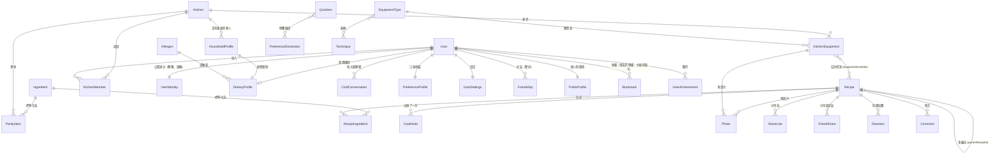

# 05 資料模型

> 以 TypeScript 型別描述，對應後端 Postgres 的資料表。實作時放在 `packages/shared-types`。
>
> 2026-11-18（決策 46）：不做離線，資料一律存在雲端。原本的同步欄位（`rev`、`hlc`、`fieldClocks`）、同步佇列、同步游標、本地資料庫與食材事件都已拿掉。

## 共同欄位

資料分兩種歸屬（見 [04 ADR-17](04-architecture.md#adr-17廚房是食材與廚具的歸屬單位m0-起)）：

- **個人資料**（食譜、收藏、和大廚的對話、設定等）：用 `UserEntity`，屬於某位使用者。
- **廚房資料**（食材、廚具）：用 `KitchenEntity`，屬於某個廚房，同廚房的成員共用。

```ts
// ── 時間型別（D14）──
type Instant = string;     // 時間點，ISO 8601 含時區，例 '2026-11-18T18:30:00+08:00'
type LocalDate = string;   // 某一天，'YYYY-MM-DD'，一律以「廚房的時區」解讀（到期日、購買日等）

type Visibility = 'private' | 'household' | 'friends';   // 只有自己／家人／家人＋好友

interface UserEntity {
  id: string;            // UUID v7，客戶端產生（樂觀更新時不用等伺服器）
  userId: string;
  createdAt: Instant;
  updatedAt: Instant;    // 顯示用（「3 小時前修改」）
  deletedAt?: Instant;   // 軟刪除，方便復原誤刪
  createdVia?: 'app' | 'external_ai';   // 經由外部 AI 連接器建立的，在 App 中標示「來自你的 AI」（M4）
}

interface KitchenEntity {
  id: string;
  kitchenId: string;     // 屬於哪個廚房
  createdBy: string;     // 哪位成員建立
  updatedBy: string;     // 最後修改的成員
  createdAt: Instant;
  updatedAt: Instant;
  deletedAt?: Instant;
  createdVia?: 'app' | 'external_ai';
}
```

- **時間點**（`Instant`）用在「什麼時候發生」：料理時間、建立與修改時間、事件時間。
- **日期**（`LocalDate`）用在「哪一天」：食材的加入日、使用者設定的到期日、記錄食譜的日期。到期提醒、「今天」都以廚房的時區判斷，所以住美國的家人和你看到的到期日一致。

### Kitchen — 廚房

```ts
interface Kitchen {
  id: string;
  name: string;                       // 「我家」「爸媽家」
  timezone: string;                   // IANA 時區，例 'Asia/Taipei'、'America/Los_Angeles'；建立時取手機時區，可修改。到期日、「今天」、每日提醒、深夜判斷一律以它為準（2026-11-18 定案）
  region: string;                     // 地區代碼，例 'TW'、'US'；決定季節分法、當季食材與節日料理。該地區還沒有當季資料時，只用依南北半球的四季（2026-11-18 定案）
  createdBy: string;
  updatedBy: string;
  // 邀請家人不在廚房上放共用連結：每一位家人各自一筆 Invite（type: 'household'，綁定 email、一次性），所有成員都可以發（決策 37）
  createdAt: Instant;
  updatedAt: Instant;
  deletedAt?: Instant;
}

interface KitchenMember {
  id: string;                         // 每一段成員關係一筆；離開後再加入會新增一筆，保留歷史
  kitchenId: string;
  userId: string;
  role: 'admin' | 'member';           // 管理者可以有多位；權限見 02「角色與權限」
  shareDietaryInfo: boolean;          // 讓同廚房的人讀取我的飲食限制檔案（加入時詢問，建議開啟）
  expiryAlerts: boolean;              // 這個廚房的到期提醒，預設 true
  joinedAt: Instant;
  leftAt?: Instant;                   // 離開或被移除；他加的食材顯示為「前成員」加的
  updatedAt: Instant;
}

interface HouseholdProfile extends KitchenEntity {   // 家人檔案：沒有帳號的家人（小孩、長輩）（M2）
  name: string;                       // 過敏原與飲食限制放在 DietaryProfile
  convertedToUserId?: string;         // 之後有了帳號、轉成正式成員時記錄
}
```

- 同一位使用者在同一個廚房，同時間只會有一筆 `leftAt` 為空的成員紀錄（資料庫唯一性條件）。

### DietaryProfile — 飲食限制檔案（D3）

過敏原、不吃的食物、飲食限制獨立成一份，才能單獨分享給家人或好友，而不露出其他私人設定。

```ts
interface DietaryProfile {
  id: string;
  userId?: string;                    // 屬於使用者，或
  householdProfileId?: string;        // 屬於家人檔案（兩者恰好一個有值）
  allergenIds: string[];              // 對應過敏原字典，硬性限制
  dislikeIngredientIds: string[];     // 對應食材字典，盡量避開
  dietaryRestrictionIds: string[];    // 對應飲食限制字典：飲食原則（素食、不吃牛…）、宗教與文化規則（清真、五辛素、印度教不吃牛…）
  recurringRules?: { restrictionId: string; schedule: 'lunar_1_15' | 'weekly' | 'ramadan'; weekday?: number }[];   // 週期性規則，例：初一十五吃素
  noCookingAlcohol: boolean;          // 不用料理酒（米酒、紹興、味醂）
  updatedAt: Instant;
}
```

- 誰能讀：本人；同廚房、且本人 `KitchenMember.shareDietaryInfo` 為真的成員；本人開啟「讓好友知道我的過敏原」時的好友（M4）。家人檔案的飲食限制，同廚房的成員都能讀。

### UserIdentity — 公開身分（D4）

暱稱與頭像只存在這裡。家人、好友、通知、動態要顯示名字時都讀這一份。

```ts
interface UserIdentity {
  userId: string;
  displayName: string;                // 暱稱；M0 在新手設定時填（可跳過，預設「我」）
  updatedAt: Instant;
}
```

- 頭像是一張 `Photo`（`ownerType: 'avatar'`），不在這裡另存照片 ID。
- 誰能讀：本人、同廚房的成員（含前成員的歷史紀錄顯示）、好友。

- M0 第一次使用時自動建立一個廚房與一筆 `admin` 成員。
- 使用者目前所在的廚房記在 `UserSettings.currentKitchenId`。
- 一致性規則（至少一位管理者、每人 1–5 個廚房、每廚房最多 10 位成員）見 [04 ADR-17](04-architecture.md#adr-17廚房是食材與廚具的歸屬單位m0-起)。

## 關聯圖



## 實體定義

### Ingredient — 標準食材字典（全站共用，唯讀）

```ts
interface Ingredient {
  id: string;                 // 例：'soy-sauce'
  name: string;               // 醬油
  aliases: string[];          // ['生抽', '薄鹽醬油', '壺底油']
  family: string;             // 'soy-sauce-family'，統計時歸類用
  category: IngredientCategory; // vegetable | meat | seafood | egg-dairy | tofu-bean | grain | seasoning | sauce | spice | ...
  defaultStorage: StorageZone;
  isPerishable: boolean;             // 是否為生鮮；決定「最近買的」標記
  recentDays?: number;               // 生鮮加入後維持「最近買的」幾天（例：葉菜 5、根莖類 14），之後自動淡化
  densityGPerMl?: number;            // 容量換算重量用（1 杯麵粉 ≈ ? 克），P2
  seasonMonths?: Record<string, number[]>;   // 依地區的當季月份，例 { TW: [11,12,1,2], US: [10,11] }；先做台灣與美國
  flavorTags?: FlavorTag[];          // salty | sweet | sour | spicy | umami | aromatic | bitter
  allergenIds?: string[];            // 對應過敏原字典
}

type StorageZone = 'seasoning' | 'fridge' | 'freezer' | 'pantry';
```

### Allergen、DietaryRestriction — 過敏原與飲食限制字典（全站共用，唯讀；D13）

過敏原與飲食限制改成字典資料，不寫死在程式裡。新增一種（例如其他國家常見的過敏原、宗教飲食）只要更新字典。

```ts
interface Allergen {
  id: string;                         // 例：'peanut'、'shellfish'、'sesame'
  name: string;                       // 花生
  aliases: string[];
  regions?: string[];                 // 哪些地區的標示規範列為主要過敏原，供新手設定排序
}

interface DietaryRestriction {
  id: string;                         // 例：'vegetarian'、'vegan'、'pescatarian'、'no-beef'、'no-pork'
  name: string;                       // 不吃牛
  excludesIngredientFamilies: string[];   // 排除哪些食材家族，推薦時據此篩選
}
```

### 單位（共用型別）

規則見 [02 單位與換算](02-features.md#i-單位與換算共通設定)。所有數值都存**使用者輸入或來源上的原始值與單位**，顯示時才換算。

```ts
type UnitCode =
  // 重量
  | 'g' | 'kg' | 'oz' | 'lb' | 'tw_jin' | 'tw_liang' | 'cn_jin'
  // 容量
  | 'ml' | 'l' | 'tsp' | 'tbsp' | 'cup' | 'cup_jp' | 'rice_cup' | 'fl_oz' | 'qt'
  // 尺寸
  | 'cm' | 'inch'
  // 不換算
  | 'piece' | 'pack' | 'clove' | 'slice' | 'serving' | 'pinch' | 'to_taste';
  // 個、包、瓣、片、人份、一小撮、適量

interface Quantity { amount: number; unit: UnitCode; }
interface Temperature { value: number; unit: 'C' | 'F'; }
```

- `cup` 代表美制杯與台灣量杯（237／240 毫升，視為相同）；`cup_jp`（200 毫升）與 `rice_cup`（約 180 毫升）分開記錄。
- `tw_jin`（600 克）與 `cn_jin`（500 克）分開記錄。

### Technique — 手法字典（全站共用，唯讀）

```ts
type TechniqueId = string;    // 例：'pan-fry'、'steam'、'sous-vide'、'blend'、'freeze'

interface Technique {
  id: TechniqueId;
  name: string;               // 舒肥
  group: 'heat' | 'no-heat' | 'time-temp';
  safetyRuleId?: string;      // 需要安全檢查的手法（舒肥、油炸、壓力烹調）對應的規則
}
```

### EquipmentType — 廚具字典（全站共用，唯讀；內容見 [07](07-equipment-techniques.md)）

```ts
interface EquipmentType {
  id: string;                 // 例：'rice-cooker'
  name: string;               // 電鍋
  aliases: string[];          // ['大同電鍋', '電子鍋']
  category: 'heat-source' | 'cookware' | 'appliance' | 'blending' | 'knife-prep' | 'special' | 'measuring' | 'baking';
  techniques: TechniqueId[];  // 能做的手法
  optionalTechniques?: TechniqueId[];   // 部分機型才有，使用者可勾選（例：烤箱的熱風 → 近似氣炸）
  requiresHeatSource: boolean;// 鍋具類：要有可用的爐具才算做得到
  isHeatSource: boolean;      // 瓦斯爐、電磁爐、電陶爐、卡式爐
  assists?: TechniqueId[];    // 量測工具：不做手法，但讓手法更準更安全（溫度計 → 炸、烤、舒肥替代做法）
  onboarding: 'default-on' | 'show' | 'hidden';   // 新手盤點：預設勾選／出現／不出現
  dishwasherSafe: 'yes' | 'partial' | 'no' | 'n/a';   // 能否進洗碗機；只在廚具卡上顯示清洗方式，不計算清洗負擔（決策 57）
  iconKey: string;            // 新手盤點圖示牆、裝備圖鑑剪影
}

interface TechniqueSubstitute {        // 「沒有 X 器具時怎麼做」
  technique: TechniqueId;
  missingEquipmentTypeId: string;
  alternatives: { equipmentTypeIds: string[]; note: string; limitations?: string }[];
}
```

### KitchenEquipment — 廚房的廚具

```ts
interface KitchenEquipment extends KitchenEntity {   // 屬於廚房，同廚房的成員共用
  equipmentTypeId?: string;   // 對應到字典；自訂器具可為空
  personalOwnerId?: string;   // 標成「個人的」時，記錄是誰的（例：自己的主廚刀）；仍列在廚房裡
  rawName: string;            // 使用者取的名字（「阿嬤的鐵鍋」）
  brand?: string;
  model?: string;
  capacity?: Quantity;        // 10 人份、5 公升、6 吋
  extraTechniques?: TechniqueId[];  // 使用者補充的能力
  dishwasherSafe?: boolean;   // 使用者修正自己這件能否進洗碗機；字典標 'partial' 又沒修正時視為要手洗
  acquiredAt?: LocalDate;     // 照片是 Photo（ownerType: 'equipment'），不在這裡存照片 ID
  status: 'active' | 'stored' | 'lent' | 'broken' | 'retired';   // lent、broken、retired 不列入推薦
  isHeirloom: boolean;        // 傳家寶
  story?: string;
  showOnProfile: boolean;     // 是否出現在個人料理頁的「我的廚具」（M2），預設 false
  // 不記使用次數與最後使用日（2026-11-18 願景調整：不讓使用者有使用次數的壓力）
}
```

### PantryItem — 廚房的食材

```ts
interface PantryItem extends KitchenEntity {   // 屬於廚房，同廚房的成員共用；只記「有沒有」，不記數量
  ingredientId?: string;      // 對應到字典；對應不到時為空
  rawName: string;            // 使用者原本輸入的名稱，永遠保留
  zone: StorageZone;
  addedOn: LocalDate;         // 加入的日期；生鮮依字典的 recentDays 決定「最近買的」
  wantToUseSoon: boolean;     // 🔥 想先用掉（使用者手動）
  expiresAt?: LocalDate;      // 選填：使用者自己設定的期限，以廚房時區解讀；有值才會提醒
  dateType?: 'use-by' | 'best-before';   // 有效日期／賞味期限；不做系統估算
  expirySetOn?: LocalDate;    // 設定期限的那天，計算提醒比例用
  status: 'active' | 'removed';   // removed 不區分用掉或丟掉、不問原因
  removedAt?: Instant;        // 「最近移除」清單用，可復原（復原就改回 active）
  removedBy?: string;         // 哪位成員移除的
  removedWithRecipeId?: string;   // 記錄食譜時「順手更新食材」移除的，連到那一篇
  note?: string;
}
```

- 誰加的看 `createdBy`、誰移除的看 `removedBy`。兩位家人同時操作同一樣食材時，後送到的為準（只會是「有」或「沒有」，影響很小）。
- 不記數量、用量、丟棄原因，也沒有購物清單與廚具使用事件（2026-11-18 願景調整）。食材事件 `PantryEvent` 在決策 46 不做離線後拿掉，改用上面幾個欄位。
- 「最近買的」不存：由 `addedOn` 與字典的 `recentDays` 在查詢時判斷。


### Recipe — 食譜

自己寫的內容只有這一種（決策 43）：**記錄一道菜就是新增一篇食譜**，像發一篇貼文。照片、心得、「值得記住的原因」與做法（食材、步驟）放在同一篇；做法選填。原本的料理收藏 `DishPost`（更早叫料理日誌 `CookLog`）已併入這裡。

```ts
interface Recipe extends UserEntity {
  status: 'draft' | 'published';   // draft：煮的時候先存的照片草稿，只有自己看得到，不會提醒補完
  title?: string;             // 照片或標題至少一項；只有照片時，AI 之後從照片補
  story?: string;             // 心得與故事（「阿嬤的味道」）；封面是 isCover 的那張 Photo
  highlights: Highlight[];    // 為什麼值得記住，可多選、可空
  rating?: 'loved' | 'ok' | 'flop';   // 😋 🙂 😅
  cookedAt?: Instant;         // 記錄的那次料理的時間點（預設取第一張照片的拍攝時間）；匯入的食譜沒有
  cookedOn?: LocalDate;       // 衍生：依當時廚房時區算出的日期，建立後不變；時間軸、回顧用
  kitchenId?: string;         // 在哪個廚房做的
  diners?: Diner[];           // 一起吃的人（D11）
  occasion?: 'solo' | 'family' | 'friends' | 'party';
  cookNotes: CookNote[];      // 又做了一次（P1）；不計次數、不顯示做過幾次
  // 做法（全部選填）
  servings?: number;
  difficulty?: Difficulty;    // 難易度（決策 57）；不存烹煮分鐘數
  ingredients: RecipeIngredient[];   // 內嵌陣列（Postgres 用 jsonb），不另開表；可以是空的
  steps: RecipeStep[];               // 可以是空的
  tips?: string;
  cuisine?: string[];         // ['台式']
  tags: string[];
  equipmentTypeIds?: string[];  // 衍生：由步驟彙整，例：['rice-cooker']
  techniques?: TechniqueId[];   // 衍生：由步驟彙整
  ingredientIds: string[];      // 衍生：這道菜用了哪些食材（D18），來源優先序見「衍生欄位」
  equipmentUsedIds?: string[];  // 這次用到的廚具（選填），裝備卡的「拿手菜」用；不計次數
  // AI 補的標籤，使用者可修正
  aiTags?: {
    cuisine?: string[];
    mainIngredientIds?: string[];
    techniques?: TechniqueId[];   // 煎、炒、蒸、舒肥…
    flavors?: FlavorTag[];
    confirmedByUser: boolean;
  };
  source?: {
    type: 'original' | 'url' | 'handwritten' | 'friend' | 'ai' | 'external_ai';
    url?: string;
    fromUserId?: string;        // 改編自哪位朋友
    fromUserName?: string;      // 當時的名字快照；朋友改名後仍顯示當時的名字
  };
  safetyWarnings?: string[];  // 後端檢查未通過的項目（過敏原、舒肥組合不在表內等），App 中醒目顯示
  parentRecipeId?: string;    // 改編自哪一份（自己的或朋友的）；「記錄我做的版本」時填入
  version: number;            // 做法每次修改加一；修訂紀錄見 10 的 D15
  visibility: Visibility;     // 預設 'friends'（決策 42）；從網址匯入、拍照轉文字、外部 AI 建立的預設 'private'；草稿一律只有自己；household 進入家庭食譜本
  // 季節不存：查詢時由 cookedOn 與廚房地區計算（D10）
}

interface Difficulty {        // 難易度（決策 57），算法見 03
  ingredients: 1 | 2 | 3 | 4 | 5;   // 食材
  equipment: 1 | 2 | 3 | 4 | 5;     // 廚具
  time: 1 | 2 | 3 | 4 | 5;          // 時間（相對，不是分鐘）
  technique: 1 | 2 | 3 | 4 | 5;     // 技巧
  failureRisk: 1 | 2 | 3 | 4 | 5;   // 失敗風險（成功率的反面）
  overall: number;                   // 衍生：1–10，由五個面向算出
  source: 'author' | 'ai';           // 作者點選或調整過，還是 AI 估的
  estimatedFrom?: 'recipe' | 'photo';   // AI 依做法估，或只從照片與標題粗估
}

interface CookNote {          // 又做了一次：日期＋一句話＋照片（Photo 的 cookNoteId）
  id: string;
  cookedOn: LocalDate;
  text?: string;              // 「這次少放糖，更好吃」
  rating?: 'loved' | 'ok' | 'flop';
}

type Highlight = 'first_time' | 'hosted_friends' | 'improved' | 'family_favorite' | 'festive' | 'make_again' | 'funny_flop';
// 第一次做、招待朋友、改良成功、家人最愛、節日料理、值得再做、翻車也好笑

type Diner =                  // 一起吃的人：一個清單、多種類型（D11）
  | { type: 'member'; userId: string }                     // 同廚房的成員（M2），合併其飲食限制
  | { type: 'household'; householdProfileId: string }      // 家人檔案（M2），合併其飲食限制
  | { type: 'friend'; userId: string }                     // 標記的好友（M4），對方可移除自己
  | { type: 'text'; name: string };                        // 自由文字（M0）
```

type RecipeSnapshot = Pick<Recipe, 'title' | 'story' | 'highlights' | 'cookedOn' | 'servings' | 'difficulty' | 'ingredients' | 'steps' | 'tips' | 'cuisine' | 'tags' | 'equipmentTypeIds' | 'techniques'> & {
  photoPaths: string[];       // 分享當下的公開照片副本
  authorName: string;         // 分享當下的作者名字
};

interface RecipeIngredient {
  id: string;                 // 穩定 ID，調整順序也不會對錯（D12）
  rawText: string;            // 「醬油 2 大匙」原文
  ingredientId?: string;      // 解析後的標準食材
  amount?: number;
  unit?: UnitCode;            // 原始單位，顯示時依偏好換算
  optional: boolean;
  group?: string;             // 「醃料」「醬汁」分組
}

interface RecipeStep {
  id: string;                 // 穩定 ID：照片、烹飪模式進度、欄位合併都指向它（D12）
  order: number;
  text: string;               // 文字中的溫度、份量轉成標記，例：「烤箱預熱 {{temp:180:C}}」，顯示時依偏好換算
  timerSeconds?: number;      // 烹飪模式的計時器；步驟照片是 Photo（ownerType: 'recipe_step'）
  techniques?: TechniqueId[]; // 這一步的手法
  equipmentTypeIds?: string[];// 這一步用的器具（烹飪模式提示「換氣炸鍋上場」）
  targetTemp?: Temperature;   // 舒肥、油炸、烤箱等需要溫度的步驟；保留原始單位，安全檢查時換算
}
```

### Bookmark — 收藏

朋友的食譜和大廚的點子都收在這裡（決策 54，取代原本的想做清單 `WishlistItem` 與 `RecipeBookmark`）。不分「想做、做過、只是喜歡」；做過的由 `cookedRecipeId` 自動判斷。

```ts
interface Bookmark extends UserEntity {
  kind: 'friend_recipe' | 'chef_idea';
  recipeId?: string;          // friend_recipe：參照原作，不複製；原作改回只有自己或刪除時顯示「這道菜已收起來了」
  ownerId?: string;           // friend_recipe 的作者（刻意的重複，見衍生欄位）
  idea?: {                    // chef_idea：點子當下的快照
    title: string;
    why?: string;
    recipeDraft?: { ingredients: RecipeIngredient[]; steps: RecipeStep[] };
    suggestionId?: string;
  };
  ingredientIds: string[];    // 衍生：主要食材，判斷「材料差不多齊了」
  cookedRecipeId?: string;    // 從這個收藏記錄了自己的版本後，連到那一篇；有值就是「做過了」
  note?: string;              // 自己的備註（選填）
}
```

### ChefConversation — 和大廚聊聊

```ts
interface ChefConversation extends UserEntity {   // 只有本人能讀；管理後台與產品數據都不讀內容；保留 30 天
  kitchenId: string;          // 對話時所在的廚房（決定用哪個廚房的食材與廚具）
  summary?: string;           // 大廚整理的條件摘要，給之後的回合用（例：「想吃熱的；有筍子、半顆高麗菜」）
  turnCount: number;          // 最多 20 輪（用量保護）
  messages: ChefMessage[];    // 內嵌陣列（jsonb）
  mentionedIngredients: { text: string; ingredientId?: string; addedToPantry: boolean }[];   // 對話中說的、不在食材裡的
  lastMessageAt: Instant;
}

interface ChefMessage {
  id: string;
  role: 'user' | 'chef';
  text: string;               // 使用者每則上限 500 字
  suggestionId?: string;      // 大廚這一則附的點子（AiSuggestionCache）
  at: Instant;
}
```

### PreferenceProfile — 口味地圖

飲食偏好模型的完整設計見 [13 口味地圖](13-taste-preferences.md)（2026-11-18，取代原本的「口味小測驗」）。硬限制（過敏、宗教與文化、飲食原則、週期性規則）放在 `DietaryProfile`；這裡只放喜好與情境。

```ts
interface PreferenceProfile extends UserEntity {   // 只有本人能讀
  dims: Record<string, {              // key 對應 PreferenceDimension，例 'cuisine.southeast_asia.thai'、'taste.sour'
    affinity: number;                 // −1 很不喜歡 ～ +1 很喜歡
    confidence: number;               // 0 ～ 1，把握程度；不足門檻的維度不參與點子計分、不顯示在口味名片
    source: 'user_set' | 'explored' | 'learned';   // 你設定的／探索回答／行為學習；user_set 不會被自動學習覆蓋
    updatedAt: Instant;
  }>;
  context: {
    cookingFrequency?: 'occasional' | 'weekly' | 'daily';   // 只用來調整點子難度，不顯示給任何人
    timeBudgetMinutes?: number;
    cooksFor?: ('self' | 'partner' | 'family' | 'guests')[];
    adventure: number;                // 0–1，挑戰意願
    goals: string[];                  // 想學的方向
    festiveDishes: boolean;           // 想在節日做應景菜
  };
  answeredItemIds: string[];          // 已回答的題目，避免重複問
  lastExploredAt?: Instant;
  cardTitle?: string;                 // 口味名片的名稱，例「香辣台式派」（由程式產生）
}

interface PreferenceDimension {       // 字典，隨版本發佈
  key: string;                        // 'cuisine.southeast_asia.thai'
  group: 'cuisine' | 'taste' | 'spice_type' | 'seasoning' | 'texture' | 'form' | 'protein' | 'ingredient' | 'richness';
  name: string;                       // 泰式
  parentKey?: string;                 // 樹狀：'cuisine.southeast_asia'
  impact: number;                     // 對點子的影響力，挑題目時用
}

interface QuizItem {                  // 題庫，隨版本發佈
  id: string;
  type: 'dish_card' | 'this_or_that' | 'spectrum' | 'quick_fire' | 'constraint' | 'context';
  title: string;
  description?: string;               // 描述菜卡的感官描述，30 字以內
  regions: string[];                  // 哪些地區的使用者會看到
  mapping: Record<string, number>;    // 回答時各維度的加減
  excludedBy?: string[];              // 有這些硬限制的人不會看到（例：蝦蟹過敏）
  followUps?: string[];
}
```


### Photo — 照片

```ts
interface Photo extends UserEntity {   // 照片只記錄自己屬於誰；上層資料不存照片 ID（D5）
  ownerType: 'recipe' | 'recipe_step' | 'equipment' | 'avatar' | 'status';
  ownerId: string;            // 對應的食譜、步驟、廚具、使用者、近況
  cookNoteId?: string;        // ownerType 為 recipe 時，屬於哪一次「又做了一次」
  recipeId?: string;          // ownerType 為 recipe_step 時，所屬的食譜（權限判斷用）
  kitchenId?: string;         // ownerType 為 equipment 時，所屬的廚房（權限判斷用）
  sortOrder: number;          // 同一個擁有者的照片順序
  isCover: boolean;           // 食譜的封面
  storagePath: string;        // Storage 路徑（原圖，已壓縮）；上傳完成才建立這筆資料
  thumbPath: string;          // 縮圖
  width: number;
  height: number;
  takenAt?: string;
}
```

### ShareLink — 分享

```ts
interface ShareLink extends UserEntity {
  recipeId: string;
  token: string;              // 公開網址用，不可猜測
  snapshot: RecipeSnapshot;   // 分享當下的食譜快照
  revokedAt?: string;         // 使用者自己撤銷
  takenDownAt?: string;       // 管理員下架
  viewCount: number;
  saveCount: number;          // 被收藏或複製的次數
}
```

### UserSettings — 使用者設定

```ts
interface UserSettings extends UserEntity {   // 只有本人能讀
  // 暱稱在 UserIdentity；過敏原與飲食限制在 DietaryProfile；廚具在 KitchenEquipment
  chefPersona: 'warm' | 'coach' | 'punny' | 'minimal';   // 大廚模式：溫暖陪伴（預設）／熱血教練／冷笑話／簡潔
  currentKitchenId: string;   // 目前所在的廚房；食材、廚具、點子都以它為準
  householdSize: number;      // 預設份量（平常煮幾人份）；選了「這餐誰一起吃」時改用實際人數
  adventurousness: number;    // 0–1，「新挑戰」的冒險程度，預設 0.2
  units: {
    temperature: 'C' | 'F' | 'C+F' | 'F+C';     // 「+」表示兩種都顯示，後者在括號內；預設 'C'
    measure: 'metric' | 'us' | 'metric+us' | 'us+metric';   // 預設 'metric'
  };
  notifications: {
    expiringAlert: boolean;     // 設了期限的食材到期提醒，預設 true
    time: string;               // 到期提醒的時間，預設 '17:00'（以廚房時區）
    weekendInspiration: boolean;   // 週末靈感（每週六早上一則，預設 false，使用者自己開啟）
  };
  sound: boolean;
  haptics: boolean;
  analyticsOptOut: boolean;   // 不參與使用統計（決策 47），預設 false；開啟後不記錄產品事件、不出現微問卷
  social: {                   // M2 起（決策 36）
    defaultVisibility: Visibility;              // 記錄食譜的預設可見範圍，預設 'friends'
    shareAchievementsToFeed: boolean;           // 成就是否出現在好友動態（M4）
    showAllergensToFriends: boolean;            // 讓好友知道我的過敏原（P2），預設 false
    allowFriendSuggestions: boolean;            // 出現在「你可能認識」（P2），預設 false
    notify: Record<'friendRequest' | 'friendShare' | 'reaction' | 'comment' | 'recipeBookmarked' | 'cookedYourRecipe' | 'tagged', boolean>;   // cookedYourRecipe、tagged 為 M4
  };
}
```

### 衍生／快取資料（由程式算出或後端產生）

```ts
interface TasteProfileSnapshot {      // 由 core 套件計算，存在後端供 AI 代理使用
  computedAt: string;
  period: 'last_30_days' | 'last_90_days' | 'all_time';
  data: TasteProfile;                 // 見 03 AI 設計
}

interface AiSuggestionCache {       // 存在後端，換手機也看得到上次的點子
  id: string;
  kind: 'home' | 'chat' | 'easter_egg' | 'observation';   // 首頁大廚點子、對話中的點子、靈感彩蛋、記錄時的一句話
  inputHash: string;                  // 食材狀態＋口味檔案的雜湊；沒變就不重算
  createdAt: string;
  expiresAt: string;
  payload: unknown;                   // 結構化輸出
  feedback?: { action: 'bookmarked' | 'recorded' | 'dismissed'; reason?: string };   // 回饋迴圈
}

interface UserAchievement extends UserEntity {
  achievementId: string;              // 成就定義放在程式碼中
  unlockedAt: string;
  progress?: number;
}

interface Entitlement {               // 只存在後端，前端唯讀
  userId: string;
  plan: 'free' | 'plus';
  validUntil?: string;
  fairUseOverride?: { dailyUsd?: number; monthlyUsd?: number };   // 管理員個別調整時才有值，平常以 AppConfig 為準（D7）
}

interface UserProfile {               // 帳號狀態，只存在後端（M1 起）
  userId: string;
  role: 'user' | 'admin';
  status: 'active' | 'suspended';     // suspended：停用，無法登入，AI、分享都停止，資料保留
  aiPaused: boolean;                  // 只暫停這個人的 AI（異常使用時），其他功能照常；預設 false
  inviteId?: string;                  // 經由哪一筆邀請註冊
  createdAt: string;
  lastActiveAt?: string;
}

interface Invite {                    // 邀請（M1 起），只存在後端
  id: string;
  email: string;                      // 存小寫
  note?: string;                      // 例：「小美，大學同學」
  plan: 'free' | 'plus';              // 註冊後套用的方案；household 邀請固定 'free'
  tokenHash: string;                  // 邀請連結的雜湊值，不存原始值（連結只在產生當下顯示一次）
  status: 'pending' | 'accepted' | 'expired' | 'revoked';
  type: 'admin' | 'household';       // admin：管理者發出，建立自己的廚房；household：使用者邀請家人加入自己的廚房（不需核准）
  invitedBy: string;                  // 產生邀請的人（管理者或使用者）
  kitchenId?: string;                 // household 邀請要加入的廚房
  befriendInviter: boolean;           // 預設 true：註冊後和邀請者成為好友
  expiresAt: string;                  // 預設 14 天後
  linkRegeneratedAt?: string;         // 最近一次「重新產生連結」的時間；舊連結同時失效
  acceptedAt?: string;
  acceptedUserId?: string;
  acceptedVia?: 'password' | 'google' | 'apple';
  createdAt: string;
}

interface PasswordResetLink {         // 管理員產生的重設密碼連結，只存在後端
  id: string;
  userId: string;
  tokenHash: string;
  createdBy: string;                  // 產生的管理員
  expiresAt: string;                  // 24 小時後
  usedAt?: string;
  createdAt: string;
}

interface WaitlistEntry {             // 等候名單（P1），只存在後端
  id: string;
  email: string;
  message?: string;                   // 對方留的話
  status: 'waiting' | 'invited' | 'dismissed';
  createdAt: string;
}

interface AppConfig {                 // 後端設定，在管理後台的「系統設定」修改
  registrationMode: 'invite_only' | 'waitlist' | 'open';
  maxUsers: number;                   // 已註冊＋待接受的邀請合計上限，預設 30
  aiMonthlyBudgetUsd: number;         // AI 每月預算，預設 18（決策 48：每月營運總額 US$20）；用到 80% 提醒管理員，100% 改用不用 AI 的推薦
  aiProtection: {                     // 用量保護（決策 44）；使用者看不到這些數值
    perMinute: number;                // 每人每分鐘呼叫上限，例 6
    perHour: number;                  // 每人每小時呼叫上限，例 60
    fairUse: Record<'free' | 'plus', { dailyUsd: number; monthlyUsd: number }>;   // 合理使用上限，依 M1 實測的每次成本訂
    maxFreeTextChars: number;         // 自由文字輸入上限，例 200
  };
}

interface AiUsageAlert {              // 異常使用紀錄，只存在後端；後台「AI 用量與成本」的異常使用清單
  id: string;
  userId: string;
  kind: 'rate_limited' | 'fair_use_daily' | 'fair_use_monthly' | 'repeated_input' | 'oversized_input' | 'multi_device_burst';
  detail?: string;
  createdAt: string;
  resolvedAt?: string;
  resolvedBy?: string;                // 處理的管理員
  resolution?: 'ok' | 'override_raised' | 'ai_paused';
}

interface AiUsageRecord {             // 每次呼叫 AI 一筆，只存在後端
  id: string;
  userId: string;
  task: string;                       // 'home' | 'more' | 'entry' | 'ask' | 'import' | 'tagging' | 'normalize' | ...
  model: string;                      // 'claude-opus-5-5' | 'claude-haiku-5-5'
  inputTokens: number;
  outputTokens: number;
  cacheReadTokens: number;
  estimatedCostUsd: number;
  latencyMs: number;
  result: 'ok' | 'refusal' | 'error' | 'rate_limited' | 'fair_use' | 'over_budget';
  createdAt: string;
}

interface AdminAuditLog {             // 管理員操作紀錄，只能新增，不能修改或刪除
  id: string;
  adminUserId: string;
  action: string;                     // 'invite.send' | 'invite.revoke' | 'user.suspend' | 'user.ai_pause' | 'config.update' | 'share.takedown' | 'kitchen.assign_admin' | ...
  targetType?: string;
  targetId?: string;
  detail?: unknown;                   // 修改前後的值等
  createdAt: string;
}

interface Feedback {                  // 使用者回報問題／給建議（M2）
  id: string;
  userId: string;
  kind: 'bug' | 'idea' | 'other';
  message: string;
  attachedRef?: { type: string; id: string };   // 回報時附上的那筆資料
  allowAdminView: boolean;            // 使用者同意管理員查看附上的資料
  status: 'new' | 'read' | 'done';
  createdAt: string;
}

interface Announcement {              // 全站公告（M2）
  id: string;
  message: string;
  startsAt: string;
  endsAt: string;
}

interface ProductEvent {              // 產品事件（M1a 起；決策 23、47），只存在自己的資料庫，不用第三方分析工具。事件清單見 14
  id: string;
  userId: string;                     // 只用來去重與算留存；後台與報表工具都看不到
  sessionId: string;                  // 一次打開 App（30 分鐘內算同一次）
  name: string;                       // 「區域.動作」，例 'record.publish'、'suggestion.dismissed'；只能用 14 的事件清單
  screen?: string;
  props?: Record<string, string | number | boolean>;   // 只能是白名單內的屬性；不記任何內容（食譜文字、照片、食材名稱、留言）
  suggestionId?: string;              // 點子相關事件對應 AiSuggestionCache
  appVersion: string;
  platform: 'ios' | 'android' | 'desktop';
  installed: boolean;                 // 是否加到主畫面
  at: Instant;
}
// 使用者在設定關閉「使用統計」時不記錄。原始事件保留 13 個月，每月匯總進 ProductMetricMonthly 後刪除

interface ProductMetricMonthly {      // 每月匯總的產品數據，後台「產品數據」與報表工具讀這張；長期保留
  month: string;                      // 'YYYY-MM'
  metric: string;                     // 例 'exchange_rate'、'feature.reach.pantry'、'funnel.record.publish'
  segment?: string;                   // 分組，例 '註冊 2026-12'、'ios'；人數少於 5 人的分組不產生
  value: number;
  sampleSize: number;
}

interface FeatureFlag {               // 功能開關（M3）
  key: string;                        // 例：'fridge-photo-recognition'
  enabledForAll: boolean;
  enabledUserIds: string[];           // 只開給部分使用者試用
}

// ── 料理社群（M2 起）──

interface PublicProfile {             // 個人料理頁；暱稱與頭像讀 UserIdentity，近況照片是 Photo（ownerType: 'status'）
  userId: string;
  bio?: string;                       // 一句話自我介紹
  status?: { text: string; updatedAt: Instant };   // 近況
  sections: Record<'status' | 'taste' | 'recipes' | 'equipment' | 'achievements' | 'highlights', boolean>;
  friendLinkTokenHash: string;        // 好友連結，可重新產生
}

interface PublicTasteSummary {        // 使用者按「發佈」才上傳的料理偏好摘要
  userId: string;
  topCuisines: string[];
  topSauces: string[];                // 愛用醬料前五名
  flavorVector: Record<FlavorTag, number>;
  topTechniques: TechniqueId[];
  publishedAt: string;
}

interface Friendship {                // 雙向好友，一組好友只存一筆
  id: string;
  userLowId: string;                  // 兩人 ID 排序後存，避免重複
  userHighId: string;
  status: 'pending' | 'accepted';
  requestedBy: string;
  createdAt: string;
  acceptedAt?: string;
}

interface FriendPreference {          // 單方面的設定，對方看不到
  userId: string;
  friendId: string;
  muteFeed: boolean;                  // 不看動態
}

interface Block {
  userId: string;
  blockedUserId: string;
  createdAt: string;
}

interface Reaction {                  // 料理反應
  id: string;
  userId: string;
  recipeId: string;                   // 只有食譜一種對象，直接用外鍵（D16 因合併而解決）
  kind: 'yummy' | 'want_to_learn' | 'amazing' | 'fire';   // 😋 🤩 👏 🔥
  createdAt: string;
}

interface Comment {
  id: string;
  userId: string;
  recipeId: string;
  text: string;
  createdAt: string;
  deletedAt?: string;                 // 留言者或內容擁有者都能刪除
}

// 收藏見上方 Bookmark（決策 54，取代原本的 RecipeBookmark 與 WishlistItem）

interface FriendShare {               // 分享給好友
  id: string;
  fromUserId: string;
  toUserId: string;
  recipeId: string;                   // 即使可見範圍是「只有自己」，收到的人也能讀
  message?: string;
  createdAt: string;
  readAt?: string;
}

interface Notification {
  id: string;
  userId: string;                     // 收通知的人
  type: 'friend_request' | 'friend_accepted' | 'friend_share' | 'reaction' | 'comment' | 'recipe_bookmarked' | 'cooked_your_recipe' | 'tagged'
      | 'kitchen_member_joined' | 'kitchen_member_left' | 'kitchen_role_changed'   // 廚房相關（M2）；系統管理員指定管理者也用 kitchen_role_changed;
  actorId: string;
  target?: { type: string; id: string };
  createdAt: string;
  readAt?: string;
}

interface ContentReport {             // 檢舉（公開上線前才做，決策 45），送到管理後台；同時在 Recipe 加 takenDownAt、通知加 content_taken_down
  id: string;
  reporterId: string;
  target: { type: 'recipe' | 'comment' | 'profile'; id: string };
  reason: 'inappropriate' | 'harassment' | 'copyright' | 'other';
  detail?: string;                    // 檢舉者補充的說明
  targetOwnerId: string;              // 被檢舉內容的作者；「同一人被檢舉幾次」用
  status: 'open' | 'taken_down' | 'dismissed';
  handledBy?: string;                 // 處理的管理員
  handledAt?: string;
  resolutionNote?: string;            // 下架時寫給作者的說明
  createdAt: string;
}

interface ConnectedAiClient {         // 外部 AI 連接器的授權紀錄（M4），只存在後端
  id: string;
  userId: string;
  clientName: string;                 // 對方 AI 用戶端的名稱，顯示在「已連接的 AI」
  scopes: ('read' | 'write')[];
  createdAt: string;
  lastUsedAt?: string;
  revokedAt?: string;
}

```

## 索引設計（Postgres）

| 查詢 | 索引 |
|------|------|
| 食材有哪些 | `pantry_items (kitchen_id, status)` 取目前廚房、狀態為 active 的食材（通常只有幾十到幾百筆） |
| 最近買的 | 同上，依 `added_on` 與字典的 `recentDays` 判斷 |
| 設了期限、快到期的 | 同上，篩有 `expires_at` 的，依比例計算提醒狀態；計算函式放在 `packages/core`，排程推播也用同一個 |
| 最近移除（可復原） | `pantry_items (kitchen_id, removed_at)` |
| 食譜時間軸 | `recipes (user_id, cooked_on)`，只取 published、未刪除 |
| 草稿匣 | `recipes (user_id, status)` 取 draft |
| 依標籤瀏覽（第一次做的…） | `recipes.highlights`（GIN 索引） |
| 季節回顧 | 依 `cooked_on` 範圍取出後，用廚房地區的季節分法分組（不另存季節） |
| 手邊食材能做的食譜 | `recipes.ingredient_ids`（GIN 索引）比對手邊的食材 |
| 收藏的材料齊了嗎 | `bookmarks.ingredient_ids`（GIN 索引）比對食材，只看還沒做過的（`cooked_recipe_id` 為空） |
| 裝備卡的拿手菜 | `recipes.equipment_used_ids`（GIN 索引，只含自己的食譜） |
| 朋友的動態 | `recipes (user_id, visibility, created_at)` 複合索引，搭配好友關係（見 10 的 D21） |

## 設計備註

- **為什麼 RecipeIngredient 內嵌？** 食譜的食材總是跟食譜一起讀寫，用 `jsonb` 內嵌較簡單；查詢用的 `ingredientIds` 另外存成陣列並建索引。
- **衍生欄位一律標明來源**：見下方「衍生欄位」表。兩者不一致時以來源為準，衍生值可以隨時重算。
- **只讀得到自己所屬廚房的資料**：由 RLS 保證；切換廚房時，食材與廚具畫面跟著換。
- **不計次數**：沒有下廚次數、食材用量、廚具出場次數等統計欄位；食譜的 `equipmentUsedIds` 只用來顯示裝備卡的拿手菜。
- **一筆資訊只放一個地方**：暱稱只在 `UserIdentity`、過敏原只在 `DietaryProfile`、照片的歸屬只記在 `Photo`、「照哪份食譜做」只用 `recipeId`。
- **廚具字典與手法字典**：和食材字典一樣是全站共用、隨 App 版本發佈的靜態資料（放在 `packages/equipment`），不存在資料庫。內容與 JSON 格式見 [07 廚具與手法字典](07-equipment-techniques.md)。
- **季節與當季資料依地區**：每個地區有自己的季節分法、當季食材與節日料理（台灣：3–5 春、6–8 夏、9–11 秋、12–2 冬，之後加 24 節氣；美國：依美國的節日如感恩節）。先做台灣與美國，其他地區沒有資料時只用依南北半球的四季、不推薦當季食材。季節在查詢時計算，不存在食譜上。
- **Postgres 欄位**：`ingredients` / `steps` 等內嵌陣列用 `jsonb`；陣列欄位用 GIN 索引。
- **Schema 演進**：只有 Supabase migration 一套，`shared-types` 是唯一事實來源。

## 衍生欄位（D10）

為了查詢效率，下列欄位是由其他資料算出來後存下來的。規則：**不直接修改**；來源改變時重算；兩者不一致時以來源為準。

| 欄位 | 來源 | 何時重算 |
|------|------|---------|
| `Recipe.equipmentTypeIds`、`techniques` | 各步驟的廚具與手法 | 儲存食譜時 |
| `Recipe.ingredientIds` | 依序取第一個有值的來源：① 食材清單中對應到字典的項目 ② AI 補的標籤 ③ 「順手更新食材」移除的食材 | 儲存食譜、AI 補標籤完成時 |
| `Bookmark.ingredientIds` | 朋友的食譜，或大廚點子的主要食材 | 收藏時、原作更新時 |
| `Recipe.difficulty.overall` | 五個面向的平均換算成 1–10 | 面向改變時 |
| `Recipe.cookedOn` | `cookedAt` 依**當時**廚房的時區換算 | 只在建立時計算一次，之後廚房改時區也不變 |
| `ShareLink.snapshot` | 分享當下的食譜 | 刻意不重算（快照），使用者可以手動「更新分享內容」 |
| `Bookmark.ownerId`（M2） | 食譜的作者 | 刻意保留以加快查詢；作者不會變動 |

不存、改成查詢時計算的：季節（由 `cookedOn` 與廚房地區）、「最近買的」（由 `addedOn` 與字典）、邀請是否過期（由 `expiresAt`）。
