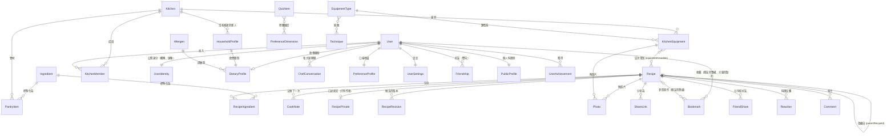

# 05 資料模型

> 以 TypeScript 型別描述，對應後端 Postgres 的資料表。這份是**設計**：欄位的意義與理由；資料表清單、主鍵外鍵、權限表、資料庫函式等**實作細節**見 [16 後端實作規格](16-backend-implementation.md)。
>
> **命名**：這份文件用 camelCase 方便閱讀；資料庫與資料存取層一律用 snake_case（`cookedOn` → `cooked_on`），TypeScript 型別由 Supabase 從資料庫自動產生。

## 共同欄位

資料分兩種歸屬（見 [04 ADR-17](04-architecture.md#adr-17廚房是食材與廚具的歸屬單位m0-起)）：

- **個人資料**（食譜、收藏、和大廚的對話、設定等）：用 `UserEntity`，屬於某位使用者。
- **廚房資料**（食材、廚具）：用 `KitchenEntity`，屬於某個廚房，同廚房的成員共用。

```ts
// ── 時間型別──
type Instant = string;     // 時間點，ISO 8601 含時區，例 '2026-11-18T18:30:00+08:00'
type LocalDate = string;   // 某一天，'YYYY-MM-DD'，一律以「廚房的時區」解讀（到期日、購買日等）

// ── 語系與地區（見 15）──
type LanguageTag = string; // 任何語言代碼（BCP 47），例 'zh-TW'、'zh-CN'、'ja'、'en-US'；字典可以有任何語言的名稱與別名
type UiLocale = 'zh-TW';   // App 介面實際支援的語言，是 LanguageTag 的一部分。目前只有繁中；加介面語言時擴充，例 'zh-TW' | 'ja'
type RegionCode = string;  // 地區代碼（ISO 3166-1 alpha-2），例 'TW'、'US'、'JP'；和語系分開
type LocalizedText = { 'zh-TW': string } & Record<LanguageTag, string>;     // 字典的顯示文字：繁中必填，其他語言選填；顯示時用使用者的介面語言，缺的退回繁中
type LocalizedTerms = { 'zh-TW': string[] } & Record<LanguageTag, string[]>; // 別名與搜尋詞，可以放介面還不支援的語言（例：日文的「長ねぎ」、中國用語的「西紅柿」）；搜尋時比對所有語言

type Visibility = 'private' | 'household' | 'friends';   // 只有自己／家人（和作者同屬任一廚房的人）／家人＋好友

interface UserEntity {
  id: string;            // UUID v7，客戶端產生（樂觀更新時不用等伺服器）
  userId: string;
  createdAt: Instant;
  updatedAt: Instant;    // 顯示用（「3 小時前修改」）
  deletedAt?: Instant;   // 軟刪除，方便復原誤刪
  createdVia?: 'app' | 'external_ai';   // 經由外部 AI 連接器建立的，在 App 中標示「來自你的 AI」（M4）
}

interface KitchenEntity {
  id: string;
  kitchenId: string;     // 屬於哪個廚房
  createdBy: string;     // 哪位成員建立
  updatedBy: string;     // 最後修改的成員
  createdAt: Instant;
  updatedAt: Instant;
  deletedAt?: Instant;
  createdVia?: 'app' | 'external_ai';
}
```

- **時間點**（`Instant`）用在「什麼時候發生」：料理時間、建立與修改時間、事件時間。
- **日期**（`LocalDate`）用在「哪一天」：食材的加入日、使用者設定的到期日、記錄食譜的日期。到期提醒、「今天」都以廚房的時區判斷，所以住美國的家人和你看到的到期日一致。

### Kitchen — 廚房

```ts
interface Kitchen {
  id: string;
  name: string;                       // 「我家」「爸媽家」
  timezone: string;                   // IANA 時區，例 'Asia/Taipei'、'America/Los_Angeles'；建立時取手機時區，可修改。到期日、「今天」、每日提醒、深夜判斷一律以它為準
  region: RegionCode;                 // 地區代碼，例 'TW'、'US'；對應 RegionProfile；決定季節分法、當季食材與節日料理。該地區還沒有當季資料時，只用依南北半球的四季
  createdBy: string;
  updatedBy: string;
  // 不在廚房上放長期共用的連結：還沒有帳號的家人用 Invite（type: 'kitchen'，綁定 email、一次性）；已經有帳號、人在旁邊的用 KitchenJoinCode（10 分鐘、一次性）
  createdAt: Instant;
  updatedAt: Instant;
  deletedAt?: Instant;
}

interface KitchenMember {
  id: string;                         // 每一段成員關係一筆；離開後再加入會新增一筆，保留歷史
  kitchenId: string;
  userId: string;
  role: 'admin' | 'member';           // 管理者可以有多位；權限見 02「角色與權限」
  shareDietaryInfo: boolean;          // 讓同廚房的人讀取我的飲食限制檔案（加入時詢問，建議開啟）
  expiryAlerts: boolean;              // 這個廚房的到期提醒，預設 true
  defaultDinersAll: boolean;          // 在這個廚房找點子時，預設「全家一起吃」；預設 false＝只有自己
  joinedAt: Instant;
  leftAt?: Instant;                   // 離開或被移除；他加的食材顯示為「前成員」加的
  updatedAt: Instant;
}

interface KitchenJoinCode {           // 讓家人加入的臨時代碼（M2）：成員在「廚房 → 成員 → 讓家人加入」產生，給旁邊已經有帳號的家人輸入
  id: string;
  kitchenId: string;
  createdBy: string;                  // 產生代碼的成員
  codeHash: string;                   // 6 碼代碼的雜湊，不存原始值
  expiresAt: Instant;                 // 10 分鐘後
  usedBy?: string;                    // 用掉的人；只能用一次
  usedAt?: Instant;
  createdAt: Instant;
}

interface HouseholdProfile extends KitchenEntity {   // 家人檔案：沒有帳號的家人（小孩、長輩）（M2）
  name: string;                       // 過敏原與飲食限制放在 DietaryProfile
}
```

- 同一位使用者在同一個廚房，同時間只會有一筆 `leftAt` 為空的成員紀錄（資料庫唯一性條件）。
- 家人檔案的人之後有了自己的帳號時，**不自動轉換**：他用新帳號重新設定過敏原與飲食限制，管理者再手動刪除原本的家人檔案；舊食譜上「一起吃的人」仍指向原本的家人檔案。

### DietaryProfile — 飲食限制檔案

過敏原、不吃的食物、飲食限制獨立成一份，才能單獨分享給家人或好友，而不露出其他私人設定。

```ts
interface DietaryProfile {
  id: string;
  userId?: string;                    // 屬於使用者，或
  householdProfileId?: string;        // 屬於家人檔案（兩者恰好一個有值）
  allergenIds: string[];              // 對應過敏原字典，硬性限制
  dislikeIngredientIds: string[];     // 對應食材字典，盡量避開
  dietaryRestrictionIds: string[];    // 對應飲食限制字典：飲食原則（素食、不吃牛…）、宗教與文化規則（清真、五辛素、印度教不吃牛…）
  recurringRules?: { restrictionId: string; schedule: 'lunar_1_15' | 'weekly' | 'ramadan'; weekday?: number }[];   // 週期性規則，例：初一十五吃素；先維持這三種，有人需要別的再加
  noCookingAlcohol: boolean;          // 不用料理酒（米酒、紹興、味醂）
  updatedAt: Instant;
}
```

- 誰能讀：本人；同廚房、且本人 `KitchenMember.shareDietaryInfo` 為真的成員；本人開啟「讓好友知道我的過敏原」時的好友（M4）。家人檔案的飲食限制，同廚房的成員都能讀。

### UserIdentity — 公開身分

暱稱與頭像只存在這裡。家人、好友、通知、動態要顯示名字時都讀這一份。

```ts
interface UserIdentity {
  userId: string;
  displayName: string;                // 暱稱；M0 在新手設定時填（可跳過，預設「我」）
  updatedAt: Instant;
}
```

- 頭像是一張 `Photo`（`ownerType: 'avatar'`），不在這裡另存照片 ID。
- 誰能讀：本人、同廚房的成員（含前成員的歷史紀錄顯示）、好友。

- M0 第一次使用時自動建立一個廚房與一筆 `admin` 成員。
- 使用者目前所在的廚房記在 `UserSettings.currentKitchenId`。
- 一致性規則（至少一位管理者、每人 1–5 個廚房、每廚房最多 10 位成員）見 [04 ADR-17](04-architecture.md#adr-17廚房是食材與廚具的歸屬單位m0-起)。

## 關聯圖



## 實體定義

### Ingredient — 標準食材字典（全站共用，唯讀）

```ts
interface Ingredient {
  id: string;                 // 例：'soy-sauce'
  name: LocalizedText;        // { 'zh-TW': '醬油' }
  aliases: LocalizedTerms;    // { 'zh-TW': ['生抽', '薄鹽醬油', '壺底油'] }
  family: string;             // 'soy-sauce-family'，統計與推薦時歸類用；不用來判斷能不能吃
  traits: IngredientTrait[];  // 飲食特性，可以多個，飲食限制依它排除；例：魚露 ['animal', 'seafood']、味醂 ['alcohol']、大蒜 ['allium']
  category: IngredientCategory; // vegetable | meat | seafood | egg-dairy | tofu-bean | grain | seasoning | sauce | spice | ...
  defaultStorage: StorageZone;
  isPerishable: boolean;             // 是否為生鮮；決定「最近買的」標記
  recentDays?: number;               // 生鮮加入後維持「最近買的」幾天（例：葉菜 5、根莖類 14），之後自動淡化
  densityGPerMl?: number;            // 容量換算重量用（1 杯麵粉 ≈ ? 克），P2
  seasonMonths?: Partial<Record<RegionCode, number[]>>;   // 依地區的當季月份，例 { TW: [11,12,1,2], US: [10,11] }；先做台灣與美國
  flavorTags?: FlavorTag[];          // salty | sweet | sour | spicy | umami | aromatic | bitter
  allergenIds?: string[];            // 對應過敏原字典
  deprecated?: boolean;              // 淘汰的項目（ID 不刪除）；所有字典都有這兩個欄位，見〈完整性與穩定性規則〉
  replacedBy?: string;
}

type StorageZone = 'seasoning' | 'fridge' | 'freezer' | 'pantry';

type IngredientCategory =
  | 'vegetable' | 'fruit' | 'mushroom' | 'meat' | 'poultry' | 'seafood' | 'egg' | 'dairy' | 'tofu-bean'
  | 'grain' | 'noodle' | 'seasoning' | 'sauce' | 'spice' | 'herb' | 'oil' | 'nut-seed' | 'dried-goods' | 'processed' | 'beverage' | 'other';

type FlavorTag = 'salty' | 'sweet' | 'sour' | 'spicy' | 'umami' | 'aromatic' | 'bitter';

type IngredientTrait =         // 飲食特性；新增特性只要擴充這份清單與字典資料
  | 'animal'                   // 任何動物來源（含魚露、柴魚、明膠、豬油）
  | 'meat' | 'pork' | 'beef' | 'lamb' | 'poultry'
  | 'seafood' | 'shellfish'
  | 'egg' | 'dairy' | 'honey'
  | 'alcohol'                  // 含酒精（米酒、紹興、味醂、料理酒）
  | 'allium';                  // 五辛：蔥、蒜、韭、洋蔥、蕗蕎
```

### Allergen、DietaryRestriction — 過敏原與飲食限制字典（全站共用，唯讀）

過敏原與飲食限制改成字典資料，不寫死在程式裡。新增一種（例如其他國家常見的過敏原、宗教飲食）只要更新字典。

過敏原有上下層：使用者選「甲殼類（蝦蟹）」時，標了「蝦」或「蟹」的食材都會被排除；食材一律標最細的那一層，檢查時往上層比對。

```ts
interface Allergen {
  id: string;                         // 例：'peanut'、'shellfish'、'sesame'
  name: LocalizedText;                // { 'zh-TW': '花生' }
  aliases: LocalizedTerms;
  parentId?: string;                  // 上層：'shrimp'、'crab' → 'crustacean'；'walnut'、'almond' → 'tree-nut'。選上層就包含底下所有的；食材標最細的那層
  regions?: RegionCode[];             // 哪些地區的標示規範列為主要過敏原；新手設定時依廚房地區排在前面
  displayLevelByRegion?: Partial<Record<RegionCode, 'self' | 'parent'>>;   // 這個地區的新手設定顯示這一層還是上層（例：台灣顯示「蝦蟹」、日本分開顯示「蝦」「蟹」）
}

interface DietaryRestriction {
  id: string;                         // 例：'vegetarian'、'vegan'、'pescatarian'、'no-beef'、'no-pork'
  name: LocalizedText;                // { 'zh-TW': '不吃牛' }
  excludesTraits: IngredientTrait[];   // 排除有這些特性的食材；例：蛋奶素 ['meat', 'seafood']、五辛素 ['animal', 'allium']、清真 ['pork', 'alcohol']
  excludesIngredientIds?: string[];    // 特性涵蓋不到的個別例外
}
```

### 單位（共用型別）

規則見 [02 單位與換算](02-features.md#i-單位與換算共通設定)。所有數值都存**使用者輸入或來源上的原始值與單位**，顯示時才換算。

```ts
type UnitCode =
  // 重量
  | 'g' | 'kg' | 'oz' | 'lb' | 'tw_jin' | 'tw_liang' | 'cn_jin'
  // 容量
  | 'ml' | 'l' | 'tsp' | 'tbsp' | 'cup' | 'cup_jp' | 'rice_cup' | 'fl_oz' | 'qt'
  // 尺寸
  | 'cm' | 'inch'
  // 不換算
  | 'piece' | 'pack' | 'clove' | 'slice' | 'serving' | 'pinch' | 'to_taste';
  // 個、包、瓣、片、人份、一小撮、適量

interface Quantity { amount: number; unit: UnitCode; }
interface Temperature { value: number; unit: 'C' | 'F'; }
```

- `cup` 代表美制杯與台灣量杯（237／240 毫升，視為相同）；`cup_jp`（200 毫升）與 `rice_cup`（約 180 毫升）分開記錄。
- `tw_jin`（600 克）與 `cn_jin`（500 克）分開記錄。

### RegionProfile — 地區設定字典（全站共用，唯讀）

一個地區的季節、節日與常見食材集中在這裡，隨 App 版本發佈。新增地區就是新增一筆 `RegionProfile` 並補上相關字典（步驟見 [15 地區與語系](15-regions-i18n.md)）。沒有 `RegionProfile` 的地區只用依南北半球的四季，不推薦當季食材與節日料理。

```ts
interface RegionProfile {
  code: RegionCode;                   // 'TW'
  name: LocalizedText;                // { 'zh-TW': '台灣' }
  hemisphere: 'north' | 'south';
  defaultTimezone: string;            // 'Asia/Taipei'；建立廚房時手機沒給時區才用
  defaultLocale: UiLocale;            // 這個地區的新使用者預設介面語言（目前一律 'zh-TW'）
  defaultUnits: { temperature: 'C' | 'F'; measure: 'metric' | 'us' };
  seasons: { key: 'spring' | 'summer' | 'autumn' | 'winter'; months: number[] }[];   // 例：台灣 3–5 春
  usesSolarTerms: boolean;            // 是否使用 24 節氣（台灣之後開啟）
  holidays: Holiday[];
  commonPantryIngredientIds: string[];   // 快速盤點的常見食材（約 40 樣）
  dataStatus: 'full' | 'partial';     // 資料完整度，partial 時只用有的部分
}

interface Holiday {
  id: string;                         // 'dongzhi'、'thanksgiving'、'setsubun'
  name: LocalizedText;                // { 'zh-TW': '冬至' }
  date:
    | { type: 'fixed'; month: number; day: number }       // 聖誕節
    | { type: 'lunar'; month: number; day: number }       // 端午、中秋（依農曆換算）
    | { type: 'solar_term'; term: string }                // 冬至
    | { type: 'rule'; rule: string };                     // 感恩節：'nth-weekday:11:4:4'（11 月第 4 個星期四）
  dishIdeas: string[];                // 對應 BaseDish 的 ID（湯圓、粽子、火雞）
  leadDays: number;                   // 節日前幾天開始出現在季節靈感
}
```

### BaseDish — 基礎菜色庫（全站共用，唯讀）

點子的候選來源之一（[03 第一階段](03-ai-design.md#第一階段候選評分l1程式計算)），約 300–500 道家常菜骨架。

```ts
interface BaseDish {
  id: string;                         // 'mapo-tofu'
  name: LocalizedText;                // { 'zh-TW': '麻婆豆腐' }
  regions: RegionCode[];              // 哪些地區的家常菜；空的代表各地都適合推薦
  cuisineKeys: string[];              // 對應 PreferenceDimension，例 'cuisine.china.sichuan'
  ingredientIds: string[];            // 主要食材
  techniques: TechniqueId[];
  equipmentTypeIds: string[];
  difficulty: Omit<Difficulty, 'source' | 'estimatedFrom'>;
}
```

### Technique — 手法字典（全站共用，唯讀）

```ts
type TechniqueId = string;    // 例：'pan-fry'、'steam'、'sous-vide'、'blend'、'freeze'

interface Technique {
  id: TechniqueId;
  name: LocalizedText;        // { 'zh-TW': '舒肥' }
  group: 'heat' | 'no-heat' | 'time-temp';
  safetyRuleId?: string;      // 需要安全檢查的手法（舒肥、油炸、壓力烹調）對應的規則
}
```

### EquipmentType — 廚具字典（全站共用，唯讀；內容見 [07](07-equipment-techniques.md)）

```ts
interface EquipmentType {
  id: string;                 // 例：'rice-cooker'
  name: LocalizedText;        // { 'zh-TW': '電鍋' }
  aliases: LocalizedTerms;    // { 'zh-TW': ['大同電鍋'] }
  regions?: RegionCode[];     // 只在某些地區常見的廚具（例：日本的烤魚爐）；空的代表各地都有
  category: 'heat-source' | 'cookware' | 'appliance' | 'blending' | 'knife-prep' | 'special' | 'measuring' | 'baking';
  techniques: TechniqueId[];  // 能做的手法
  optionalTechniques?: TechniqueId[];   // 部分機型才有（例：烤箱的熱風 → 近似氣炸）；編輯頁只問「有熱風功能嗎？」，不讓使用者勾選手法
  requiresHeatSource: boolean;// 鍋具類：要有可用的爐具才算做得到
  isHeatSource: boolean;      // 瓦斯爐、電磁爐、電陶爐、卡式爐
  assists?: TechniqueId[];    // 量測工具：不做手法，但讓手法更準更安全（溫度計 → 炸、烤、舒肥替代做法）
  onboarding: {               // 新手盤點：預設勾選／出現／不出現；依地區覆寫（例：電鍋在 TW 預設勾選、在 US 只出現）
    default: OnboardingMode;
    byRegion?: Partial<Record<RegionCode, OnboardingMode>>;
  };
  dishwasherSafe: 'yes' | 'partial' | 'no' | 'n/a';   // 能否進洗碗機；只在廚具卡上顯示清洗方式，不計算清洗負擔
  iconKey: string;            // 新手盤點圖示牆、裝備圖鑑剪影
}

type OnboardingMode = 'default-on' | 'show' | 'hidden';

interface TechniqueSubstitute {        // 「沒有 X 器具時怎麼做」
  technique: TechniqueId;
  missingEquipmentTypeId: string;
  alternatives: { equipmentTypeIds: string[]; note: LocalizedText; limitations?: LocalizedText }[];
}
```

### KitchenEquipment — 廚房的廚具

```ts
interface KitchenEquipment extends KitchenEntity {   // 屬於廚房，同廚房的成員共用
  equipmentTypeId?: string;   // 對應到字典；自訂器具可為空，自訂的不參與推薦
  rawName: string;            // 使用者取的名字（「阿嬤的鐵鍋」）
  brand?: string;
  model?: string;
  capacity?: Quantity;        // 10 人份、5 公升、6 吋；資料庫存成 capacity_value＋capacity_unit，要一起填
  enabledOptionalTechniques?: TechniqueId[];   // 類型有選配功能時，使用者回答「有」的（例：烤箱有熱風 → air-fry）；其他手法不能手動改
  dishwasherSafe?: boolean;   // 使用者修正自己這件能否進洗碗機；字典標 'partial' 又沒修正時視為要手洗
  acquiredAt?: LocalDate;     // 照片是 Photo（ownerType: 'equipment'），不在這裡存照片 ID
  description?: string;       // 自由填寫的描述（「阿嬤從嫁妝帶來的鍋」）；所有廚具都視為可以使用，不記狀態
  // 不記使用次數與最後使用日：不讓使用者有使用次數的壓力
}
```

### PantryItem — 廚房的食材

```ts
interface PantryItem extends KitchenEntity {   // 屬於廚房，同廚房的成員共用；只記「有沒有」，不記數量
  ingredientId?: string;      // 對應到字典；對應不到時為空
  rawName: string;            // 使用者原本輸入的名稱，永遠保留
  zone: StorageZone;
  addedOn: LocalDate;         // 加入的日期；生鮮依字典的 recentDays 決定「最近買的」
  wantToUseSoon: boolean;     // 🔥 想先用掉（使用者手動）
  expiresAt?: LocalDate;      // 選填：使用者自己設定的期限，以廚房時區解讀；有值才會提醒
  dateType?: 'use-by' | 'best-before';   // 有效日期／賞味期限；不做系統估算
  expirySetOn?: LocalDate;    // 設定期限的那天，計算提醒比例用；由資料庫在期限變動時填
  status: 'active' | 'removed';   // removed 不區分用掉或丟掉、不問原因
  removedAt?: Instant;        // 「最近移除」清單用，可復原（復原就改回 active）
  removedBy?: string;         // 哪位成員移除的
  alertNotified?: { tier: 'soon' | 'expiring' | 'expired' | 'past_best'; on: LocalDate };   // 到期提醒已經通知到哪一級（🟡🟠🔴⚪）；存在廚房層級，一人處理（移除或改日期）後所有成員的提醒一起消失；改日期時清空
  stillThereAskedOn?: LocalDate;  // 上次問「還在嗎？」的日期，避免重複問；使用者回答「還在」也記在這裡
  note?: string;
}
```

- 誰加的看 `createdBy`、誰移除的看 `removedBy`。兩位家人同時操作同一樣食材時，後送到的為準（只會是「有」或「沒有」，影響很小）。
- 不記數量、用量、丟棄原因，也沒有購物清單與廚具使用事件。
- 「最近買的」不存：由 `addedOn` 與字典的 `recentDays` 在查詢時判斷。


### Recipe — 食譜

自己寫的內容只有這一種：**記錄一道菜就是新增一篇食譜**，像發一篇貼文。照片、心得、「值得記住的原因」與做法（食材、步驟）放在同一篇；做法選填。

```ts
interface Recipe extends UserEntity {
  lang: LanguageTag;          // 內容的語言（預設取作者的介面語言）；內容不翻譯，給 AI、字型與之後的顯示判斷用
  status: 'draft' | 'published';   // draft：編輯頁自動存的草稿，只有自己看得到（不論 visibility），不會提醒補完
  publishedAt?: Instant;      // 第一次發佈的時間；朋友動態依它排序（草稿可能放很久才發佈，不能用 createdAt）
  title?: string;             // 照片或標題至少一項；只有照片時顯示記錄日期
  story?: string;             // 心得與故事（「阿嬤的味道」）；封面是 isCover 的那張 Photo
  highlights: Highlight[];    // 為什麼值得記住，可多選、可空
  rating?: 'loved' | 'ok' | 'flop';   // 😋 🙂 😅
  cookedAt?: Instant;         // 記錄的那次料理的時間點（預設取第一張照片的拍攝時間）；匯入的食譜沒有
  cookedOn?: LocalDate;       // 衍生：依當時廚房時區算出的日期，建立後不變；時間軸、回顧用
  kitchenId?: string;         // 在哪個廚房做的
  // 一起吃的人只有作者看得到，放在 RecipePrivate.diners；招待朋友用 highlights 的 'hosted_friends'
  cookNotes: CookNote[];      // 又做了一次（P1）；不計次數、不顯示做過幾次
  cookedDates: LocalDate[];   // 衍生：cookedOn 加上每一次「又做了一次」的日期；時間軸、季節回顧、一年前的今天都看它
  // 做法（全部選填）
  servings?: number;          // 幾人份；記錄時預設 UserSettings.householdSize，食譜頁切換人數時依它換算食材數量
  difficulty?: Difficulty;    // 難易度；不存烹煮分鐘數
  ingredients: RecipeIngredient[];   // 內嵌陣列（Postgres 用 jsonb），不另開表；可以是空的
  steps: RecipeStep[];               // 可以是空的
  tips?: string;              // 料理筆記：心得以外的提醒與防雷（「培根很鹹，下次少放鹽」）
  // 「用說的」的口述原文不放在這裡，放在只有作者能讀的 RecipePrivate（RLS 是以列為單位，同一列的欄位朋友都讀得到）
  cuisineKeys?: string[];     // 菜系，存口味維度的代碼，例 ['cuisine.taiwan']；顯示時從字典取名稱（不存中文顯示文字）
  dishTypeKeys?: string[];    // 類型（主菜、湯、甜點…），存口味維度「料理型態」的代碼，例 ['form.soup']
  tags: string[];             // 自訂標籤（使用者自己的文字）
  equipmentTypeIds?: string[];  // 衍生：由步驟彙整，例：['rice-cooker']
  techniques?: TechniqueId[];   // 衍生：由步驟彙整
  ingredientIds: string[];      // 衍生：這道菜用了哪些食材，來源優先序見「衍生欄位」
  equipmentUsedIds?: string[];  // 這次用到的廚具（選填），裝備卡的「拿手菜」用；不計次數
  // AI 補的標籤，使用者可修正
  aiTags?: {
    cuisineKeys?: string[];
    mainIngredientIds?: string[];
    techniques?: TechniqueId[];   // 煎、炒、蒸、舒肥…
    equipmentTypeIds?: string[];  // 可能用到的廚具
    flavors?: FlavorTag[];
    confirmedByUser: boolean;
  };
  source?: {
    type: 'original' | 'url' | 'friend' | 'share_link' | 'ai' | 'external_ai';
    shareLinkId?: string;       // type 為 share_link 時，從哪一個分享連結複製的
    url?: string;
    fromUserId?: string;        // 改編自哪位朋友
    fromUserName?: string;      // 當時的名字快照；朋友改名後仍顯示當時的名字
  };
  safetyWarnings?: string[];  // 後端檢查未通過的項目（過敏原、舒肥組合不在表內等），App 中醒目顯示
  parentRecipeId?: string;    // 改編自哪一份（自己的或朋友的）；「記錄我做的版本」時填入
  version: number;            // 做法每次修改加一；舊版存在 RecipeRevision
  visibility: Visibility;     // 預設 'friends'；從網址匯入、外部 AI 建立的預設 'private'；草稿一律只有自己；household 進入家庭食譜本
  // 季節不存：查詢時由 cookedOn 與廚房地區計算
}

interface Difficulty {        // 難易度，算法見 03
  ingredients: 1 | 2 | 3 | 4 | 5;   // 食材
  equipment: 1 | 2 | 3 | 4 | 5;     // 廚具
  time: 1 | 2 | 3 | 4 | 5;          // 時間（相對，不是分鐘）
  technique: 1 | 2 | 3 | 4 | 5;     // 技巧
  failureRisk: 1 | 2 | 3 | 4 | 5;   // 失敗風險（成功率的反面）
  overall: number;                   // 衍生：1–10，由五個面向算出
  source: 'author' | 'ai';           // 作者點選或調整過，還是 AI 估的
  estimatedFrom?: 'recipe' | 'text';    // AI 依做法估，或只從標題與心得粗估；不看照片
}

interface CookNote {          // 又做了一次：日期＋一句話＋照片（Photo 的 cookNoteId）
  id: string;
  cookedOn: LocalDate;
  text?: string;              // 「這次少放糖，更好吃」
  rating?: 'loved' | 'ok' | 'flop';
}

type Highlight = 'first_time' | 'hosted_friends' | 'improved' | 'family_favorite' | 'festive' | 'make_again' | 'funny_flop';
// 第一次做、招待朋友、改良成功、家人最愛、節日料理、值得再做、翻車也好笑

type Diner =                  // 一起吃的人：一個清單、多種類型
  | { type: 'member'; userId: string }                     // 同廚房的成員（M2），合併其飲食限制
  | { type: 'household'; householdProfileId: string }      // 家人檔案（M2），合併其飲食限制
  | { type: 'friend'; userId: string }                     // 一起吃的好友：只記在作者這裡，不通知對方、對方看不到
  | { type: 'text'; name: string };                        // 自由文字（M0）

type RecipeSnapshot = Pick<Recipe, 'title' | 'story' | 'highlights' | 'cookedOn' | 'servings' | 'difficulty' | 'ingredients' | 'steps' | 'tips' | 'cuisineKeys' | 'tags' | 'equipmentTypeIds' | 'techniques'> & {
  photoPaths: string[];       // 分享當下的公開照片副本：封面加最多 3 張，1080px；撤銷、管理員下架、食譜真正刪除時一起刪掉
  authorName: string;         // 分享當下的作者名字
};

interface RecipeIngredient {
  id: string;                 // 穩定 ID，調整順序也不會對錯
  rawText: string;            // 「醬油 2 大匙」原文
  ingredientId?: string;      // 解析後的標準食材
  amount?: number;
  amountMax?: number;         // 範圍的上限，例「蒜 2–3 瓣」
  unit?: UnitCode;            // 原始單位，顯示時依偏好換算
  optional: boolean;
  group?: string;             // 「醃料」「醬汁」分組
  declaredAllergenIds?: string[];   // 對不到字典時，作者可以自己勾「含哪些過敏原」；勾過（可以是空的）就不再提醒成分不明
  declaredTraits?: IngredientTrait[];
}

interface RecipeStep {
  id: string;                 // 穩定 ID：照片、烹飪模式進度、欄位合併都指向它
  order: number;
  text: string;               // 文字中的溫度、份量轉成標記，例：「烤箱預熱 {{temp:180:C}}」，顯示時依偏好換算
  timerSeconds?: number;      // 烹飪模式的計時器；步驟照片是 Photo（ownerType: 'recipe_step'）
  techniques?: TechniqueId[]; // 這一步的手法
  equipmentTypeIds?: string[];// 這一步用的器具（烹飪模式提示「換氣炸鍋上場」）
  targetTemp?: Temperature;   // 舒肥、油炸、烤箱等需要溫度的步驟；保留原始單位，安全檢查時換算
}
```

### RecipePrivate、RecipeRevision — 食譜的私人資料與版本

```ts
interface RecipePrivate {             // 只有作者能讀寫（另開一張表，因為 RLS 以列為單位）
  recipeId: string;                   // 一對一
  userId: string;
  dictation?: { text: string; lang: LanguageTag; at: Instant };   // 「用說的」口述原文，重新整理、用說的改食譜時用
  diners?: Diner[];                   // 一起吃的人；只有作者看得到，用來合併過敏原、提醒「上次請小美吃過這道了」
  updatedAt: Instant;
}

interface RecipeRevision {            // 做法的每一版；「用說的改食譜」與食譜版本（P1）都用它
  id: string;
  recipeId: string;
  version: number;                    // 對應 Recipe.version；(recipeId, version) 唯一
  snapshot: Pick<Recipe, 'title' | 'servings' | 'difficulty' | 'ingredients' | 'steps' | 'tips'>;
  changedBy: 'author' | 'ai_refine' | 'ai_dictation';   // 作者手動改、用說的改、口述整理
  createdAt: Instant;
}
```

- 只在「做法」（食材、步驟、料理筆記、份量、難易度）改變時新增一版；改心得、照片、標籤不算新版本。
- 版本只有作者能看；朋友永遠看到最新版。

### Bookmark — 收藏

朋友的食譜和大廚的點子都收在這裡。不分「想做、做過、只是喜歡」；做過的由 `cookedRecipeId` 自動判斷。

```ts
interface Bookmark extends UserEntity {
  kind: 'friend_recipe' | 'chef_idea';
  recipeId?: string;          // friend_recipe：參照原作，不複製；原作改回只有自己或刪除時顯示「這道菜已收起來了」
  ownerId?: string;           // friend_recipe 的作者（刻意的重複，見衍生欄位）
  titleSnapshot?: string;     // friend_recipe：收藏當下的菜名；原作看不到時只顯示這個與「這道菜已收起來了」，不保留做法（尊重作者）
  idea?: {                    // chef_idea：點子當下的快照
    title: string;
    why?: string;
    recipeDraft?: { ingredients: RecipeIngredient[]; steps: RecipeStep[] };   // 收藏前已經展開過就一起存；沒有的話，第一次打開收藏時才產生並存進來
    suggestionId?: string;
  };
  ideaIngredientIds?: string[];   // 衍生（只有 chef_idea）：點子的主要食材；friend_recipe 直接讀原作的 ingredientIds，不另存，原作更新也不用改別人的資料
  cookedRecipeId?: string;    // 從這個收藏記錄了自己的版本後，連到那一篇；有值就是「做過了」
  note?: string;              // 自己的備註（選填）
}
```

### ChefConversation — 和大廚聊聊

```ts
interface ChefConversation extends UserEntity {   // 只有本人能讀；管理後台與產品數據都不讀內容；保留 30 天
  kitchenId: string;          // 對話時所在的廚房（決定用哪個廚房的食材與廚具）
  lang: UiLocale;             // 對話語言，大廚用這個語言回答
  diners: Diner[];            // 這段對話「這餐誰一起吃」；預設只有自己（空的），說「今晚全家吃」或點選後才加人，之後的回合都沿用
  summary?: string;           // 大廚整理的條件摘要，給之後的回合用（例：「想吃熱的；有筍子、半顆高麗菜」）
  turnCount: number;          // 最多 20 輪（用量保護）
  messages: ChefMessage[];    // 內嵌陣列（jsonb）；只由後端的 ai 函式在同一個動作中附加「使用者的話＋大廚的回應」，手機不直接改這個欄位，兩台裝置同時送也不會互相蓋掉
  mentionedIngredients: { text: string; ingredientId?: string }[];   // 對話中說的、不在食材裡的；只用在這段對話，不寫進食材
  lastMessageAt: Instant;
}

interface ChefMessage {
  id: string;
  role: 'user' | 'chef';
  text: string;               // 使用者每則上限 500 字
  suggestionId?: string;      // 大廚這一則附的點子（AiSuggestionCache）
  at: Instant;
}
```

### PreferenceProfile — 口味地圖

飲食偏好模型的完整設計見 [13 口味地圖](13-taste-preferences.md)。硬限制（過敏、宗教與文化、飲食原則、週期性規則）放在 `DietaryProfile`；這裡只放喜好與情境。

```ts
interface PreferenceProfile extends UserEntity {   // 只有本人能讀
  dims: Record<string, {              // key 對應 PreferenceDimension，例 'cuisine.southeast_asia.thai'、'taste.sour'
    affinity: number;                 // −1 很不喜歡 ～ +1 很喜歡
    confidence: number;               // 0 ～ 1，把握程度；不足門檻的維度不參與點子計分、不顯示在口味名片
    source: 'user_set' | 'explored' | 'learned';   // 你設定的／探索回答／行為學習；user_set 不會被自動學習覆蓋
    updatedAt: Instant;
  }>;
  context: {
    cookingFrequency?: 'occasional' | 'weekly' | 'daily';   // 只用來調整點子難度，不顯示給任何人
    timePreference?: 'quick' | 'normal' | 'relaxed';   // 願意花的時間：越快越好／普通／花時間也沒關係（不用分鐘）
    cooksFor?: ('self' | 'partner' | 'family' | 'guests')[];
    adventure: number;                // 0–1，挑戰意願，「新挑戰」的冒險程度，預設 0.2（只存這裡）
    goals: string[];                  // 想學的方向
    festiveDishes: boolean;           // 想在節日做應景菜
  };
  answeredItemIds: string[];          // 已回答的題目，避免重複問
  lastExploredAt?: Instant;
  cardTitle?: string;                 // 口味名片的名稱，例「香辣台式派」（由程式產生）
}

interface PreferenceDimension {       // 字典，隨版本發佈
  key: string;                        // 'cuisine.southeast_asia.thai'
  group: 'cuisine' | 'taste' | 'spice_type' | 'seasoning' | 'texture' | 'form' | 'protein' | 'ingredient' | 'richness';
  name: LocalizedText;                // { 'zh-TW': '泰式' }
  parentKey?: string;                 // 樹狀：'cuisine.southeast_asia'
  impact: number;                     // 對點子的影響力，挑題目時用
}

interface QuizItem {                  // 題庫，隨版本發佈
  id: string;
  type: 'dish_card' | 'this_or_that' | 'spectrum' | 'quick_fire' | 'constraint' | 'context';
  title: LocalizedText;
  description?: LocalizedText;        // 描述菜卡的感官描述，30 字以內（每個語系各自寫，不是直譯）
  regions: RegionCode[];              // 哪些地區的使用者會看到
  mapping: Record<string, number>;    // 回答時各維度的加減
  excludedBy?: string[];              // 有這些硬限制的人不會看到（例：蝦蟹過敏）
  followUps?: string[];
}
```


### Photo — 照片

```ts
interface Photo extends UserEntity {   // 照片只記錄自己屬於誰；上層資料不存照片 ID。userId 是上傳的人；廚具照片（equipment）屬於廚房：同廚房成員都能管理，上傳的人刪除帳號時保留
  ownerType: 'recipe' | 'recipe_step' | 'equipment' | 'avatar' | 'status';
  ownerId: string;            // 對應的食譜、步驟、廚具、使用者、近況
  cookNoteId?: string;        // ownerType 為 recipe 時，屬於哪一次「又做了一次」
  recipeId?: string;          // ownerType 為 recipe_step 時，所屬的食譜（權限判斷用）
  kitchenId?: string;         // ownerType 為 equipment 時，所屬的廚房（權限與擁有者都依它）
  sortOrder: number;          // 同一個擁有者的照片順序
  isCover: boolean;           // 食譜的封面
  storagePath: string;        // Storage 路徑（原圖，已壓縮）；上傳完成才建立這筆資料
  feedPath: string;           // 動態圖：長邊 1080px，動態與滿版顯示用
  thumbPath: string;          // 縮圖：長邊 400px，格子與清單用
  width: number;
  height: number;
  takenAt?: Instant;
}
```

### ShareLink — 分享

```ts
interface ShareLink extends UserEntity {
  recipeId: string;
  token: string;              // 公開網址用，不可猜測
  snapshot: RecipeSnapshot;   // 分享當下的食譜快照
  revokedAt?: string;         // 使用者自己撤銷
  takenDownAt?: string;       // 管理員下架
  ogImagePath?: string;       // LINE、FB 貼上時的預覽圖（public/{token}/og.webp），建立分享連結時產生
  viewCount: number;          // 只給管理後台看，不顯示給作者
  saveCount: number;          // 被收藏或複製的次數；同上，只在後台
}
```

### UserSettings — 使用者設定

```ts
interface UserSettings extends UserEntity {   // 只有本人能讀
  // 暱稱在 UserIdentity；過敏原與飲食限制在 DietaryProfile；廚具在 KitchenEquipment
  locale: UiLocale;           // 介面語言，預設 'zh-TW'；AI 的回應也用這個語言
  chefPersona: 'warm' | 'coach' | 'punny' | 'minimal';   // 大廚模式：溫暖陪伴（預設）／熱血教練／冷笑話／簡潔
  currentKitchenId: string;   // 目前所在的廚房；食材、廚具、點子都以它為準
  householdSize: number;      // 預設份量（平常煮幾人份）；選了「這餐誰一起吃」時改用實際人數
  units: {
    temperature: 'C' | 'F' | 'C+F' | 'F+C';     // 「+」表示兩種都顯示，後者在括號內；預設 'C'
    measure: 'metric' | 'us' | 'metric+us' | 'us+metric';   // 預設 'metric'
  };
  notifications: {
    expiringAlert: boolean;     // 設了期限的食材到期提醒，預設 true
    time: string;               // 到期提醒的時間，預設 '17:00'；每個廚房依它自己的時區，在那個時間各彙整一則
    weekendInspiration: boolean;   // 週末靈感（每週六早上一則，依目前所在廚房的時區；預設 false，使用者自己開啟）；內容用最新的首頁點子或模板，不另外呼叫 AI
  };
  sound: boolean;
  haptics: boolean;
  analyticsOptOut: boolean;   // 不參與使用統計，預設 false；開啟後不記錄產品事件、不出現微問卷
  onboarding: {               // 新手引導進度（見 12），中途離開可以接著做
    completedSteps: string[];   // 例 ['vision', 'account', 'kitchen', 'taste']
    completedAt?: Instant;
  };
  seenHints: string[];        // 看過的一次性說明，例 'first_publish_visibility'（第一次發佈時的「這篇會出現在好友的首頁」）
  lastSurveyShownAt?: Instant;   // 上次出現微問卷的時間；每人每月最多一題（見 14）
  social: {                   // M2 起
    defaultVisibility: Visibility;              // 記錄食譜的預設可見範圍，預設 'friends'
    showAllergensToFriends: boolean;            // 讓好友知道我的過敏原（P2），預設 false
    allowFriendSuggestions: boolean;            // 出現在「你可能認識」（P2），預設 false
    notify: Partial<Record<NotificationType, boolean>>;   // 每一類通知的開關，代碼和 Notification.type 相同；沒設定的預設開啟
  };
}
```

### 衍生／快取資料（由程式算出或後端產生）

```ts
interface TasteProfileSnapshot {      // 由後端用 core 套件計算（不信任手機上傳的結果）；只有本人與 AI 代理能讀，手機只讀來顯示
  userId: string;
  computedAt: Instant;
  stale: boolean;                     // 口味地圖、食譜、收藏、點子回饋、食材改變時由觸發器標記；下次呼叫 AI 或打開口味頁前重算
  period: 'last_30_days' | 'last_90_days' | 'all_time';
  data: TasteProfile;                 // 見 03 AI 設計
}

interface AiSuggestionCache {       // 存在後端，換手機也看得到上次的點子；只有本人能讀
  id: string;
  userId: string;
  kitchenId: string;                  // 產生時所在的廚房
  conversationId?: string;            // kind 為 chat 時，屬於哪段對話
  kind: 'home' | 'chat' | 'easter_egg' | 'observation';   // 首頁大廚點子、對話中的點子、靈感彩蛋、記錄時的一句話
  inputHash: string;                  // 食材狀態＋口味檔案＋介面語言的雜湊；沒變就不重算（換介面語言就重算）
  createdAt: string;
  expiresAt: string;
  payload: unknown;                   // 結構化輸出（點子卡片，不含做法）
  drafts?: Record<string, { ingredients: RecipeIngredient[]; steps: RecipeStep[]; tips?: string }>;   // 依點子 ID 存「展開做法」的結果；同一個點子不重算
  feedback: { ideaId: string; action: 'bookmarked' | 'recorded' | 'dismissed'; reason?: string; at: Instant }[];   // 每個點子各自的回饋（首頁一組最多 5 個點子），用來學口味
}

interface UserAchievement extends UserEntity {   // 解鎖類功能（徽章、護照）之後才做，初期不建這張表
  achievementId: string;              // 成就定義放在程式碼中；名稱與說明放在語系檔
  unlockedAt: string;
  progress?: number;
}

interface Entitlement {               // 只存在後端，前端唯讀
  userId: string;
  plan: 'free' | 'plus';
  validUntil?: string;
  fairUseOverride?: { dailyUsd?: number; monthlyUsd?: number };   // 管理員個別調整時才有值，平常以 AppConfig 為準
}

interface UserProfile {               // 帳號狀態，只存在後端（M1 起）
  userId: string;
  role: 'user' | 'system_admin';      // 系統管理員；和廚房的 admin 角色不同名，避免權限規則寫錯
  status: 'active' | 'suspended';     // suspended：停用，無法登入，AI、分享都停止，資料保留
  aiPaused: boolean;                  // 只暫停這個人的 AI（異常使用時），其他功能照常；預設 false
  inviteId?: string;                  // 經由哪一筆邀請註冊
  createdAt: string;
  lastActiveAt?: string;
}

interface Invite {                    // 邀請（M1 起），只存在後端
  id: string;
  email: string;                      // 存小寫
  note?: string;                      // 例：「小美，大學同學」
  plan: 'free' | 'plus';              // 註冊後套用的方案；使用者發的邀請固定 'free'
  tokenHash: string;                  // 邀請連結的雜湊值，不存原始值（連結只在產生當下顯示一次）
  status: 'pending' | 'accepted' | 'revoked';   // 是否過期由 expiresAt 判斷，不存
  type: 'account' | 'kitchen';        // 同一個邀請表單：account＝一般邀請，受邀者建立自己的廚房；kitchen＝勾了「也邀請他加入我的廚房」，受邀者加入 kitchenId。系統管理員兩種都能發，使用者能發 kitchen（account 在 M4 開放）
  invitedBy: string;                  // 產生邀請的人（管理者或使用者）
  kitchenId?: string;                 // kitchen 邀請要加入的廚房
  befriendInviter: boolean;           // 預設 true：註冊後和邀請者成為好友
  expiresAt: string;                  // 預設 14 天後
  linkRegeneratedAt?: string;         // 最近一次「重新產生連結」的時間；舊連結同時失效
  installCode?: {                     // iPhone 先安裝時用的 6 碼邀請碼：打開邀請連結時產生，在主畫面的 App 輸入
    codeHash: string;                 // 只存雜湊
    expiresAt: Instant;               // 1 小時後
    failedAttempts: number;           // 輸入錯誤 5 次暫停 15 分鐘
    lockedUntil?: Instant;
  };
  acceptedAt?: string;
  acceptedUserId?: string;
  acceptedVia?: 'password' | 'google';   // 不做 Apple 登入
  createdAt: string;
}

interface PasswordResetLink {         // 管理員產生的重設密碼連結，只存在後端
  id: string;
  userId: string;
  tokenHash: string;
  createdBy: string;                  // 產生的管理員
  expiresAt: string;                  // 24 小時後
  usedAt?: string;
  createdAt: string;
}

interface WaitlistEntry {             // 等候名單（P1），只存在後端
  id: string;
  email: string;
  message?: string;                   // 對方留的話
  status: 'waiting' | 'invited' | 'dismissed';
  createdAt: string;
}

interface AppConfig {                 // 後端設定，在管理後台的「系統設定」修改
  registrationMode: 'invite_only' | 'waitlist' | 'open';
  maxUsers: number;                   // 已註冊＋還沒過期的待接受邀請（expiresAt 在現在之後）合計上限，預設 30
  softDeleteRetentionDays: number;    // 刪除的食譜與廚房保留多久可以復原，預設 30
  photoLimits: { perRecipe: number; perCookNote: number };   // 每篇食譜最多 10 張（含步驟照）、每次又做了一次最多 3 張
  textLimits: {                       // 使用者內容的長度上限，資料庫與 API 都檢查
    title: number;                    // 80
    story: number;                    // 心得 2,000
    tips: number;                     // 料理筆記 1,000
    step: number;                     // 每個步驟 500
    comment: number;                  // 500
    status: number;                   // 近況 60
    bio: number;                      // 自我介紹 100
  };
  aiMonthlyBudgetUsd: number;         // AI 每月預算，預設 18（每月營運總額 US$20）；100% 改用不用 AI 的推薦
  aiBudgetAlertRatio: number;         // 提醒門檻，預設 0.8：提醒管理員，並把首頁點子降級成 Haiku 5.5、靈感彩蛋改用模板
  aiProtection: {                     // 用量保護；使用者看不到這些數值
    perMinute: number;                // 每人每分鐘呼叫上限，例 6
    perHour: number;                  // 每人每小時呼叫上限，例 60
    fairUse: Record<'free' | 'plus', { dailyUsd: number; monthlyUsd: number }>;   // 合理使用上限，依 M1 實測的每次成本訂
    maxChars: { chat: number; dictation: number; other: number };   // 自由文字上限，例 500／1,000／200
    maxTurnsPerConversation: number;  // 每段對話的輪數上限，例 20
  };
}

interface AiRateCounter {             // 速率限制的計數，只存在後端；每人每分鐘、每小時各一列，過期的由維護排程刪除
  userId: string;
  window: 'minute' | 'hour';
  windowStart: Instant;               // 例：該分鐘或該小時的開始
  count: number;                      // 原子遞增；(userId, window, windowStart) 唯一
}

interface BackgroundJob {             // 背景任務佇列（發佈後整理、食材正規化、照片清理…），只存在後端
  id: string;
  kind: 'post_publish' | 'normalize' | 'import_retry' | 'storage_cleanup' | 'push';   // post_publish：發佈當下的整理失敗時，在背景重試標籤與難易度
  payload: unknown;                   // 例：{ recipeId }、{ rawText }
  status: 'pending' | 'running' | 'done' | 'failed';
  attempts: number;                   // 失敗時退避重試，最多 5 次
  runAfter: Instant;
  lastError?: string;
  createdAt: Instant;
}

interface IngredientMapping {         // 全站共用的食材對應快取（03 食材正規化），只存在後端；來源只有 AI 與你的審查
  rawTextNormalized: string;          // 去空白、全半形統一後的原文；唯一
  ingredientId?: string;              // 對不到時為空（之後不再問 AI，等你審查）
  source: 'ai' | 'admin';
  occurrences: number;                // 被輸入過幾次，M3 字典審查依它排序
  updatedAt: Instant;
}

interface UserIngredientMapping {     // 使用者自己的修正，只影響自己的資料；優先於全站對應
  userId: string;
  rawTextNormalized: string;
  ingredientId: string;
  updatedAt: Instant;
}

interface AiUsageAlert {              // 異常使用紀錄，只存在後端；後台「AI 用量與成本」的異常使用清單
  id: string;
  userId: string;
  kind: 'rate_limited' | 'fair_use_daily' | 'fair_use_monthly' | 'repeated_input' | 'oversized_input' | 'multi_device_burst';
  detail?: string;
  createdAt: string;
  resolvedAt?: string;
  resolvedBy?: string;                // 處理的管理員
  resolution?: 'ok' | 'override_raised' | 'ai_paused';
}

interface AiUsageRecord {             // 每次呼叫 AI 一筆，只存在後端；保留 13 個月，之後只留 AiSpendMonthly 的月加總
  id: string;
  userId: string;
  task: string;                       // 'home' | 'chat' | 'expand' | 'dictation' | 'refine' | 'import_url' | 'post_publish' | 'normalize' | 'easter_egg'
  model: string;                      // 'claude-haiku-5-5' | 'claude-sonnet-5-5' | 'claude-opus-5-5'（模型依任務，見 03）
  inputTokens: number;
  outputTokens: number;
  cacheReadTokens: number;
  estimatedCostUsd: number;
  latencyMs: number;
  result: 'ok' | 'refusal' | 'error' | 'rate_limited' | 'fair_use' | 'over_budget';
  createdAt: string;
}

interface AiSpendMonthly {            // 本月累計，每次 AI 呼叫時用原子更新加上去；預算與合理使用上限直接讀這張，不必加總明細
  month: string;                      // 'YYYY-MM'
  scope: 'global' | 'user';
  userId?: string;                    // scope 為 user 時
  totalUsd: number;
  callCount: number;
  updatedAt: Instant;
}

interface AdminAuditLog {             // 管理員操作紀錄，只能新增，不能修改或刪除
  id: string;
  adminUserId: string;
  action: string;                     // 'invite.send' | 'invite.revoke' | 'user.suspend' | 'user.ai_pause' | 'config.update' | 'share.takedown' | 'kitchen.assign_admin' | ...
  targetType?: string;
  targetId?: string;
  detail?: unknown;                   // 修改前後的值等
  createdAt: string;
}

interface Feedback {                  // 使用者回報問題／給建議（M2）
  id: string;
  userId: string;
  kind: 'bug' | 'idea' | 'other';
  message: string;
  attachedRef?: { type: string; id: string };   // 回報時附上的那筆資料
  allowAdminView: boolean;            // 使用者同意管理員查看附上的資料
  status: 'new' | 'read' | 'done';
  createdAt: string;
}

interface Announcement {              // 全站公告（M2）
  id: string;
  message: LocalizedText;
  startsAt: string;
  endsAt: string;
}

interface ProductEvent {              // 產品事件（M1a 起），只存在自己的資料庫，不用第三方分析工具。事件清單見 14
  id: string;
  analyticsId: string;                // 每人一組隨機的分析 ID，不是使用者 ID；對照表 AnalyticsIdentity 只有後端讀得到，刪除帳號時刪掉對照就等於匿名化
  sessionId: string;                  // 一次打開 App（30 分鐘內算同一次）
  name: string;                       // 「區域.動作」，例 'record.publish'、'suggestion.dismissed'；只能用 14 的事件清單
  screen?: string;
  props?: Record<string, string | number | boolean>;   // 只能是白名單內的屬性；不記任何內容（食譜文字、照片、食材名稱、留言）
  suggestionId?: string;              // 點子相關事件對應 AiSuggestionCache
  appVersion: string;
  platform: 'ios' | 'android' | 'desktop';
  installed: boolean;                 // 是否加到主畫面
  at: Instant;
}
// 使用者在設定關閉「使用統計」時不記錄。原始事件保留 13 個月，每月匯總進 ProductMetricMonthly 後刪除

interface PushSubscription {          // 推播訂閱，每台裝置一筆，只有本人與後端的推播函式能讀
  id: string;
  userId: string;
  endpoint: string;                   // Web Push 的端點（唯一）
  keys: { p256dh: string; auth: string };
  platform: 'ios' | 'android' | 'desktop';
  createdAt: Instant;
  lastSuccessAt?: Instant;
  failureCount: number;               // 連續失敗次數；端點回應已失效或連續失敗 5 次就刪除
}

interface ErrorLog {                  // 錯誤紀錄（ADR-21），只有後端與後台讀得到；保留 90 天
  id: string;
  source: 'client' | 'edge_function' | 'cron' | 'backup';
  kind: string;                       // 錯誤類型，例 'photo_upload_failed'、'ai_timeout'、'rls_denied'
  where: string;                      // 畫面或函式名稱
  severity: 'info' | 'warning' | 'critical';
  appVersion?: string;
  platform?: 'ios' | 'android' | 'desktop';
  analyticsId?: string;               // 不存使用者 ID
  count: number;                      // 同一種錯誤一小時內只記一筆、累加次數
  firstAt: Instant;
  lastAt: Instant;
}

interface AnalyticsIdentity {         // 使用者與分析 ID 的對照，只有後端的匯總排程讀得到
  userId: string;
  analyticsId: string;
  createdAt: Instant;
}

interface ProductMetricMonthly {      // 每月匯總的產品數據，後台「產品數據」與報表工具讀這張；長期保留
  month: string;                      // 'YYYY-MM'
  metric: string;                     // 例 'exchange_rate'、'feature.reach.pantry'、'funnel.record.publish'
  segment?: string;                   // 分組，例 '註冊 2026-12'、'ios'；人數少於 5 人的分組不產生
  value: number;
  sampleSize: number;
}

interface FeatureFlag {               // 功能開關（M3）
  key: string;                        // 例：'refine-by-voice'
  enabledForAll: boolean;
  enabledUserIds: string[];           // 只開給部分使用者試用
}

// ── 料理社群（M2 起）──

interface PublicProfile {             // 個人料理頁；暱稱與頭像讀 UserIdentity，近況照片是 Photo（ownerType: 'status'）
  userId: string;
  bio?: string;                       // 一句話自我介紹
  status?: { text: string; updatedAt: Instant };   // 近況
  sections: Record<'status' | 'taste' | 'recipes' | 'signatures', boolean>;   // 不放廚具，也不放任何數字或解鎖
  signatureRecipeIds?: string[];      // 自己挑的拿手菜（M4），最多 5 道
  friendLinkTokenHash: string;        // 好友連結，可重新產生
}

interface PublicTasteSummary {        // 使用者按「發佈」才上傳的料理偏好摘要
  userId: string;
  topCuisineKeys: string[];           // 口味維度代碼
  topSauceIngredientIds: string[];    // 愛用醬料前五名（食材字典 ID）
  flavorVector: Record<FlavorTag, number>;
  topTechniques: TechniqueId[];
  publishedAt: string;
}

interface Friendship {                // 雙向好友，一組好友只存一筆
  id: string;
  userLowId: string;                  // 兩人 ID 排序後存，避免重複
  userHighId: string;
  status: 'pending' | 'accepted';
  requestedBy: string;
  createdAt: string;
  acceptedAt?: string;
}

interface FriendPreference {          // 單方面的設定，對方看不到
  userId: string;
  friendId: string;
  muteFeed: boolean;                  // 不看動態
}

interface Block {                     // 封鎖：公開上線前才做，初期不建這張表
  userId: string;
  blockedUserId: string;
  createdAt: string;
}

interface Reaction {                  // 料理反應
  id: string;
  userId: string;
  recipeId: string;                   // 只有食譜一種對象，直接用外鍵
  kind: ReactionKind;                 // 精選的 24 種料理反應之一，英文代碼（例：'yummy' 😋），清單見 02 好友動態；資料庫用 text＋CHECK，之後只加不刪
  createdAt: string;
}

interface Comment {
  id: string;
  userId: string;
  recipeId: string;
  parentCommentId?: string;           // 回覆哪一則留言；只有一層：回覆不能再被回覆
  text: string;
  createdAt: Instant;
  deletedAt?: Instant;                // 留言者或內容擁有者都能刪除；被刪的留言如果有回覆，顯示「這則留言已刪除」並保留回覆
}

// 收藏見上方 Bookmark

interface FriendShare {               // 分享給好友
  id: string;
  fromUserId: string;
  toUserId: string;
  recipeId: string;                   // 即使可見範圍是「只有自己」，收到的人也能讀（沒有收回、仍是好友時）
  message?: string;
  createdAt: Instant;
  readAt?: Instant;
  revokedAt?: Instant;                // 作者收回；作者刪除食譜、移除好友時也自動填上
}

type NotificationType =
  | 'friend_request' | 'friend_accepted' | 'friend_share' | 'reaction' | 'comment' | 'comment_reply' | 'recipe_bookmarked'
  | 'cooked_your_recipe'                                             // M4
  | 'kitchen_invite' | 'kitchen_member_joined' | 'kitchen_member_left' | 'kitchen_role_changed';   // kitchen_invite：已經是使用者的人收到廚房邀請，按「加入」接受   // 廚房相關（M2）；系統管理員指定管理者也用 kitchen_role_changed

interface Notification {
  id: string;
  userId: string;                     // 收通知的人
  type: NotificationType;
  actorId: string;
  target?: { type: string; id: string };
  createdAt: string;
  readAt?: string;
}

interface ContentReport {             // 檢舉（公開上線前才做），送到管理後台；同時在 Recipe 加 takenDownAt、通知加 content_taken_down
  id: string;
  reporterId: string;
  target: { type: 'recipe' | 'comment' | 'profile'; id: string };
  reason: 'inappropriate' | 'harassment' | 'copyright' | 'other';
  detail?: string;                    // 檢舉者補充的說明
  targetOwnerId: string;              // 被檢舉內容的作者；「同一人被檢舉幾次」用
  status: 'open' | 'taken_down' | 'dismissed';
  handledBy?: string;                 // 處理的管理員
  handledAt?: string;
  resolutionNote?: string;            // 下架時寫給作者的說明
  createdAt: string;
}

interface ConnectedAiClient {         // 外部 AI 連接器的授權紀錄（M4），只存在後端
  id: string;
  userId: string;
  clientName: string;                 // 對方 AI 用戶端的名稱，顯示在「已連接的 AI」
  scopes: ('read' | 'write')[];
  createdAt: string;
  lastUsedAt?: string;
  revokedAt?: string;
}

```

## 完整性與穩定性規則

型別寫在上面，下面這些規則由資料庫保證（約束、觸發器、RLS），不只靠 App。

**唯一性**（有軟刪除的表，一律用 `WHERE deleted_at IS NULL` 的部分唯一索引）

| 規則 | 約束 |
|------|------|
| 同一個廚房的同一種食材只有一筆「有」 | `pantry_items (kitchen_id, ingredient_id) WHERE status = 'active' AND ingredient_id IS NOT NULL`；再加入同一種食材時，更新 `addedOn`（重新算「最近買的」），不新增一筆；兩次都設了期限時，保留比較早的那個 |
| 自己打的食材之後被 AI 對到字典 | 如果同一個廚房已經有那一種食材，兩筆合併成一筆（保留較早的加入日期與較早的期限），不讓唯一性限制擋下背景處理 |
| 合併食材（加入別人的廚房時搬過去） | 和目標廚房已經有的同一種食材合併成一筆，保留較早的加入日期與較早的期限；廚具照樣搬過去 |
| 兩人同時加同一種食材 | 新增一律用「已經有就更新日期、沒有才新增」（upsert）的寫法 |
| 同一個人在同一個廚房同時只有一段成員關係 | `kitchen_members (kitchen_id, user_id) WHERE left_at IS NULL` |
| 同一篇朋友的食譜只收藏一次 | `bookmarks (user_id, recipe_id) WHERE kind = 'friend_recipe' AND deleted_at IS NULL` |
| 每人對每篇食譜，每種反應最多一個（不同反應可以同時按） | `reactions (user_id, recipe_id, kind)` |
| 留言的回覆只有一層 | 觸發器檢查：`parentCommentId` 指向的留言本身沒有 `parentCommentId`，且屬於同一篇食譜 |
| 同一個 email 同時只有一筆待接受的邀請 | `invites (email) WHERE status = 'pending'` |
| 一組好友只有一筆 | `friendships (user_low_id, user_high_id)`，並檢查 `user_low_id < user_high_id` |
| 食譜的每一版只有一筆 | `recipe_revisions (recipe_id, version)` |

**欄位檢查**

- 使用者內容的長度依 `AppConfig.textLimits` 檢查（標題 80 字、心得 2,000 字、料理筆記 1,000 字、每個步驟 500 字、留言 500 字、近況 60 字、自我介紹 100 字），超過就拒絕並告訴使用者還差多少。
- 列舉值用 `text` 加 `CHECK`，不用 Postgres 的 `ENUM` 型別：之後加選項只要改約束，不用處理 `ENUM` 不好修改的問題。
- 難易度的五個面向在 1–5；`overall` 在 1–10。
- `DietaryProfile` 的 `userId`、`householdProfileId` 恰好一個有值；`Photo` 依 `ownerType` 檢查對應的欄位有值。
- 已發佈的食譜要有標題或至少一張照片：在發佈的 API 檢查（照片在另一張表，資料庫約束做不到）。
- 草稿一律只有作者看得到：RLS 判斷 `status = 'draft'` 時只放行作者，不看 `visibility`。

**內嵌 JSON 的格式**

- `ingredients`、`steps`、`cookNotes`、`messages`、`difficulty` 等 `jsonb` 欄位，寫入時用 JSON Schema 檢查（Supabase 的 `pg_jsonschema`），格式不對就拒絕，不讓壞資料進到畫面。
- 每個 `jsonb` 欄位帶 `schemaVersion`；之後改格式時，依版本決定怎麼轉換舊資料。

**照片的存放路徑**（Storage 的存取權限依路徑前綴判斷）

| 照片 | 路徑 |
|------|------|
| 個人的（食譜、步驟、頭像、近況） | `users/{userId}/{photoId}.webp` |
| 廚房的（廚具） | `kitchens/{kitchenId}/{photoId}.webp` |
| 分享頁的公開副本 | `public/{shareToken}/{photoId}.webp` |

每張照片另有動態圖 `{photoId}_feed.webp`（1080px）與縮圖 `{photoId}_thumb.webp`（400px），放在同一個資料夾。分享頁的公開副本只存封面加最多 3 張的動態圖尺寸。

**時間與 ID**

- `createdAt`、`updatedAt` 由資料庫設定（預設值與觸發器），不信任手機的時間；只有「料理的時間」`cookedAt` 取自照片或使用者。
- ID 由手機產生（UUID v7），後端檢查格式；新增用「已經存在就略過」的寫法，網路不穩時重送也不會產生兩筆。

**同時修改**

- 修改只送有改的欄位（[04 ADR-02](04-architecture.md#adr-02雲端為唯一的資料來源不做離線)）。
- 食譜的做法是整包的 `jsonb`，兩台裝置同時改會互相蓋掉，所以儲存時帶上讀取時的 `updatedAt`；不一致就不儲存，請使用者看過最新版再改（「這篇在別的地方改過了」）。

**刪除**

| 刪除的東西 | 怎麼處理 |
|-----------|---------|
| 食譜 | 軟刪除，預設 30 天內可以復原（`AppConfig.softDeleteRetentionDays`，後台可以改）；立刻撤銷它的分享連結，朋友的收藏顯示「這道菜已收起來了」。期限到了真正刪除：連同照片檔、反應、留言、版本、私人資料一起刪；收藏保留但標示已收起 |
| 食材 | 移除只是改狀態（可復原）；真的刪掉才用軟刪除 |
| 廚房 | 最後一位成員離開時軟刪除，保留期限同上，到期後刪除食材、廚具、家人檔案 |
| 帳號 | 依 [04 安全與隱私](04-architecture.md#安全與隱私)：比照離開廚房；個人資料刪除；別人資料裡的參照改成空值，顯示為「前成員」 |
| 照片檔 | 照片資料列刪除時，排程清掉 Storage 裡的檔案；每週再掃一次沒有對應資料列的孤兒檔案（上傳成功但資料列建立失敗時會產生） |

**字典 ID 永遠不刪、不改名**

食材、廚具、手法、口味維度等字典是隨 App 發佈的靜態檔，資料庫無法用外鍵保護使用者資料裡的字典 ID。所以：

- 字典的 ID 一旦發佈就不刪除、不改名。要合併或淘汰時，在字典裡標 `deprecated: true` 與 `replacedBy`，顯示與計算時自動對應到新的 ID。
- 使用者資料中出現字典裡找不到的 ID 時（例如舊版 App 寫入），當成「對應不到」處理，保留原文，不讓畫面壞掉。
- 字典隨 App 版本發佈，不放資料庫：修改經過程式碼審查，安全資料不會被隨手改動。App 與後端可能暫時用不同版本的字典，雙方遇到不認得的 ID 都照上一條處理；字典檔帶版本號，後端記錄每次請求用的版本，方便追查。

**排程維護**

對話紀錄超過 30 天刪除、通知超過 90 天刪除、原始產品事件與 AI 用量明細 13 個月後刪除（只留月加總）、軟刪除到期後真正刪除、孤兒照片清理、`AiSpendMonthly` 每月對帳。全部用同一個每日排程執行，並在後台總覽顯示上次執行結果。

## 索引設計（Postgres）

| 查詢 | 索引 |
|------|------|
| 食材有哪些 | `pantry_items (kitchen_id, status)` 取目前廚房、狀態為 active 的食材（通常只有幾十到幾百筆） |
| 最近買的 | 同上，依 `added_on` 與字典的 `recentDays` 判斷 |
| 設了期限、快到期的 | 同上，篩有 `expires_at` 的，依比例計算提醒狀態；計算函式放在 `packages/core`，排程推播也用同一個 |
| 最近移除（可復原） | `pantry_items (kitchen_id, removed_at)` |
| 常買清單 | `pantry_items (kitchen_id, ingredient_id, added_on)`：過去 30 天加入過的食材依筆數排序（已移除的也算；再加入已有的食材只更新日期，所以一筆代表一段「有」的期間）；次數不顯示。新廚房用 `RegionProfile.commonPantryIngredientIds` |
| 食譜時間軸 | `recipes.cooked_dates`（GIN 索引）展開成「食譜＋日期」，只取 published、未刪除；又做了一次的那天顯示那次的照片與一句話 |
| 草稿匣 | `recipes (user_id, status)` 取 draft |
| 依標籤瀏覽（第一次做的…） | `recipes.highlights`（GIN 索引） |
| 季節回顧 | 依 `cooked_dates` 範圍取出後，用廚房地區的季節分法分組（不另存季節） |
| 搜尋食譜（名稱、心得、食材原文、標籤） | PGroonga 全文索引（能斷中文、日文詞），建在 `recipes` 的 `title`、`story`、`ingredients` 原文與 `tags`；收藏用 `Bookmark.titleSnapshot` 與原作一起查。食材名稱先用字典的別名（所有語言）對到 ID，再用 `ingredient_ids` 查 |
| 依手邊食材評分候選（L1） | `recipes.ingredient_ids`（GIN 索引）比對手邊的食材 |
| 收藏的材料齊了嗎 | 大廚點子用 `bookmarks.idea_ingredient_ids`（GIN 索引），朋友的食譜接到原作的 `recipes.ingredient_ids`；只看還沒做過的（`cooked_recipe_id` 為空） |
| 裝備卡的拿手菜 | `recipes.equipment_used_ids`（GIN 索引，只含自己的食譜） |
| 朋友的動態 | `recipes (user_id, published_at DESC)`，部分索引只含 `status = 'published' AND deleted_at IS NULL`；搭配好友與同廚房的判斷函式。往下載入時用上一頁最後一篇的 `(published_at, id)` 當游標，不用頁碼：有人發新食譜時不會重複或漏掉 |
| 是不是好友、是不是同廚房（RLS 每次都要判斷） | `friendships (user_low_id, user_high_id)` 唯一、`friendships (user_high_id)`；`kitchen_members (user_id) WHERE left_at IS NULL`；判斷寫成 `SECURITY DEFINER` 的資料庫函式 |
| 一篇食譜的反應與留言 | `reactions (recipe_id)`、`comments (recipe_id, created_at) WHERE deleted_at IS NULL` |
| 我的收藏 | `bookmarks (user_id, created_at)`；收藏了某篇食譜的人用 `bookmarks (recipe_id)`（原作收起時標示、發通知用；不顯示收藏次數） |
| 通知（「我的」分頁的紅點） | `notifications (user_id, created_at DESC)`，未讀數用 `WHERE read_at IS NULL` 的部分索引 |
| 對話紀錄 | `chef_conversations (user_id, last_message_at DESC)` |
| 產品事件 | `product_events (at)`；每月匯總後刪除，量大時改成依月份分割資料表 |

## 設計備註

- **為什麼 RecipeIngredient 內嵌？** 食譜的食材總是跟食譜一起讀寫，用 `jsonb` 內嵌較簡單；查詢用的 `ingredientIds` 另外存成陣列並建 GIN 索引。
- **不計次數**：沒有下廚次數、食材用量、廚具出場次數等統計欄位；社群上只顯示反應數。食譜的 `equipmentUsedIds` 只用來顯示裝備卡的拿手菜。
- **一筆資訊只放一個地方**：暱稱只在 `UserIdentity`、過敏原只在 `DietaryProfile`、照片的歸屬只記在 `Photo`、「照哪份食譜做」只用 `recipeId`。
- **語系、地區與文字的存法**：見 [15](15-regions-i18n.md)。季節在查詢時依廚房地區計算，不存在食譜上。
- **字典**：食材、廚具、手法等字典隨 App 版本發佈，字典檔是唯一來源；部署時也匯入資料庫的唯讀表（`dict_*`）。內容與格式見 [07](07-equipment-techniques.md)。
- **資料庫結構的演進**：只用 Supabase migration 一套，TypeScript 型別由資料庫自動產生（見 [16](16-backend-implementation.md)）。

## 衍生欄位

為了查詢效率，下列欄位是由其他資料算出來後存下來的。規則：**不直接修改**；來源改變時重算；兩者不一致時以來源為準。**由儲存食譜等資料庫函式計算**，不信任手機送來的值；需要字典的計算讀資料庫裡的字典唯讀表（見 16）。

| 欄位 | 來源 | 何時重算 |
|------|------|---------|
| `Recipe.equipmentTypeIds`、`techniques` | 各步驟的廚具與手法 | 儲存食譜時 |
| `Recipe.ingredientIds` | 依序取第一個有值的來源：① 食材清單中對應到字典的項目 ② AI 補的標籤 | 儲存食譜、發佈後整理完成時 |
| `Bookmark.ideaIngredientIds` | 大廚點子的主要食材（只有 chef_idea） | 收藏時；之後不變 |
| `Recipe.difficulty.overall` | 五個面向的平均換算成 1–10 | 面向改變時 |
| `Recipe.cookedOn` | `cookedAt` 依**當時**廚房的時區換算 | 只在建立時計算一次，之後廚房改時區也不變 |
| `Recipe.cookedDates` | `cookedOn` 與 `cookNotes[].cookedOn` | 新增或刪除「又做了一次」時 |
| `ShareLink.snapshot` | 分享當下的食譜 | 刻意不重算（快照），使用者可以手動「更新分享內容」 |
| `Bookmark.ownerId`（M2） | 食譜的作者 | 刻意保留以加快查詢；作者不會變動 |
| `AiSpendMonthly` | `AiUsageRecord` 的加總 | 每次 AI 呼叫時累加；每月對帳一次，不一致時以明細為準 |

不存、改成查詢時計算的：季節（由 `cookedOn` 與食譜的廚房地區；那個廚房已刪除或作者已離開時，用作者目前所在廚房的地區）、「最近買的」（由 `addedOn` 與字典）、邀請是否過期（由 `expiresAt`）。

---

## 之後可以擴充與檢討

上線後依實際使用再看的事。類型：**擴充**＝之後可以加的功能；**優化**＝讓現有的更好；**檢討**＝回頭確認當初的決定還對不對。全部項目依時間整理在 [08 第四部分](08-open-items.md#四之後可以擴充優化或檢討)。

| 項目 | 類型 | 什麼時候看 | 怎麼判斷 |
|------|------|-----------|---------|
| `Bookmark` 的分類 | 擴充 | 需要收藏分類時 | 加 `collectionIds`，另開 `BookmarkCollection` 表 |
| 個人化的難易度 | 擴充 | 做「對你來說」的難易度時 | 不改 `Recipe.difficulty`，在讀取時依使用者的下廚經驗換算，或另存在 `TasteProfileSnapshot` |
| 口述原文的保存期限 | 檢討 | 公開上線前 | `RecipePrivate.dictation` 目前長期保存，評估整理完一段時間後刪除，只留結構化欄位 |
| 食材的地區取得難易度 | 擴充 | AI 判斷不準時（見 03） | 加 `Ingredient.availability: Partial<Record<RegionCode, 'common' \| 'rare'>>` |
| 手法的地區 | 擴充 | 少數地區手法常被推給不熟的人時 | 加選填的 `Technique.regions`，和廚具一樣 |
| 地區的節氣 | 擴充 | 台灣的節氣靈感上線時 | `RegionProfile.usesSolarTerms` 打開，補 24 節氣的日期換算與對應菜色 |
| P2 功能的資料結構 | 擴充 | 開始做靈感挑戰、共煮挑戰、年度代表作時 | 這三個功能還沒有資料結構：挑戰本身、誰參加、哪篇食譜是為它做的；年度代表作 AI 寫的文字存在哪裡、能不能重新產生 |
| `FeatureFlag.enabledUserIds` | 優化 | 開放註冊後 | 目前是陣列，人多了改成關聯表 |
