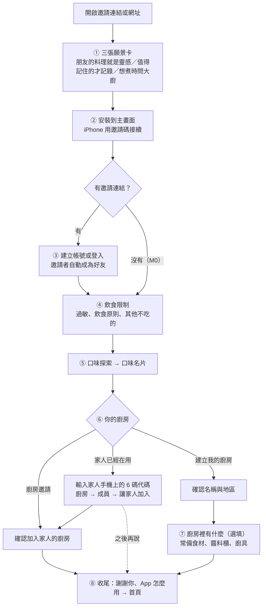
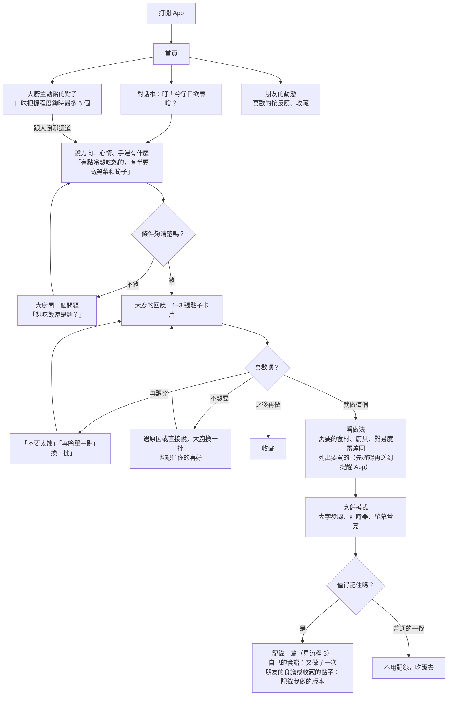
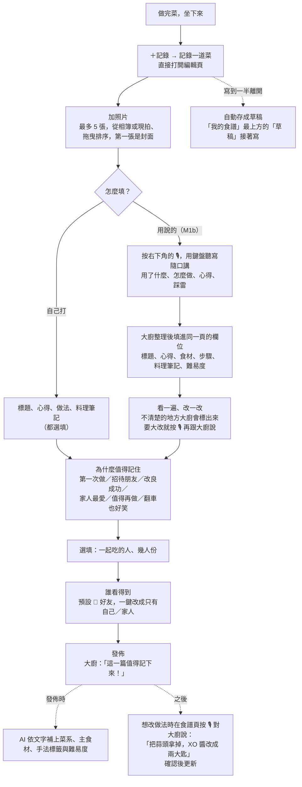
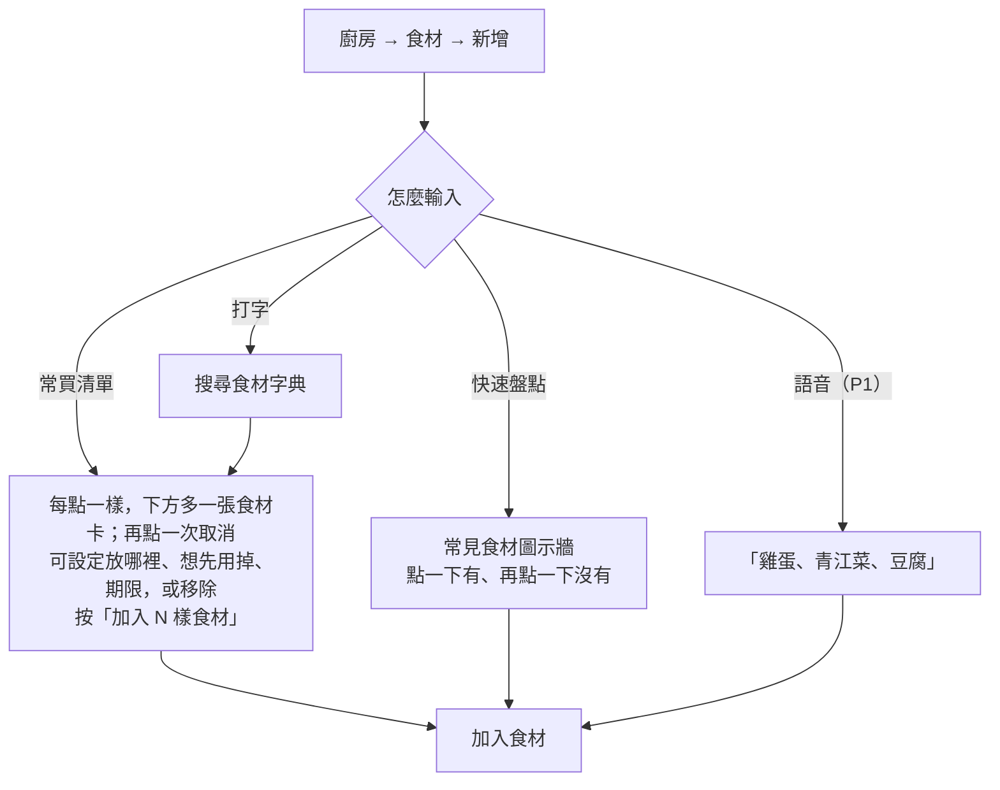
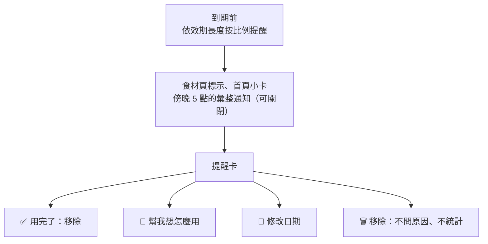
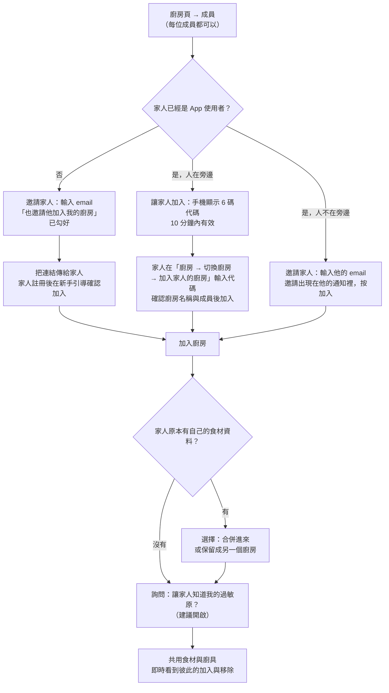
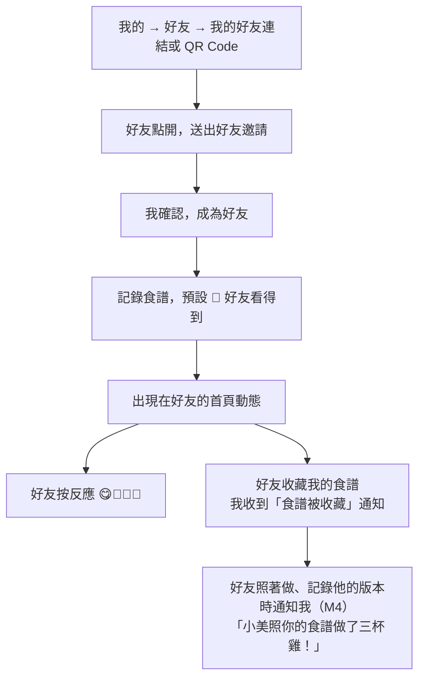
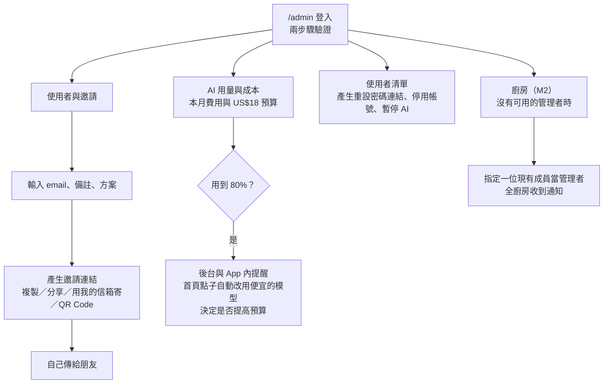

# 09 使用者流程

> 社群是核心，首頁看得到朋友的動態與互動。這個 App **沒有每日循環**：想煮的時候打開找靈感，做出值得記住的料理時記錄一篇。一個月用兩次的人，和每天用的人，流程一樣完整。

畫面代號對應[設計總覽](https://claude.ai/artifact/GnLWGFy3yvruDHi9vTnD7t)的線框稿 v4：App 是 A1–A32，管理後台是 B1–B6。

## 旅程總覽

| 階段 | 時間點 | 使用者想要 | 大廚的角色 | 階段 |
|------|-------|-----------|-----------|------|
| 1. 第一次見面 | 第 1 天 | 知道這是什麼、加入家人與朋友、讓大廚認識自己 | 打招呼、了解你的口味 | M0（完整版 M2） |
| 2. 打開首頁 | 不定期 | 看看朋友最近做了什麼、想煮什麼 | 出點子、牽線 | M0（朋友區塊 M2） |
| 3. 記錄一道菜 | 做出值得記住的菜時 | 好好留下照片、心得，想的話加上做法 | 替你開心 | M0 |
| 4. 照顧食材 | 買菜回來、偶爾想到時 | 讓大廚知道手邊有什麼 | 幫忙記 | M0 |
| 5. 很久沒用之後回來 | 隔了幾週或幾個月 | 不想有落後的感覺 | 歡迎回來 | M0 |
| 6. 和家人共用 | 想讓家人一起用時 | 共用食材、照顧家人的過敏 | 協調 | M2 |
| 7. 和好友互動 | 想分享時 | 分享作品、看朋友的精選、互動 | 牽線 | M2 |
| 8. 長時間的回顧 | 每季、每年 | 回味這段時間做過的好菜 | 陪伴、慶祝 | M3／M4 |
| 管理者 | 隨時 | 邀請朋友、控制成本 | — | M1 |

---

## 1. 第一次見面

完整設計見 [12 新手引導](12-onboarding.md)，口味探索見 [13 口味地圖](13-taste-preferences.md)。摘要：

---

## 2. 打開首頁、找靈感（M0 起，對話 M1a 起，朋友區塊 M2 起）

首頁由上而下是：和大廚聊聊（對話框）、大廚主動給的點子、朋友的互動、朋友的動態。**不是每天的任務**：只在使用者想看、想煮時打開。最常見的用法是直接跟大廚說。

- 對話中說的食材只用在這段對話，不會寫進食材；食材只在「廚房」頁管理。
- 點子優先用對話中說的食材、「想先用掉」，以及設了期限、快到期的食材。
- 還沒做過的收藏，材料差不多齊時首頁會提一句。
- 偶爾出現「靈感彩蛋」：「你有 XO 醬，要不要試試 XO 醬炒飯？」不定期、不催促。

### 網路斷了

- 不做離線使用。畫面上方出現「網路好像斷了，連上後就能繼續」。
- 還沒傳完的照片先暫存在手機，連上後自動送出，關掉 App 再回來也不會不見；M0 不暫存文字。

---

## 3. 記錄一道菜（M0）

記錄一道菜像**發一篇貼文**：用心，不匆忙。記下來的就是一篇「食譜」，做法可以現在寫、之後補，或永遠不寫。

- 照片或標題有一項就能發佈，其他都選填。不用 AI 也能完整記錄；「用說的」只是幫忙填欄位。
- 大廚不看照片：照片裡有、但沒說出口的食材不會自動加。
- 寫到一半會自動存成草稿，只有自己看得到，**也不會提醒你補完**。
- 食譜隨時可以編輯，像修改一篇貼文；做法之後再補也可以。
- 同一道菜又做了一次，在原本的食譜按「又做了一次」，留下日期、照片和一句話（P1）。

---

## 4. 照顧食材（M0）

食材清單是靈感素材庫，**只記有沒有**。

### 買菜回來

### 平常的照顧

| 情境 | 操作 |
|------|------|
| 用完了 | 一鍵移除，不問原因；誤刪可以從「我的 → 最近刪除」復原 |
| 想先用掉 | 標 🔥，大廚優先用它出點子 |
| 生鮮放很久 | 食材頁上大廚輕輕問「高麗菜還在嗎？」，一鍵移除或保留；不推播 |

### 設了期限的食材（選填）

沒有設期限的食材，永遠不會出現在提醒裡。

---

## 5. 很久沒用之後回來（M0）

**目標**：隔了幾週或幾個月回來，和第一次打開一樣愉快，沒有任何「落後」的感覺。

| 會發生的 | 不會發生的 |
|---------|-----------|
| 大廚：「好久不見！最近天氣變冷了，要不要來點暖胃的？」 | 「你已經 45 天沒來了」 |
| 首頁照常給點子，帶一點季節感 | 補記提醒、日曆上的空格 |
| 食材頁：大廚問幾樣生鮮「還在嗎？」，可以一鍵清掉 | 一長串「已過期」的警告（除非使用者自己設了期限） |
| 可以選擇「食材快速盤點」重新開始 | 要求先處理完舊資料才能用 |

---

## 6. 和家人共用廚房（M2）

### 全家一起吃

1. 在首頁選「這餐誰一起吃」，選家人與家人檔案（沒有帳號的小孩、長輩）。
2. 大廚合併所有人的過敏原（硬性排除）與不吃的食物，給大家都能吃的點子。
3. 份量依人數調整。
4. 有人沒有分享飲食限制時，點子卡片提醒「煮之前記得問一下喔」。

### 多個廚房

- 頂端的廚房名稱可以切換（例：「我家」⇄「爸媽家」）。
- 食材、廚具、點子都跟著切換；記錄的食譜會記下是在哪個廚房做的。

---

## 7. 和好友互動（M2）

記錄的本來就是值得記住的料理，社群像朋友圈的料理版 Instagram。

- 個人料理頁的每個區塊都可以個別開關，並可以「預覽好友看到的樣子」。
- 好友清單不顯示下廚頻率，避免互相比較。

---

## 8. 長時間的回顧（M3／M4）

回顧以**記錄的食譜**和**較長的時間**為單位，只在有內容時出現。

| 時間 | 會看到什麼 |
|------|-----------|
| 隨時 | 食譜時間軸（依月分組，只顯示有記錄的月份，含「又做了一次」）、名稱與食材搜尋 |
| 每季 | 季節回顧：「這個秋天的料理」，依廚房地區的季節；這一季沒有記錄就不出現 |
| 偶爾 | 一年前的今天：那天剛好有記錄時，輕輕提起 |
| 每年 | 年度代表作（M4）：今年的精選料理與印象最深的一餐，可分享 |

---

## 9. 管理者（你）的流程（M1 起）

- 每一個操作都寫進操作紀錄，不能修改或刪除。
- 初期沒有檢舉功能，公開上線前才加入。

---

## 10. 例外流程

| 情況 | 使用者看到 | 怎麼恢復 |
|------|-----------|---------|
| 網路斷了 | 「網路好像斷了，連上後就能繼續」；M0 不暫存文字 | 連上網路後繼續 |
| 短時間點太多次（速率限制） | 「點子想太快，燈泡有點燙，等我一分鐘」 | 一兩分鐘後自動恢復 |
| 碰到合理使用上限（異常用量，一般人碰不到） | 「今天點子想了好多，我先從你的食譜裡挑，明天再幫你想新的」，改用不用 AI 的推薦 | 隔天恢復；管理員收到通知，可以調整或暫停該帳號的 AI |
| 全站 AI 預算用完 | 「這個月點子想太多，燈泡要休息一下」 | 管理者提高預算，或下個月 |
| 忘記密碼 | 「請聯絡邀請你的人，取得重設密碼的連結」 | 管理者在後台產生重設連結 |
| 換手機 | 新手機登入後，資料都在 | 不需要額外處理 |
| 未受邀的人用到雲端功能 | 「這裡目前是私人廚房，只招待受邀的朋友」，可加入等候名單 | 管理者產生邀請連結 |
| 離開廚房 | 自己的食譜跟著走 | 最後一位管理者要先指定接手者 |
