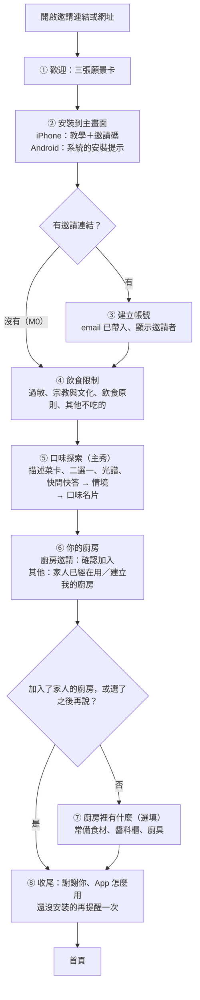

# 12 新手引導（Onboarding）設計

口味探索的偏好模型見 [13 口味地圖](13-taste-preferences.md)。

---

## 一、設計原則

1. **說清楚這是什麼**：一個朋友之間的料理社群，加上懂你的靈感大廚；不是流水帳。
2. **口味探索是主秀**：有趣、快、有回饋，做完拿到一張口味名片。不用圖片，用描述與選擇（見 [13](13-taste-preferences.md)）。
3. **不重複建立**：從邀請連結就知道要加入哪個廚房、和誰成為好友，自動帶入。
4. **朋友第一天就在，但不多一個步驟**：邀請你的人自動成為好友，他記錄的食譜第一次進首頁就看得到。加更多好友在「我的 → 好友」。
5. **先給價值，再做家事**：口味探索放在前面；建立廚房、盤點廚具與食材這些比較花時間的設定放在後面，也可以之後再做。
6. **資料不足就留白，不硬塞**：口味懂得不夠，就不給點子；空的地方用來鼓勵「記錄第一道菜」和「加好友」。
7. **每一步都能跳過**：全部跳過約 30 秒。
8. **權限在需要時才要**：通知權限等到用得到時才問。

---

## 二、邀請與入口

### 一個邀請表單

後台與 App 裡用同一個邀請表單：填對方的 email，多一個勾選：

> ☐ **也邀請他加入我的廚房「我家」**（給同住的家人）

| | 勾了：廚房邀請 | 沒勾：一般邀請 |
|---|---|---|
| **受邀者會怎樣** | 建立帳號（或已有帳號就登入）後，**直接確認加入邀請者的廚房**，跳過食材與廚具盤點 | 建立帳號與**自己的廚房** |
| **誰能發** | 系統管理員（後台）與所有使用者（App 的「廚房 → 成員」或「我的 → 好友」），不需要核准 | 系統管理員；使用者從 M4 開始，每人 2 個名額 |
| **好友** | 預設和邀請者成為好友（可取消勾選） | 同左 |
| **人數上限** | 計入 30 人上限（App 不顯示名額）；額滿時邀請者看到「目前沒辦法邀請新的人加入」 | 同左 |
| **對方已經是使用者** | 邀請直接出現在對方的 App 通知裡，按「加入」就好，不用註冊。人在旁邊時更快的做法：「廚房 → 成員 → 讓家人加入」產生 6 碼代碼，對方輸入就加入 | 不需要邀請，用好友連結加好友 |

使用者之間加好友（雙方都已是使用者）用「好友連結」或 QR Code，不需要邀請。

### 四種入口

| 入口 | 情境 | 帳號 | 廚房 | 好友 |
|------|------|------|------|------|
| **A. 一般邀請** | 你邀請的親友 | 註冊 | 建立自己的廚房（或選「家人已經在用」） | 預設和邀請者成為好友 |
| **B. 廚房邀請** | 同住的家人邀請 | 註冊；已有帳號就登入 | **直接確認加入邀請者的廚房**，跳過食材與廚具盤點 | 預設和邀請者成為好友 |
| **C. 直接打開網址** | 你自己，或 M0 階段沒有帳號 | 不需要（M0） | 建立自己的廚房 | 之後再加 |
| **D. 換新手機、重新登入** | 已經是使用者 | 登入 | 資料都在雲端，直接進首頁 | 不變 |

入口 D 直接進入首頁，不走新手流程。

---

## 三、流程

| 步驟 | 預估時間 | 可以跳過嗎 |
|------|---------|-----------|
| ① 歡迎 | 20 秒 | 可以 |
| ② 安裝到主畫面 | 30 秒 | 可以，但會建議先裝 |
| ③ 建立帳號 | 30 秒 | 不行（有邀請連結時） |
| ④ 飲食限制 | 20 秒 | 可以，「我沒有限制」 |
| ⑤ 口味探索 | 約 2 分鐘 | 可以，隨時「先這樣」，已回答的都算數 |
| ⑥ 你的廚房 | 10 秒 | 不行，但有預設值 |
| ⑦ 廚房裡有什麼 | 1 分鐘 | 可以，「之後再說」 |
| ⑧ 收尾 | 20 秒 | 可以 |

**什麼時候出現**：登入後 `onboarding_completed_at` 是空的就進新手引導；`onboarding_completed_steps` 記下做完的步驟，再進來時跳過（例如已經做過口味探索就不再問）。走完 ⑧ 才填 `onboarding_completed_at`。「我的 → 新手引導」可以重新跑一次，已經填過的資料帶入，不清空。

---

### ① 歡迎：三張願景卡

左右滑動的三張卡片，右上角「跳過」。三張分別回答：這是什麼、有哪些地方、大廚怎麼認識你。

| 卡片 | 標題 | 內容 |
|------|------|------|
| 1 | **朋友的料理，就是最好的靈感** | 朋友之間的料理社群，加上一位懂你的靈感大廚。大廚：「叮！看看朋友最近做了什麼好菜；想煮的時候，問我要點子。」 |
| 2 | **你的食譜和廚房，我都幫你記著** | （書本 icon）**食譜**：記錄值得記住的料理，不用每天記；喜歡朋友的就收藏起來。（房子 icon）**廚房**：記下手邊的食材和廚具，同住的家人可以一起用。大廚：「我會用你的食譜和廚房想點子。」 |
| 3 | **接下來 3 分鐘，讓我認識你** | 三件事：① 不能吃的（過敏、忌口）② 喜歡的口味 ③ 廚房裡有什麼（可以之後再做）。大廚：「之後你記錄、收藏、跟我聊天，我會越來越懂你。」 |

- 第 2 張明講「不用每天記」，先解除壓力。
- 第 3 張預告接下來的步驟，使用者知道要花多久、為什麼要回答。
- 從邀請連結進來時，每張底部顯示是誰邀請你。
- 最後一張的按鈕：「開始」。

---

### ② 安裝到主畫面

**先安裝，再註冊**。iPhone 主畫面上的 App 和 Safari 的登入狀態是分開的：在 Safari 註冊完才安裝，要再登入一次。先裝好就只要登入一次，推播也從第一天就能開。

| 裝置 | 做法 |
|------|------|
| Android | 跳出系統的安裝提示；裝好後登入狀態共用，直接繼續 |
| iPhone | 圖文教學「分享 → 加入主畫面」，畫面上顯示一組 6 碼**邀請碼**（例：`K7Q 2MX`）：「從主畫面打開後，輸入這組碼」。主畫面的 App 第一次打開時先問「有邀請碼嗎？」，輸入後接著建立帳號 |
| 電腦，或已經從主畫面打開 | 跳過這一步 |

- 不想安裝也可以按「先在瀏覽器用」，照原本的流程繼續；收尾時再提醒一次（那時安裝要再登入一次）。
- 邀請碼在打開邀請連結時才產生，1 小時內有效，屬於同一筆邀請；邀請用掉或撤銷時一起失效。輸入錯誤 5 次就暫停 15 分鐘，避免被猜中。
- 沒有邀請連結的入口跳過邀請碼。M0 只有你自己、帳號已經存在：只做圖文教學，從主畫面打開後登入一次。邀請碼和邀請制一起在 M1a 做。

---

### ③ 建立帳號（入口 A、B）

沿用 [02 K 節](02-features.md#k-帳號與邀請制註冊)：email 已帶入，選「設定密碼」或「用 Google 登入」。畫面上方顯示：

> 「**小美**邀請你一起用『今仔日煮啥』」

---

### ④ 飲食限制

口味探索之前，先用**一頁**問不能吃的，之後含有這些食材的題目與點子都不會出現。說明：「這些是硬性限制，我絕不會推薦違反的菜。」

| 區塊 | 內容 |
|------|------|
| 過敏 | 全球共用順序的主要過敏原（花生、堅果、蝦蟹、貝類、魚、蛋、牛奶、小麥、大豆、芝麻…），可以選上層（「甲殼類」包含蝦、蟹）；各地區只補當地標示規定的項目（例：日本的蕎麥） |
| 飲食原則、宗教與文化 | 全素、蛋奶素、海鮮素、鍋邊素、不吃牛、不吃豬、清真、五辛素… |
| 其他 | 不用料理酒 |
| 還有其他不吃的嗎？ | 搜尋框，從食材字典找（例：青椒、苦瓜），加進「不吃的食物」，盡量避開但不是絕對排除 |

- 沒有限制的人按「我沒有限制」，一下就過。
- 之後都可以在「我的 → 我的口味地圖」修改。
- 口味探索裡的爭議食材快問快答（香菜、苦瓜、內臟…）答「不行」只記成很不喜歡，點子會避開；要絕對避開的，在這一步自己加。

---

### ⑤ 口味探索（主秀）

依 [13 口味地圖](13-taste-preferences.md) 設計，**不用圖片**，用描述與選擇。這時還沒建立廚房，題目依手機的地區設定挑（台灣、美國加州、日本的家常菜不同）。約 12–15 題、2 分鐘，上方有進度條，隨時可以「先這樣」。

**順序**

1. **自適應的喜好題**（約 10 題）：描述菜卡、二選一、口味光譜、爭議食材快問快答交錯出現；先問大方向，只往有興趣的方向深入。
2. **情境**（3 題）：平常願意花多久、通常煮給誰吃、週末有空想做什麼（挑戰意願）。不問下廚頻率。

**即時回饋**

- 每回答一題，大廚燈泡有反應：「記住了！」「這個我可以教你！」「好，換下一道。」
- 偶爾插一句觀察：「看來你很愛酸辣，東南亞的菜應該很合你。」

**口味名片**

> 💡 **香辣台式派**，偶爾想挑戰泰式
> 愛：醬油系、豆瓣麻辣、快炒與燉滷
> 想學：泰式
> 不吃：香菜 ｜ 過敏：蝦蟹
>
> 「叮！我大概懂你了。之後你記錄的菜、收藏的朋友食譜，都會讓我更懂你。」

做完可以選「再多聊幾題」（深入模式），也可以之後在「我的口味地圖」修改。

---

### ⑥ 你的廚房

**入口 B（廚房邀請）**：只有一頁，確認加入。

> 「媽媽邀請你加入『**我家**』廚房。加入後，食材和廚具就和家人共用，不用重新登記。」
>
> ☑ 讓同廚房的家人知道我的過敏原和不吃的食物（全家一起吃時，點子才會安全）
>
> ［加入「我家」］　［我想建立自己的廚房］

**入口 A、C**：三頁，一頁只做一件事。M0 還沒有家人可以加入，只做「建立我的廚房」這一頁；選擇頁、輸入代碼與確認加入在 M2-12 和邀請一起做。

**⑥ 你的廚房**

> 「你和家人一起住，而且他們已經在用『今仔日煮啥』嗎？」
>
> ［是，家人已經在用］　［不是，建立我的廚房］

**⑥-1 家人已經在用**

> 「請家人打開 App 的 **廚房 → 成員 → 讓家人加入**，把他手機上顯示的 6 碼代碼輸入在這裡。」
>
> ［輸入代碼：`_ _ _  _ _ _`］　［加入］
>
> **之後再說**：先用自己的廚房。之後在 **廚房 → 切換廚房 → 加入家人的廚房** 輸入代碼，一樣可以加入。

- 代碼 10 分鐘內有效、只能用一次，過期就請家人再按一次。輸入錯誤 5 次會暫停 15 分鐘。
- 輸入正確後，進到和入口 B 一樣的「確認加入」頁：看到廚房名稱與成員，選擇要不要分享過敏原，按［加入］。
- 家人不在旁邊時，也可以請他在「廚房 → 成員 → 邀請家人」輸入你的 email；邀請會出現在你的通知裡，按「加入」就好。
- 選「之後再說」的人跳過 ⑦ 廚房裡有什麼（之後可能加入家人的廚房，現在盤點會白做），收尾時再提醒一次怎麼加入。
- 加入家人的廚房後，帳號建立時預設的那個空廚房自動刪除。

**⑥-2 建立我的廚房**

> 名稱：「我家」（可以改）
> 時區與地區：取手機設定（台北・台灣），之後可以在廚房設定改
>
> ［建立］

帳號建立時已經用這些預設值建好廚房（每個人至少要有一個廚房），這一頁是確認與改名。之後加入家人的廚房時，可以把這個廚房的食材和廚具搬過去。

---

### ⑦ 廚房裡有什麼（選填）

**加入家人廚房的人跳過**，只顯示「家人已經登記了 23 樣食材、15 件廚具」。在「家人已經在用」選了「之後再說」的人也跳過。

其他人：

> 「讓我知道手邊有什麼，點子才會用得上。點一下就好，不用填數量。」

| 分頁 | 內容 |
|------|------|
| 常備食材 | 約 30–40 樣放得久的食材（`RegionProfile.stapleIngredientIds`）：米、麵、乾貨、罐頭、冷凍食品，加上蛋、洋蔥、馬鈴薯、紅蘿蔔、蒜、薑這類放得久的生鮮；不放葉菜、生肉、海鮮。點一下「有」 |
| 醬料櫃 | 約 30 種當地常見的醬料與調味料（`RegionProfile.pantrySeasoningIds`，依廚房地區；地區沒有清單時用台灣的）。點一下「有」 |
| 廚具 | 48 種，大部分家庭都有的 10 種已預設勾選 |

按鈕：［好了］［之後再說］。選「之後再說」的人，第一次打開廚房的食材或廚具時，會看到一張「30 秒盤點」的小卡，不會跳出提醒。

---

### ⑧ 收尾

設定走了好幾步，這一頁先好好謝謝使用者，再用一頁讓人知道 App 能做什麼。

1. **讚賞**：小煙火與開心的大廚：「辛苦了！我已經認識你了，接下來就交給我。」
2. **App 怎麼用**：底部五個分頁各一句，圖示和導覽列一樣：

   | 分頁 | 一句話 |
   |------|-------|
   | 首頁 | 想煮的時候來這裡，我會依你的口味和廚房給點子 |
   | 食譜 | 你記下的料理，和收藏的點子 |
   | ＋記錄 | 做出得意的菜，挑幾張照片、寫幾句話；不用每天記 |
   | 廚房 | 手邊的食材和廚具，點子靠它才用得上 |
   | 我的 | 口味地圖、飲食限制和設定 |

3. **還沒安裝的人再提醒一次**：放在最下面，做法同 ②，可以跳過。
4. **開始**：進入首頁，首頁的大廚區就有第一組點子（資料不夠時是鼓勵文字，見第四節）。

**通知權限在需要時才問**：

| 時機 | 說明 |
|------|------|
| 第一次加好友，或有人對你的料理按反應 | 「朋友記錄新料理、對你的菜按反應時，要通知你嗎？」 |
| 第一次替食材設定期限 | 「要我在到期前提醒你嗎？」 |
| 在設定中打開「週末靈感」 | 「每週六早上給你一個點子？」 |

---

## 四、新手之後：空畫面

資料少的時候不硬塞內容，每個空畫面都給一個下一步。

| 畫面 | 空的時候顯示 |
|------|-------------|
| 首頁的大廚區 | 口味懂得夠 → 點子；不夠 → 「再告訴我一點你的口味，或記錄幾道你做的菜」＋「繼續口味探索」 |
| 首頁的朋友動態 | 有朋友但還沒有分享 → 「朋友發第一篇時會出現在這裡」；沒有朋友 → 好友連結與 QR Code |
| 食譜 | 「這裡會放你值得記住的料理。不用每天記，做出得意的菜時按中間的 ＋ 記錄一篇；也可以收藏大廚的點子。」；「收藏」分頁沒有收藏時說明怎麼收藏（首頁的點子點進去按「收藏」） |
| 回顧 | 有記錄之後才出現內容；空的時候不顯示這一區 |
| 食材 | 「點一下就好，不用填數量」＋快速盤點 |

**第一次記錄**時的回饋要特別好：小煙火、大廚說「這一篇值得記下來！」；朋友按了反應時，第一則通知也要讓人開心。

**沒有完成的新手步驟**，在「我的」頁顯示一張溫和的卡片（例如「完成口味探索，點子會更準」），可以關掉；沒有紅點、沒有數字、不推播。

---

## 五、要衡量的數字

記在自己的資料庫（`ProductEvent`），不用第三方分析工具；完整的指標與事件清單見 [14 產品成效與使用數據](14-product-metrics.md)：

| 指標 | 用來判斷 |
|------|---------|
| 每一步的完成率與跳過率 | 哪一步太長、太無聊 |
| 口味探索回答的題數、選「再多聊幾題」的比例 | 主秀是否吸引人 |
| 第一週內收藏朋友食譜的比例 | 朋友是否成為靈感來源 |
| 新手引導後首頁點子出現的比例、被收藏的比例；第一次和大廚對話的比例 | 偏好模型是否夠準 |
| 第一次記錄、第一次加好友出現的時間 | 願景與社群是否傳達清楚（只看是否發生，不追求越快越好） |
