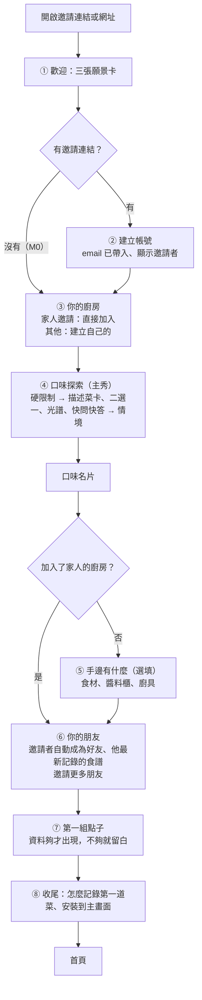

# 12 新手引導（Onboarding）設計

口味探索的偏好模型見 [13 口味地圖](13-taste-preferences.md)。

---

## 一、設計原則

1. **說清楚這是什麼**：一個朋友之間的料理社群，加上懂你的靈感大廚；不是流水帳。
2. **口味探索是主秀**：有趣、快、有回饋，做完拿到一張口味名片。不用圖片，用描述與選擇（見 [13](13-taste-preferences.md)）。
3. **不重複建立**：從邀請連結就知道要加入哪個廚房、和誰成為好友，自動帶入。
4. **朋友第一天就在**：邀請你的人自動成為好友；他記錄的食譜就是你最初的靈感。
5. **資料不足就留白，不硬塞**：口味懂得不夠，就不給點子；空的地方用來鼓勵「記錄第一道菜」和「加好友」。
6. **每一步都能跳過**：全部跳過約 30 秒。
7. **權限在需要時才要**：通知權限等到用得到時才問。

---

## 二、邀請與入口

### 兩種邀請連結

| | 系統管理者（你）在後台產生 | 使用者在 App 裡產生 |
|---|---|---|
| **給誰** | 親友：建立新帳號、**建立自己的廚房** | 同住的家人：建立新帳號（或已有帳號）、**加入邀請者的廚房** |
| **需要核准嗎** | 不需要 | **不需要**，任何使用者都可以直接邀請 |
| **好友** | 預設和你成為好友（可取消勾選） | 預設和邀請者成為好友 |
| **人數上限** | 計入 30 人上限 | 計入 30 人上限（App 不顯示名額）；額滿時邀請者看到「目前沒辦法邀請新的人加入，請聯絡邀請你的人」 |
| **邀請對象已經是使用者** | — | 直接加入廚房、成為好友，不用再註冊 |

使用者之間加好友（雙方都已是使用者）仍用「好友連結」或 QR Code，不需要邀請。

### 四種入口

| 入口 | 情境 | 帳號 | 廚房 | 好友 |
|------|------|------|------|------|
| **A. 管理者的邀請連結** | 你邀請的親友 | 註冊 | 建立自己的廚房（可改選「家人已經在用」） | 預設和你成為好友 |
| **B. 家人的邀請連結** | 同住的家人邀請 | 註冊；已有帳號就登入 | **直接加入家人的廚房**，跳過食材與廚具盤點 | 預設和邀請者成為好友 |
| **C. 直接打開網址** | 你自己，或 M0 階段沒有帳號 | 不需要（M0） | 建立自己的廚房 | 之後再加 |
| **D. 換新手機、重新登入** | 已經是使用者 | 登入 | 資料都在雲端，直接進首頁 | 不變 |

入口 D 直接進入首頁，不走新手流程。

---

## 三、流程

| 步驟 | 預估時間 | 可以跳過嗎 |
|------|---------|-----------|
| ① 歡迎 | 20 秒 | 可以 |
| ② 建立帳號 | 30 秒 | 不行（有邀請連結時） |
| ③ 你的廚房 | 10 秒 | 不行，但有預設值 |
| ④ 口味探索 | 約 2 分鐘 | 可以，隨時「先這樣」，已回答的都算數 |
| ⑤ 手邊有什麼 | 1 分鐘 | 可以 |
| ⑥ 你的朋友 | 30 秒 | 可以 |
| ⑦ 第一組點子 | — | 自動 |
| ⑧ 收尾 | 15 秒 | 可以 |

---

### ① 歡迎：三張願景卡

左右滑動的三張卡片，每張一句大廚的話，右上角「跳過」。

| 卡片 | 標題 | 大廚說 |
|------|------|-------|
| 1 | **朋友的料理，就是你的靈感** | 「叮！這裡是朋友之間的料理社群。看看大家最近做了什麼，喜歡就存起來，換你也做做看。」 |
| 2 | **值得記住的，才記錄** | 「這裡不是流水帳。荷包蛋、炒青菜不用記；第一次做成功的、招待朋友的、得意的，再好好發一篇。很久沒來也沒關係。」 |
| 3 | **想煮的時候，問大廚** | 「我是靈感大廚。你的口味、手邊有什麼、朋友做了什麼，我都記得。想煮的時候，我給你點子。」 |

最後一張的按鈕：「開始」。

---

### ② 建立帳號（入口 A、B）

沿用 [02 K 節](02-features.md#k-帳號與邀請制註冊)：email 已帶入，選「設定密碼」或「用 Google 登入」。畫面上方顯示：

> 「**小美**邀請你一起用『今仔日煮啥』」

---

### ③ 你的廚房

**入口 B（家人的邀請連結）**：

> 「媽媽邀請你加入『**我家**』廚房。加入後，食材和廚具就和家人共用，不用重新登記。」
>
> ［加入「我家」］　［我想建立自己的廚房］

**入口 A、C**：

> 「你和家人一起住，而且他們已經在用『今仔日煮啥』嗎？」
>
> ［是］→ 「請家人在 App 裡打開 廚房 → 成員 → 邀請家人，傳連結給你，或讓你掃 QR Code。」可以掃描 QR Code，或「先建立自己的，之後再合併」。
>
> ［不是，建立我的廚房］→ 自動命名「我家」，時區與地區取手機設定（之後可改）

---

### ④ 口味探索（主秀）

依 [13 口味地圖](13-taste-preferences.md) 設計，**不用圖片**，用描述與選擇。約 12–15 題、2 分鐘，上方有進度條，隨時可以「先這樣」。

**順序**

1. **先問硬限制**（一頁）：過敏、宗教與文化、飲食原則（含「初一十五吃素」這類週期性規則）、不用酒。說明：「這些是硬性限制，我絕不會推薦違反的菜。」之後的題目會自動避開這些食材。
2. **自適應的喜好題**（約 10 題）：描述菜卡、二選一、口味光譜、爭議食材快問快答交錯出現；先問大方向，只往有興趣的方向深入。
3. **情境**（約 3 題）：下廚頻率（註明「只用來調整點子的難度，不會有人看到」）、平常願意花多久、想往哪裡挑戰。

**即時回饋**

- 每回答一題，大廚燈泡有反應：「記住了！」「這個我可以教你！」「好，換下一道。」
- 偶爾插一句觀察：「看來你很愛酸辣，東南亞的菜應該很合你。」

**口味名片**

> 💡 **香辣台式派**，偶爾想挑戰泰式
> 愛：醬油系、豆瓣麻辣、快炒與燉滷
> 想學：做麵包
> 不吃：香菜 ｜ 過敏：蝦蟹 ｜ 初一十五吃素
>
> 「叮！我大概懂你了。之後你記錄的菜、收藏的朋友食譜，都會讓我更懂你。」

做完可以選「再多聊幾題」（深入模式），也可以之後在「我的口味地圖」修改。

**加入家人廚房的人**，這一步最後多一個選項：「讓同廚房的家人知道我的過敏原和不吃的食物」（預設開啟，說明：全家一起吃時，點子才會安全）。

---

### ⑤ 手邊有什麼（選填）

**加入家人廚房的人跳過**，只顯示「家人已經登記了 23 樣食材、15 件廚具」。

其他人：

> 「讓我知道手邊有什麼，點子才會用得上。點一下就好，不用填數量。」

| 分頁 | 內容 |
|------|------|
| 食材 | 約 40 個常見食材，點一下「有」 |
| 醬料櫃 | 約 30 種常見醬料與調味料 |
| 廚具 | 47 種，大部分家庭都有的 10 種已預設勾選 |

按鈕：［好了］［之後再說］。

---

### ⑥ 你的朋友

讓使用者一進來就有朋友、有靈感來源。

| 情況 | 顯示 |
|------|------|
| 有邀請者 | 「你和**小美**已經是料理好友了」，下方列出小美最新記錄的食譜（好友看得到的），每道可以按「收藏」 |
| 邀請者還沒有分享內容 | 「小美還沒有分享料理，等他發第一篇時，會出現在你的首頁」 |
| 邀請朋友 | 「把好友連結傳給一起下廚的朋友」：好友連結、QR Code；同住的家人用「邀請家人加入廚房」 |
| 沒有邀請者（入口 C） | 只顯示邀請朋友的入口 |

---

### ⑦ 第一組點子

**資料夠才出現**：口味探索的把握程度達到門檻時，大廚從口味（以及手邊的食材、朋友的菜）給 1–3 個簡單的點子，並說出理由，讓人感覺「它真的聽懂了」。

> 「叮！依你的口味，我想到這兩道：」
> 🏠 **麻婆豆腐**：你愛豆瓣麻辣，手邊又有豆腐
> 🚀 **小美的泰式打拋豬**：你說想試泰式，小美剛好記錄了這道

**資料不夠時不硬給**，改成鼓勵：

> 「我還不夠懂你。記錄幾道你做的菜、收藏幾道朋友的食譜，我的點子就會越來越準。」

- 點子數量依把握程度決定（0–3 個），不湊數。
- 不提供與使用者沒有關聯的通用內容。

---

### ⑧ 收尾

1. **記錄第一道菜**：「下次做出得意的菜，按中間的 ＋ 發一篇：挑幾張照片、寫幾句話。不用每天記。」
   發佈時預設給好友看，會出現在朋友的首頁；想自己留著，一鍵就能改成只有自己。
2. **安裝到主畫面**：Android 用系統提示；iOS 顯示圖文教學。可以跳過。
3. **開始**：進入首頁。

**通知權限在需要時才問**：

| 時機 | 說明 |
|------|------|
| 第一次加好友，或有人對你的料理按反應 | 「朋友記錄新料理、對你的菜按反應時，要通知你嗎？」 |
| 第一次替食材設定期限 | 「要我在到期前提醒你嗎？」 |
| 在設定中打開「週末靈感」 | 「每週六早上給你一個點子？」 |

---

## 四、新手之後：空畫面

資料少的時候不硬塞內容，每個空畫面都給一個下一步。

| 畫面 | 空的時候顯示 |
|------|-------------|
| 首頁的大廚區 | 口味懂得夠 → 點子；不夠 → 「再告訴我一點你的口味，或記錄幾道你做的菜」＋「繼續口味探索」 |
| 首頁的朋友動態 | 有朋友但還沒有分享 → 「朋友發第一篇時會出現在這裡」；沒有朋友 → 好友連結與 QR Code |
| 食譜 | 「這裡會放你值得記住的料理。不用每天記，做出得意的菜時按中間的 ＋ 記錄一篇；也可以收藏朋友的食譜。」；「收藏」分頁顯示新手時收藏的菜 |
| 回顧 | 有記錄之後才出現內容；空的時候不顯示這一區 |
| 食材 | 「點一下就好，不用填數量」＋快速盤點 |

**第一次記錄**時的回饋要特別好：小煙火、大廚說「這一篇值得記下來！」；朋友按了反應時，第一則通知也要讓人開心。

**沒有完成的新手步驟**，在「我的」頁顯示一張溫和的卡片（例如「完成口味探索，點子會更準」），可以關掉；沒有紅點、沒有數字、不推播。

---

## 五、要衡量的數字

記在自己的資料庫（`ProductEvent`），不用第三方分析工具；完整的指標與事件清單見 [14 產品成效與使用數據](14-product-metrics.md)：

| 指標 | 用來判斷 |
|------|---------|
| 每一步的完成率與跳過率 | 哪一步太長、太無聊 |
| 口味探索回答的題數、選「再多聊幾題」的比例 | 主秀是否吸引人 |
| 新手引導中收藏朋友食譜的比例 | 朋友是否成為靈感來源 |
| 第一組點子出現的比例、被收藏的比例；第一次和大廚對話的比例 | 偏好模型是否夠準 |
| 第一次記錄、第一次加好友出現的時間 | 願景與社群是否傳達清楚（只看是否發生，不追求越快越好） |
